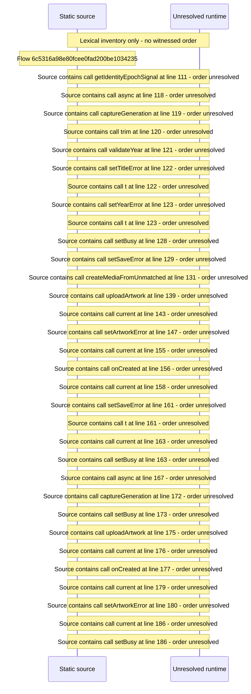

# Create a Media from an unmatched record and upload artwork — flow-diagram

Source revision: d442b4a6a38de86be0670669b3a3f6aa47e80b22. Trust: generated. Freshness: pinned source; run docs flows check for a later revision.

<!-- flowdocs:paragraph:807561dd4a10701ef7f48396cf60ca6c -->
Static source inventory only; sequence and runtime ordering are unresolved\.

Source: internal/web/app/src/areas/manage/pages/unmatched/CreateMediaForm\.tsx:23; symbol: uploadArtwork; span SHA256: ab684484ef0e920778940bc7d20da087174859abf997a4670127ae7a91bffe39.

