# Create a Media from an unmatched record and upload artwork — flow-diagram

Source revision: d658ad5b71dcb67da0ae540d6d5ff80ca8efefd5. Trust: generated. Freshness: pinned source; run docs flows check for a later revision.

<!-- flowdocs:paragraph:807561dd4a10701ef7f48396cf60ca6c -->
Static source inventory only; sequence and runtime ordering are unresolved\.

Source: internal/web/app/src/areas/manage/pages/unmatched/CreateMediaForm\.tsx:14; symbol: ARTWORK\_SLOT; span SHA256: 8e67075a8aab38f7bf5c9b674127821fdd38583d97555893a5165ab87cc49be3.

```mermaid
sequenceDiagram
    participant S as Static source
    participant U as Unresolved runtime
    Note over S,U: Lexical inventory only - no witnessed order
    Note over S: Flow 6c5316a98e80fcee0fad200be1034235
    Note over S,U: Source contains call useT at line 78 - order unresolved
    Note over S,U: Source contains call useState at line 79 - order unresolved
    Note over S,U: Source contains call useState at line 80 - order unresolved
    Note over S,U: Source contains call useState at line 82 - order unresolved
    Note over S,U: Source contains call useState at line 83 - order unresolved
    Note over S,U: Source contains call useState at line 84 - order unresolved
    Note over S,U: Source contains call useState at line 85 - order unresolved
    Note over S,U: Source contains call useRef at line 95 - order unresolved
    Note over S,U: Source contains call useEffect at line 96 - order unresolved
    Note over S,U: Source contains call trim at line 51 - order unresolved
    Note over S,U: Source contains call Number at line 53 - order unresolved
    Note over S,U: Source contains call Date at line 54 - order unresolved
    Note over S,U: Source contains call getFullYear at line 54 - order unresolved
    Note over S,U: Source contains call test at line 55 - order unresolved
    Note over S,U: Source contains call getIdentityEpochSignal at line 111 - order unresolved
    Note over S,U: Source contains call async at line 118 - order unresolved
    Note over S,U: Source contains call captureGeneration at line 119 - order unresolved
    Note over S,U: Source contains call trim at line 120 - order unresolved
    Note over S,U: Source contains call validateYear at line 121 - order unresolved
    Note over S,U: Source contains call setTitleError at line 122 - order unresolved
    Note over S,U: Source contains call t at line 122 - order unresolved
    Note over S,U: Source contains call setYearError at line 123 - order unresolved
    Note over S,U: Source contains call t at line 123 - order unresolved
    Note over S,U: Source contains call setBusy at line 128 - order unresolved
    Note over S,U: Source contains call setSaveError at line 129 - order unresolved
    Note over S,U: Source contains call createMediaFromUnmatched at line 131 - order unresolved
    Note over S,U: Source contains call uploadArtwork at line 139 - order unresolved
    Note over S,U: Source contains call current at line 143 - order unresolved
    Note over S,U: Source contains call setArtworkError at line 147 - order unresolved
    Note over S,U: Source contains call current at line 155 - order unresolved
    Note over S,U: Source contains call onCreated at line 156 - order unresolved
    Note over S,U: Source contains call current at line 158 - order unresolved
    Note over S,U: Source contains call setSaveError at line 161 - order unresolved
    Note over S,U: Source contains call t at line 161 - order unresolved
    Note over S,U: Source contains call current at line 163 - order unresolved
    Note over S,U: Source contains call setBusy at line 163 - order unresolved
    Note over S,U: Source contains call async at line 167 - order unresolved
    Note over S,U: Source contains call captureGeneration at line 172 - order unresolved
    Note over S,U: Source contains call setBusy at line 173 - order unresolved
    Note over S,U: Source contains call uploadArtwork at line 175 - order unresolved
    Note over S,U: Source contains call current at line 176 - order unresolved
    Note over S,U: Source contains call onCreated at line 177 - order unresolved
    Note over S,U: Source contains call current at line 179 - order unresolved
    Note over S,U: Source contains call setArtworkError at line 180 - order unresolved
    Note over S,U: Source contains call current at line 186 - order unresolved
    Note over S,U: Source contains call setBusy at line 186 - order unresolved
```

