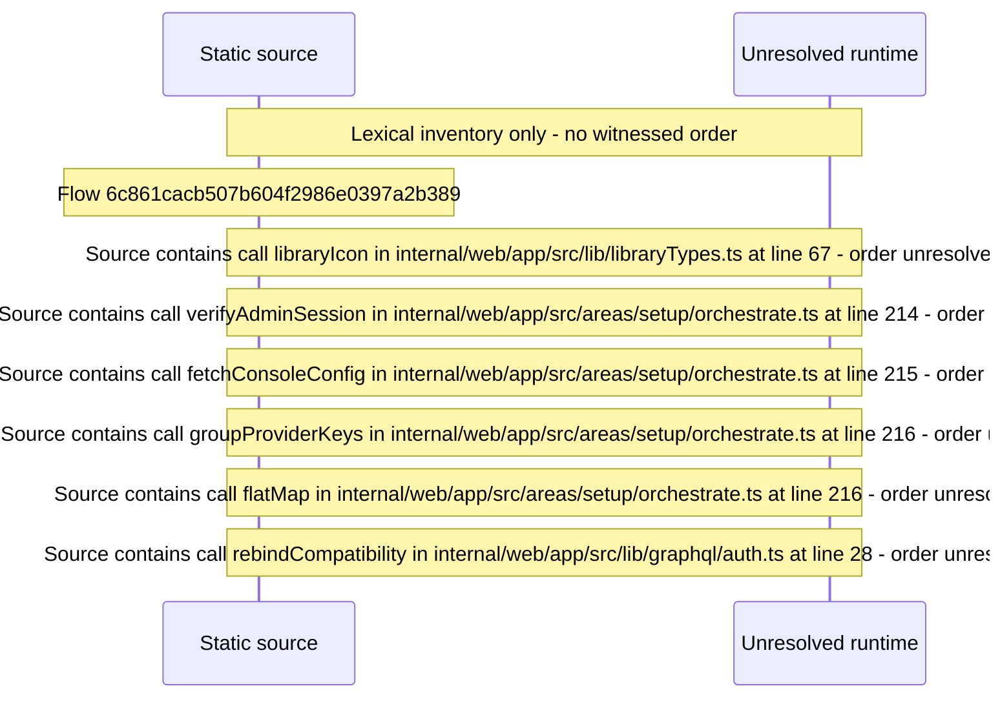

# Setup: activate plugins and enter provider keys — flow-diagram

Source revision: 4d9f6ba81afcc8de0179eb7c056488d3e3bd8218. Trust: generated. Freshness: pinned source; run docs flows check for a later revision.

<!-- flowdocs:paragraph:72288c2765450ca0a119a9453a4e8ec3 -->
Static source inventory only; sequence and runtime ordering are unresolved\.

Source: internal/web/app/src/lib/libraryTypes\.ts:65; symbol: pluginIcon; span SHA256: 24dbee9d300e4d833d40769accb0c7369effc90f0baf6eca40df7010841f8dc4.

