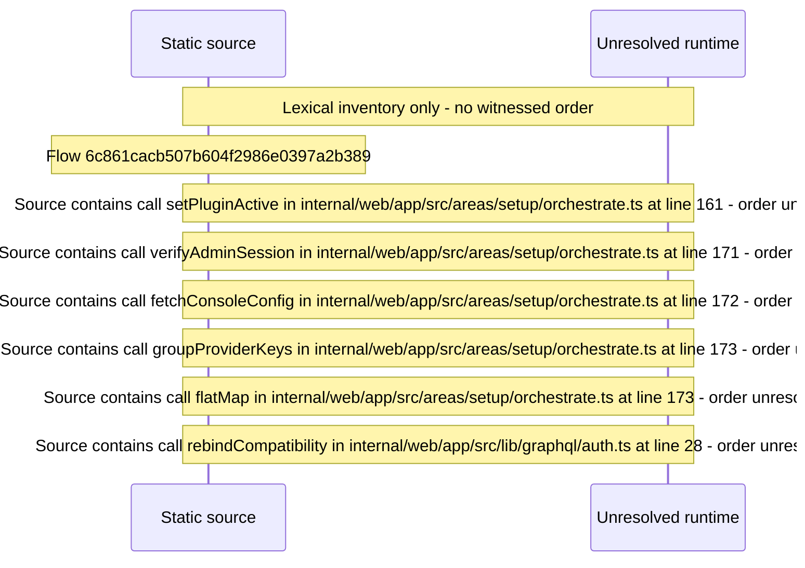

# Setup: activate plugins and enter provider keys — flow-diagram

Source revision: e417fb394873a04fbd27fb8d5bcbca5484c8747f. Trust: generated. Freshness: pinned source; run docs flows check for a later revision.

<!-- flowdocs:paragraph:72288c2765450ca0a119a9453a4e8ec3 -->
Static source inventory only; sequence and runtime ordering are unresolved\.

Source: internal/web/app/src/areas/setup/orchestrate\.ts:159; symbol: activatePlugins; span SHA256: 026ffcbbcccbe3553646fa05bca51707878dcf9f1e0cf43e3cc3ae3202e11b87.

