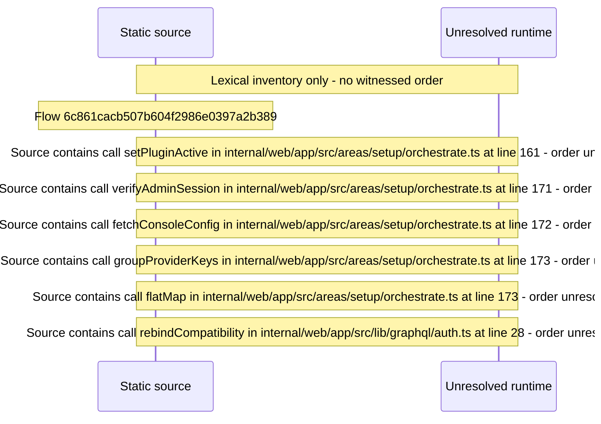

# Setup: activate plugins and enter provider keys — flow-diagram

Source revision: d658ad5b71dcb67da0ae540d6d5ff80ca8efefd5. Trust: generated. Freshness: pinned source; run docs flows check for a later revision.

<!-- flowdocs:paragraph:72288c2765450ca0a119a9453a4e8ec3 -->
Static source inventory only; sequence and runtime ordering are unresolved\.

Source: internal/web/app/src/areas/setup/SetupWizard\.tsx:115; symbol: PLUGIN\_ICON; span SHA256: 05333a405746aecee5aaad7e9a91ad91fcdda7e6f1e4a8700ec73ec1f5962de8.

