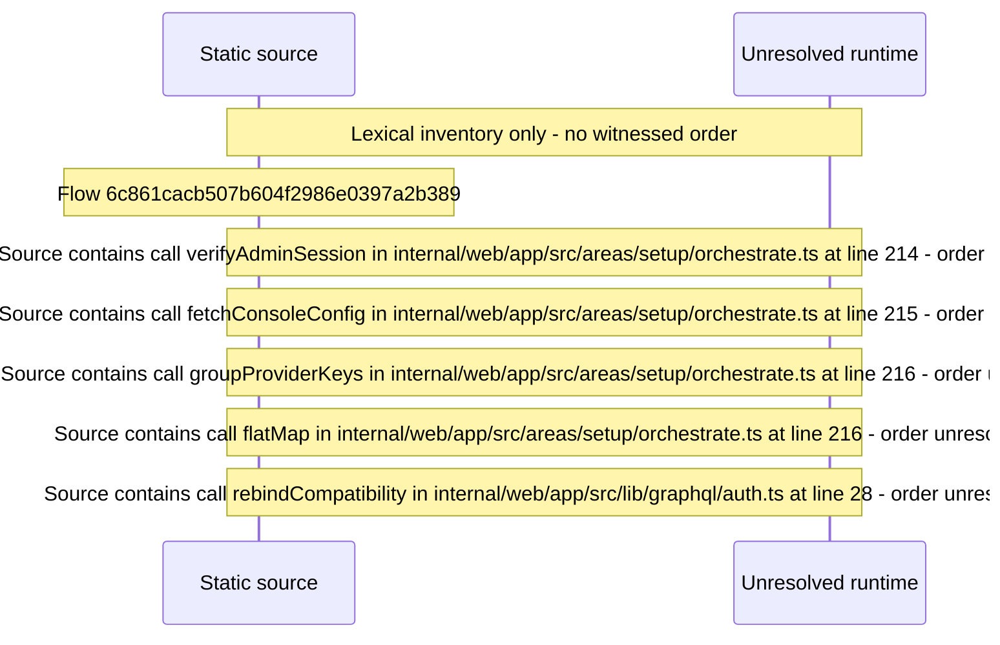

# Setup: activate plugins and enter provider keys — flow-diagram

Source revision: 684328a3dab29cbba9cf1058ce382b864f4b6b2d. Trust: generated. Freshness: pinned source; run docs flows check for a later revision.

<!-- flowdocs:paragraph:72288c2765450ca0a119a9453a4e8ec3 -->
Static source inventory only; sequence and runtime ordering are unresolved\.

Source: internal/web/app/src/areas/setup/orchestrate\.ts:160; symbol: activatePlugins; span SHA256: d93b01c0df3736470e7bed2b2264605f54e8b4ef2d319cbba4071191a9acea7f.

