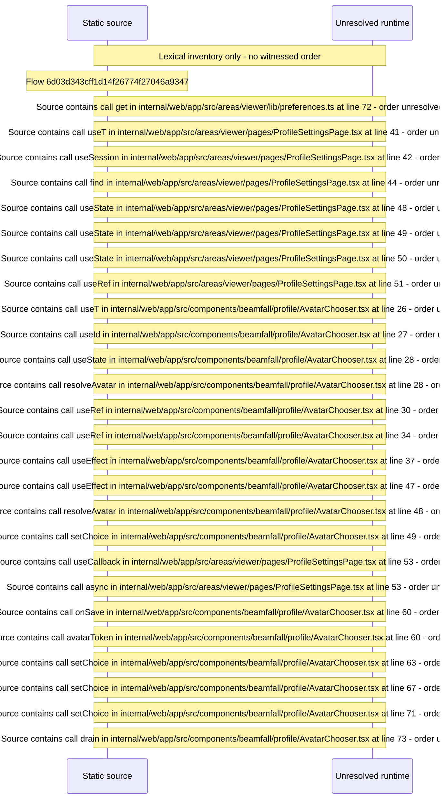

# Viewer Profile settings: preferences toggles and avatar — flow-diagram

Source revision: d442b4a6a38de86be0670669b3a3f6aa47e80b22. Trust: generated. Freshness: pinned source; run docs flows check for a later revision.

<!-- flowdocs:paragraph:a97b335f727dff65e293f397bab4d272 -->
Static source inventory only; sequence and runtime ordering are unresolved\.

Source: internal/web/app/src/areas/viewer/lib/preferences\.ts:71; symbol: bool; span SHA256: c70cba4d32e3c85a1f4452e3eea1cfc0c2b6a55bcca22f5723f03b8b0706fdc9.

