# Viewer Profile settings: preferences toggles and avatar — flow-diagram

Source revision: d658ad5b71dcb67da0ae540d6d5ff80ca8efefd5. Trust: generated. Freshness: pinned source; run docs flows check for a later revision.

<!-- flowdocs:paragraph:a97b335f727dff65e293f397bab4d272 -->
Static source inventory only; sequence and runtime ordering are unresolved\.

Source: internal/web/app/src/areas/viewer/lib/preferences\.ts:55; symbol: DOWNSTREAM\_AUDIO\_DEFAULT; span SHA256: 3771a4b3ebde3d18b22a870949ce024390336f24c946805d4f2275fab532ccc4.

```mermaid
sequenceDiagram
    participant S as Static source
    participant U as Unresolved runtime
    Note over S,U: Lexical inventory only - no witnessed order
    Note over S: Flow 6d03d343cff1d14f26774f27046a9347
    Note over S,U: Source contains call get in internal/web/app/src/areas/viewer/lib/preferences.ts at line 72 - order unresolved
    Note over S,U: Source contains call get in internal/web/app/src/areas/viewer/lib/preferences.ts at line 76 - order unresolved
    Note over S,U: Source contains call includes in internal/web/app/src/areas/viewer/lib/preferences.ts at line 77 - order unresolved
    Note over S,U: Source contains call Map in internal/web/app/src/areas/viewer/lib/preferences.ts at line 116 - order unresolved
    Note over S,U: Source contains call map in internal/web/app/src/areas/viewer/lib/preferences.ts at line 116 - order unresolved
    Note over S,U: Source contains call interval in internal/web/app/src/areas/viewer/lib/preferences.ts at line 117 - order unresolved
    Note over S,U: Source contains call bool in internal/web/app/src/areas/viewer/lib/preferences.ts at line 119 - order unresolved
    Note over S,U: Source contains call bool in internal/web/app/src/areas/viewer/lib/preferences.ts at line 120 - order unresolved
    Note over S,U: Source contains call bool in internal/web/app/src/areas/viewer/lib/preferences.ts at line 121 - order unresolved
    Note over S,U: Source contains call bool in internal/web/app/src/areas/viewer/lib/preferences.ts at line 122 - order unresolved
    Note over S,U: Source contains call bool in internal/web/app/src/areas/viewer/lib/preferences.ts at line 123 - order unresolved
    Note over S,U: Source contains call bool in internal/web/app/src/areas/viewer/lib/preferences.ts at line 124 - order unresolved
    Note over S,U: Source contains call speed in internal/web/app/src/areas/viewer/lib/preferences.ts at line 125 - order unresolved
    Note over S,U: Source contains call bool in internal/web/app/src/areas/viewer/lib/preferences.ts at line 126 - order unresolved
    Note over S,U: Source contains call interval in internal/web/app/src/areas/viewer/lib/preferences.ts at line 128 - order unresolved
    Note over S,U: Source contains call skipIntervalOverrideKey in internal/web/app/src/areas/viewer/lib/preferences.ts at line 128 - order unresolved
    Note over S,U: Source contains call downstreamAudio in internal/web/app/src/areas/viewer/lib/preferences.ts at line 130 - order unresolved
    Note over S,U: Source contains call find in internal/web/app/src/areas/viewer/lib/preferences.ts at line 105 - order unresolved
    Note over S,U: Source contains call skipIntervalOverrideKey in internal/web/app/src/areas/viewer/lib/preferences.ts at line 105 - order unresolved
    Note over S,U: Source contains call includes in internal/web/app/src/areas/viewer/lib/preferences.ts at line 106 - order unresolved
    Note over S,U: Source contains call get in internal/web/app/src/areas/viewer/lib/preferences.ts at line 83 - order unresolved
    Note over S,U: Source contains call includes in internal/web/app/src/areas/viewer/lib/preferences.ts at line 84 - order unresolved
    Note over S,U: Source contains call useT in internal/web/app/src/areas/viewer/pages/ProfileSettingsPage.tsx at line 41 - order unresolved
    Note over S,U: Source contains call useSession in internal/web/app/src/areas/viewer/pages/ProfileSettingsPage.tsx at line 42 - order unresolved
    Note over S,U: Source contains call find in internal/web/app/src/areas/viewer/pages/ProfileSettingsPage.tsx at line 44 - order unresolved
    Note over S,U: Source contains call useState in internal/web/app/src/areas/viewer/pages/ProfileSettingsPage.tsx at line 48 - order unresolved
    Note over S,U: Source contains call useState in internal/web/app/src/areas/viewer/pages/ProfileSettingsPage.tsx at line 49 - order unresolved
    Note over S,U: Source contains call useState in internal/web/app/src/areas/viewer/pages/ProfileSettingsPage.tsx at line 50 - order unresolved
    Note over S,U: Source contains call useRef in internal/web/app/src/areas/viewer/pages/ProfileSettingsPage.tsx at line 51 - order unresolved
    Note over S,U: Source contains call useT in internal/web/app/src/areas/viewer/pages/ProfileSettingsPage.tsx at line 342 - order unresolved
    Note over S,U: Source contains call t in internal/web/app/src/areas/viewer/pages/ProfileSettingsPage.tsx at line 346 - order unresolved
    Note over S,U: Source contains call useT in internal/web/app/src/components/beamfall/profile/AvatarChooser.tsx at line 26 - order unresolved
    Note over S,U: Source contains call useId in internal/web/app/src/components/beamfall/profile/AvatarChooser.tsx at line 27 - order unresolved
    Note over S,U: Source contains call useState in internal/web/app/src/components/beamfall/profile/AvatarChooser.tsx at line 28 - order unresolved
    Note over S,U: Source contains call resolveAvatar in internal/web/app/src/components/beamfall/profile/AvatarChooser.tsx at line 28 - order unresolved
    Note over S,U: Source contains call useRef in internal/web/app/src/components/beamfall/profile/AvatarChooser.tsx at line 30 - order unresolved
    Note over S,U: Source contains call useRef in internal/web/app/src/components/beamfall/profile/AvatarChooser.tsx at line 34 - order unresolved
    Note over S,U: Source contains call useEffect in internal/web/app/src/components/beamfall/profile/AvatarChooser.tsx at line 37 - order unresolved
    Note over S,U: Source contains call useEffect in internal/web/app/src/components/beamfall/profile/AvatarChooser.tsx at line 47 - order unresolved
    Note over S,U: Source contains call resolveAvatar in internal/web/app/src/components/beamfall/profile/AvatarChooser.tsx at line 48 - order unresolved
    Note over S,U: Source contains call setChoice in internal/web/app/src/components/beamfall/profile/AvatarChooser.tsx at line 49 - order unresolved
    Note over S,U: Source contains call useCallback in internal/web/app/src/areas/viewer/pages/ProfileSettingsPage.tsx at line 53 - order unresolved
    Note over S,U: Source contains call async in internal/web/app/src/areas/viewer/pages/ProfileSettingsPage.tsx at line 53 - order unresolved
    Note over S,U: Source contains call onSave in internal/web/app/src/components/beamfall/profile/AvatarChooser.tsx at line 60 - order unresolved
    Note over S,U: Source contains call avatarToken in internal/web/app/src/components/beamfall/profile/AvatarChooser.tsx at line 60 - order unresolved
    Note over S,U: Source contains call setChoice in internal/web/app/src/components/beamfall/profile/AvatarChooser.tsx at line 63 - order unresolved
    Note over S,U: Source contains call setChoice in internal/web/app/src/components/beamfall/profile/AvatarChooser.tsx at line 67 - order unresolved
    Note over S,U: Source contains call setChoice in internal/web/app/src/components/beamfall/profile/AvatarChooser.tsx at line 71 - order unresolved
    Note over S,U: Source contains call drain in internal/web/app/src/components/beamfall/profile/AvatarChooser.tsx at line 73 - order unresolved
```

