# Console access: library grants, rating ceilings, access schedules, managed policy — flow-diagram

Source revision: 684328a3dab29cbba9cf1058ce382b864f4b6b2d. Trust: generated. Freshness: pinned source; run docs flows check for a later revision.

<!-- flowdocs:paragraph:3d4e315da87c0018723e32b2ddead748 -->
Static source inventory only; sequence and runtime ordering are unresolved\.

Source: internal/web/app/src/areas/console/lib/schedulePreview\.ts:9; symbol: AccessWindow; span SHA256: 1ca7681e58d4347f95ebf7158b8a82b6a9aa8527b4cf756c5ff3bea726162698.

```mermaid
sequenceDiagram
    participant S as Static source
    participant U as Unresolved runtime
    Note over S,U: Lexical inventory only - no witnessed order
    Note over S: Flow 6da48620acc1e31c45eb871859f10ef6
    Note over S,U: Source contains call floor in internal/web/app/src/areas/console/lib/schedulePreview.ts at line 82 - order unresolved
    Note over S,U: Source contains call some in internal/web/app/src/areas/console/lib/schedulePreview.ts at line 29 - order unresolved
    Note over S,U: Source contains call weekMinute in internal/web/app/src/areas/console/lib/schedulePreview.ts at line 30 - order unresolved
    Note over S,U: Source contains call useT in internal/web/app/src/areas/console/sections/ProfilesAccess.tsx at line 526 - order unresolved
    Note over S,U: Source contains call useAsync in internal/web/app/src/areas/console/sections/ProfilesAccess.tsx at line 527 - order unresolved
    Note over S,U: Source contains call accessGrantsForProfile in internal/web/app/src/areas/console/sections/ProfilesAccess.tsx at line 528 - order unresolved
    Note over S,U: Source contains call useT in internal/web/app/src/areas/console/sections/ProfilesAccess.tsx at line 267 - order unresolved
    Note over S,U: Source contains call useAsync in internal/web/app/src/areas/console/sections/ProfilesAccess.tsx at line 268 - order unresolved
    Note over S,U: Source contains call fetchAccessSchedule in internal/web/app/src/areas/console/sections/ProfilesAccess.tsx at line 269 - order unresolved
    Note over S,U: Source contains call useT in internal/web/app/src/areas/console/sections/ProfilesAccess.tsx at line 230 - order unresolved
    Note over S,U: Source contains call useDisplayLocale in internal/web/app/src/areas/console/sections/ProfilesAccess.tsx at line 231 - order unresolved
    Note over S,U: Source contains call useT in internal/web/app/src/areas/console/sections/ProfilesAccess.tsx at line 163 - order unresolved
    Note over S,U: Source contains call useSession in internal/web/app/src/areas/console/sections/ProfilesAccess.tsx at line 164 - order unresolved
    Note over S,U: Source contains call useState in internal/web/app/src/areas/console/sections/ProfilesAccess.tsx at line 166 - order unresolved
    Note over S,U: Source contains call useT in internal/web/app/src/areas/console/sections/ProfilesAccess.tsx at line 398 - order unresolved
    Note over S,U: Source contains call useState in internal/web/app/src/areas/console/sections/ProfilesAccess.tsx at line 399 - order unresolved
    Note over S,U: Source contains call useState in internal/web/app/src/areas/console/sections/ProfilesAccess.tsx at line 400 - order unresolved
    Note over S,U: Source contains call useState in internal/web/app/src/areas/console/sections/ProfilesAccess.tsx at line 401 - order unresolved
    Note over S,U: Source contains call useState in internal/web/app/src/areas/console/sections/ProfilesAccess.tsx at line 402 - order unresolved
    Note over S,U: Source contains call useState in internal/web/app/src/areas/console/sections/ProfilesAccess.tsx at line 403 - order unresolved
    Note over S,U: Source contains call useState in internal/web/app/src/areas/console/sections/ProfilesAccess.tsx at line 404 - order unresolved
    Note over S,U: Source contains call useShowAdvanced in internal/web/app/src/areas/console/sections/ProfilesAccess.tsx at line 405 - order unresolved
    Note over S,U: Source contains call useT in internal/web/app/src/areas/console/sections/ProfilesAccess.tsx at line 61 - order unresolved
    Note over S,U: Source contains call useAsync in internal/web/app/src/areas/console/sections/ProfilesAccess.tsx at line 62 - order unresolved
    Note over S,U: Source contains call useAsync in internal/web/app/src/areas/console/sections/ProfilesAccess.tsx at line 63 - order unresolved
    Note over S,U: Source contains call filter in internal/web/app/src/areas/console/sections/ProfilesAccess.tsx at line 65 - order unresolved
    Note over S,U: Source contains call useState in internal/web/app/src/areas/console/sections/ProfilesAccess.tsx at line 68 - order unresolved
    Note over S,U: Source contains call find in internal/web/app/src/areas/console/sections/ProfilesAccess.tsx at line 70 - order unresolved
    Note over S,U: Source contains call t in internal/web/app/src/areas/console/sections/ProfilesAccess.tsx at line 86 - order unresolved
    Note over S,U: Source contains call t in internal/web/app/src/areas/console/sections/ProfilesAccess.tsx at line 88 - order unresolved
    Note over S,U: Source contains call t in internal/web/app/src/areas/console/sections/ProfilesAccess.tsx at line 90 - order unresolved
    Note over S,U: Source contains call t in internal/web/app/src/areas/console/sections/ProfilesAccess.tsx at line 91 - order unresolved
    Note over S,U: Source contains call map in internal/web/app/src/areas/console/sections/ProfilesAccess.tsx at line 94 - order unresolved
    Note over S,U: Source contains call refresh in internal/web/app/src/areas/console/sections/ProfilesAccess.tsx at line 116 - order unresolved
    Note over S,U: Source contains call map in internal/web/app/src/areas/console/sections/ProfilesAccess.tsx at line 131 - order unresolved
    Note over S,U: Source contains call find in internal/web/app/src/areas/console/sections/ProfilesAccess.tsx at line 137 - order unresolved
    Note over S,U: Source contains call refresh in internal/web/app/src/areas/console/sections/ProfilesAccess.tsx at line 140 - order unresolved
    Note over S,U: Source contains call useT in internal/web/app/src/areas/console/sections/ProfilesAccess.tsx at line 370 - order unresolved
    Note over S,U: Source contains call Date in internal/web/app/src/areas/console/sections/ProfilesAccess.tsx at line 372 - order unresolved
    Note over S,U: Source contains call nextTransition in internal/web/app/src/areas/console/sections/ProfilesAccess.tsx at line 373 - order unresolved
    Note over S,U: Source contains call getDay in internal/web/app/src/areas/console/sections/ProfilesAccess.tsx at line 373 - order unresolved
    Note over S,U: Source contains call getHours in internal/web/app/src/areas/console/sections/ProfilesAccess.tsx at line 373 - order unresolved
    Note over S,U: Source contains call getMinutes in internal/web/app/src/areas/console/sections/ProfilesAccess.tsx at line 373 - order unresolved
    Note over S,U: Source contains call t in internal/web/app/src/areas/console/sections/ProfilesAccess.tsx at line 376 - order unresolved
    Note over S,U: Source contains call t in internal/web/app/src/areas/console/sections/ProfilesAccess.tsx at line 379 - order unresolved
    Note over S,U: Source contains call t in internal/web/app/src/areas/console/sections/ProfilesAccess.tsx at line 380 - order unresolved
    Note over S,U: Source contains call formatMinute in internal/web/app/src/areas/console/sections/ProfilesAccess.tsx at line 381 - order unresolved
    Note over S,U: Source contains call t in internal/web/app/src/areas/console/sections/ProfilesAccess.tsx at line 385 - order unresolved
    Note over S,U: Source contains call update in internal/web/app/src/areas/console/sections/ProfilesAccess.tsx at line 279 - order unresolved
    Note over S,U: Source contains call preventDefault in internal/web/app/src/areas/console/sections/ProfilesAccess.tsx at line 408 - order unresolved
    Note over S,U: Source contains call setBusy in internal/web/app/src/areas/console/sections/ProfilesAccess.tsx at line 409 - order unresolved
    Note over S,U: Source contains call setCapApplied in internal/web/app/src/areas/console/sections/ProfilesAccess.tsx at line 410 - order unresolved
    Note over S,U: Source contains call setProfileStreamCap in internal/web/app/src/areas/console/sections/ProfilesAccess.tsx at line 412 - order unresolved
    Note over S,U: Source contains call Number in internal/web/app/src/areas/console/sections/ProfilesAccess.tsx at line 412 - order unresolved
    Note over S,U: Source contains call setCapApplied in internal/web/app/src/areas/console/sections/ProfilesAccess.tsx at line 413 - order unresolved
    Note over S,U: Source contains call setBusy in internal/web/app/src/areas/console/sections/ProfilesAccess.tsx at line 415 - order unresolved
    Note over S,U: Source contains call update in internal/web/app/src/areas/console/sections/ProfilesAccess.tsx at line 287 - order unresolved
    Note over S,U: Source contains call map in internal/web/app/src/areas/console/sections/ProfilesAccess.tsx at line 287 - order unresolved
    Note over S,U: Source contains call setCertificationCeiling in internal/web/app/src/areas/console/sections/ProfilesAccess.tsx at line 235 - order unresolved
    Note over S,U: Source contains call onChanged in internal/web/app/src/areas/console/sections/ProfilesAccess.tsx at line 236 - order unresolved
    Note over S,U: Source contains call update in internal/web/app/src/areas/console/sections/ProfilesAccess.tsx at line 283 - order unresolved
    Note over S,U: Source contains call filter in internal/web/app/src/areas/console/sections/ProfilesAccess.tsx at line 283 - order unresolved
    Note over S,U: Source contains call setRevoking in internal/web/app/src/areas/console/sections/ProfilesAccess.tsx at line 534 - order unresolved
    Note over S,U: Source contains call revokeAccessGrant in internal/web/app/src/areas/console/sections/ProfilesAccess.tsx at line 536 - order unresolved
    Note over S,U: Source contains call refresh in internal/web/app/src/areas/console/sections/ProfilesAccess.tsx at line 537 - order unresolved
    Note over S,U: Source contains call setRevoking in internal/web/app/src/areas/console/sections/ProfilesAccess.tsx at line 539 - order unresolved
    Note over S,U: Source contains call setSelected in internal/web/app/src/areas/console/sections/ProfilesAccess.tsx at line 169 - order unresolved
    Note over S,U: Source contains call Set in internal/web/app/src/areas/console/sections/ProfilesAccess.tsx at line 170 - order unresolved
    Note over S,U: Source contains call filter in internal/web/app/src/areas/console/sections/ProfilesAccess.tsx at line 170 - order unresolved
    Note over S,U: Source contains call setPreauth in internal/web/app/src/areas/console/sections/ProfilesAccess.tsx at line 434 - order unresolved
    Note over S,U: Source contains call setExtensionPreauthorization in internal/web/app/src/areas/console/sections/ProfilesAccess.tsx at line 435 - order unresolved
    Note over S,U: Source contains call setData in internal/web/app/src/areas/console/sections/ProfilesAccess.tsx at line 275 - order unresolved
```

