# Console access: library grants, rating ceilings, access schedules, managed policy — flow-diagram

Source revision: d442b4a6a38de86be0670669b3a3f6aa47e80b22. Trust: generated. Freshness: pinned source; run docs flows check for a later revision.

<!-- flowdocs:paragraph:3d4e315da87c0018723e32b2ddead748 -->
Static source inventory only; sequence and runtime ordering are unresolved\.

Source: internal/web/app/src/areas/console/lib/schedulePreview\.ts:81; symbol: formatMinute; span SHA256: cd2dedbdcfc087257986931a78cb50353b5c95111cb01e7e688970c0be8400a5.

```mermaid
sequenceDiagram
    participant S as Static source
    participant U as Unresolved runtime
    Note over S,U: Lexical inventory only - no witnessed order
    Note over S: Flow 6da48620acc1e31c45eb871859f10ef6
    Note over S,U: Source contains call floor in internal/web/app/src/areas/console/lib/schedulePreview.ts at line 82 - order unresolved
    Note over S,U: Source contains call some in internal/web/app/src/areas/console/lib/schedulePreview.ts at line 29 - order unresolved
    Note over S,U: Source contains call weekMinute in internal/web/app/src/areas/console/lib/schedulePreview.ts at line 30 - order unresolved
    Note over S,U: Source contains call useT in internal/web/app/src/areas/console/sections/ProfilesAccess.tsx at line 60 - order unresolved
    Note over S,U: Source contains call useAsync in internal/web/app/src/areas/console/sections/ProfilesAccess.tsx at line 61 - order unresolved
    Note over S,U: Source contains call useAsync in internal/web/app/src/areas/console/sections/ProfilesAccess.tsx at line 62 - order unresolved
    Note over S,U: Source contains call filter in internal/web/app/src/areas/console/sections/ProfilesAccess.tsx at line 64 - order unresolved
    Note over S,U: Source contains call useState in internal/web/app/src/areas/console/sections/ProfilesAccess.tsx at line 67 - order unresolved
    Note over S,U: Source contains call find in internal/web/app/src/areas/console/sections/ProfilesAccess.tsx at line 69 - order unresolved
    Note over S,U: Source contains call t in internal/web/app/src/areas/console/sections/ProfilesAccess.tsx at line 85 - order unresolved
    Note over S,U: Source contains call t in internal/web/app/src/areas/console/sections/ProfilesAccess.tsx at line 87 - order unresolved
    Note over S,U: Source contains call t in internal/web/app/src/areas/console/sections/ProfilesAccess.tsx at line 89 - order unresolved
    Note over S,U: Source contains call t in internal/web/app/src/areas/console/sections/ProfilesAccess.tsx at line 90 - order unresolved
    Note over S,U: Source contains call map in internal/web/app/src/areas/console/sections/ProfilesAccess.tsx at line 93 - order unresolved
    Note over S,U: Source contains call refresh in internal/web/app/src/areas/console/sections/ProfilesAccess.tsx at line 115 - order unresolved
    Note over S,U: Source contains call map in internal/web/app/src/areas/console/sections/ProfilesAccess.tsx at line 130 - order unresolved
    Note over S,U: Source contains call find in internal/web/app/src/areas/console/sections/ProfilesAccess.tsx at line 136 - order unresolved
    Note over S,U: Source contains call refresh in internal/web/app/src/areas/console/sections/ProfilesAccess.tsx at line 139 - order unresolved
    Note over S,U: Source contains call useT in internal/web/app/src/areas/console/sections/ProfilesAccess.tsx at line 162 - order unresolved
    Note over S,U: Source contains call useSession in internal/web/app/src/areas/console/sections/ProfilesAccess.tsx at line 163 - order unresolved
    Note over S,U: Source contains call useState in internal/web/app/src/areas/console/sections/ProfilesAccess.tsx at line 165 - order unresolved
    Note over S,U: Source contains call update in internal/web/app/src/areas/console/sections/ProfilesAccess.tsx at line 278 - order unresolved
    Note over S,U: Source contains call preventDefault in internal/web/app/src/areas/console/sections/ProfilesAccess.tsx at line 404 - order unresolved
    Note over S,U: Source contains call setBusy in internal/web/app/src/areas/console/sections/ProfilesAccess.tsx at line 405 - order unresolved
    Note over S,U: Source contains call setCapApplied in internal/web/app/src/areas/console/sections/ProfilesAccess.tsx at line 406 - order unresolved
    Note over S,U: Source contains call setProfileStreamCap in internal/web/app/src/areas/console/sections/ProfilesAccess.tsx at line 408 - order unresolved
    Note over S,U: Source contains call Number in internal/web/app/src/areas/console/sections/ProfilesAccess.tsx at line 408 - order unresolved
    Note over S,U: Source contains call setCapApplied in internal/web/app/src/areas/console/sections/ProfilesAccess.tsx at line 409 - order unresolved
    Note over S,U: Source contains call setBusy in internal/web/app/src/areas/console/sections/ProfilesAccess.tsx at line 411 - order unresolved
    Note over S,U: Source contains call update in internal/web/app/src/areas/console/sections/ProfilesAccess.tsx at line 286 - order unresolved
    Note over S,U: Source contains call map in internal/web/app/src/areas/console/sections/ProfilesAccess.tsx at line 286 - order unresolved
    Note over S,U: Source contains call setCertificationCeiling in internal/web/app/src/areas/console/sections/ProfilesAccess.tsx at line 234 - order unresolved
    Note over S,U: Source contains call onChanged in internal/web/app/src/areas/console/sections/ProfilesAccess.tsx at line 235 - order unresolved
    Note over S,U: Source contains call update in internal/web/app/src/areas/console/sections/ProfilesAccess.tsx at line 282 - order unresolved
    Note over S,U: Source contains call filter in internal/web/app/src/areas/console/sections/ProfilesAccess.tsx at line 282 - order unresolved
    Note over S,U: Source contains call setRevoking in internal/web/app/src/areas/console/sections/ProfilesAccess.tsx at line 481 - order unresolved
    Note over S,U: Source contains call revokeAccessGrant in internal/web/app/src/areas/console/sections/ProfilesAccess.tsx at line 483 - order unresolved
    Note over S,U: Source contains call refresh in internal/web/app/src/areas/console/sections/ProfilesAccess.tsx at line 484 - order unresolved
    Note over S,U: Source contains call setRevoking in internal/web/app/src/areas/console/sections/ProfilesAccess.tsx at line 486 - order unresolved
    Note over S,U: Source contains call setSelected in internal/web/app/src/areas/console/sections/ProfilesAccess.tsx at line 168 - order unresolved
    Note over S,U: Source contains call Set in internal/web/app/src/areas/console/sections/ProfilesAccess.tsx at line 169 - order unresolved
    Note over S,U: Source contains call filter in internal/web/app/src/areas/console/sections/ProfilesAccess.tsx at line 169 - order unresolved
    Note over S,U: Source contains call setPreauth in internal/web/app/src/areas/console/sections/ProfilesAccess.tsx at line 416 - order unresolved
    Note over S,U: Source contains call setExtensionPreauthorization in internal/web/app/src/areas/console/sections/ProfilesAccess.tsx at line 417 - order unresolved
    Note over S,U: Source contains call setData in internal/web/app/src/areas/console/sections/ProfilesAccess.tsx at line 274 - order unresolved
```

