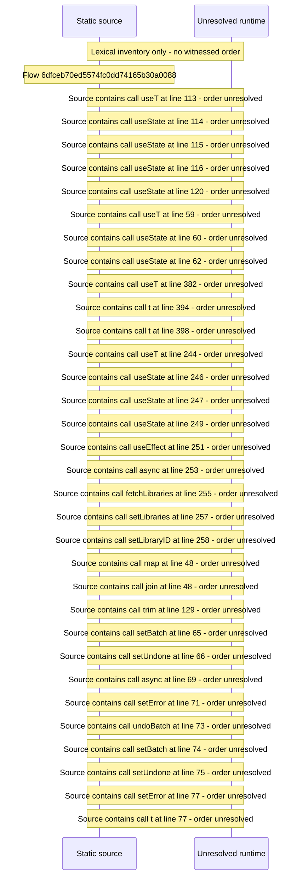

# Manage bulk edit and organize with preview and confirm — flow-diagram

Source revision: 6742c2361d684c662e9ccb84d344a2200c377582. Trust: generated. Freshness: pinned source; run docs flows check for a later revision.

<!-- flowdocs:paragraph:cd6b0423d52695913011c6c64a67c4af -->
Static source inventory only; sequence and runtime ordering are unresolved\.

Source: internal/web/app/src/areas/manage/pages/BulkOpsPage\.tsx:106; symbol: BulkEditSection; span SHA256: 2fdd3a354bb9959f851d60892c33a2f153d82e32ddbe401be5706fc20f31eb93.

