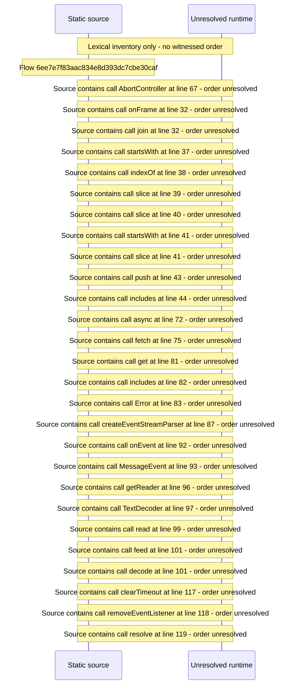

# Server event stream \(/api/events\) with reconnect backoff — flow-diagram

Source revision: d658ad5b71dcb67da0ae540d6d5ff80ca8efefd5. Trust: generated. Freshness: pinned source; run docs flows check for a later revision.

<!-- flowdocs:paragraph:668267b9c9893804cca270345daa77af -->
Static source inventory only; sequence and runtime ordering are unresolved\.

Source: internal/web/app/src/lib/eventStream\.ts:12; symbol: EventStreamHandlers; span SHA256: c8e518ab943975eb1d0e2f58f99e04cd4b60d99eeb877fc9e1484ff655608d7a.

