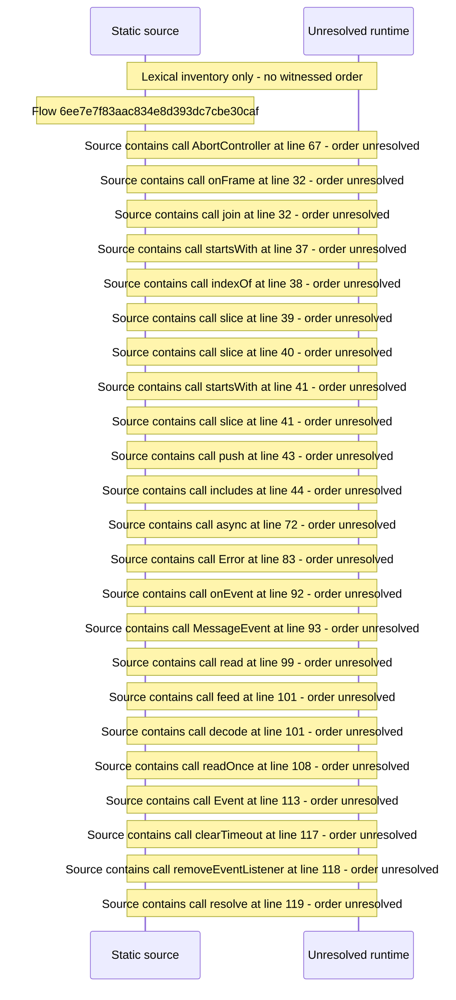

# Server event stream \(/api/events\) with reconnect backoff — flow-diagram

Source revision: 5ffe7939da2318f5153b1a20d0ef6ef94deef162. Trust: generated. Freshness: pinned source; run docs flows check for a later revision.

<!-- flowdocs:paragraph:668267b9c9893804cca270345daa77af -->
Static source inventory only; sequence and runtime ordering are unresolved\.

Source: internal/web/app/src/lib/eventStream\.ts:22; symbol: createEventStreamParser; span SHA256: baffc7202ec733f3e62791b18cf0f30368f40d0e8b62e1f5d36d3535af30056b.

