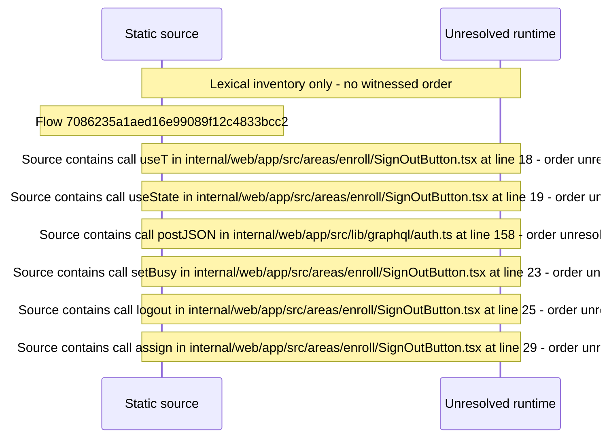

# Sign out of the web session — flow-diagram

Source revision: d658ad5b71dcb67da0ae540d6d5ff80ca8efefd5. Trust: generated. Freshness: pinned source; run docs flows check for a later revision.

<!-- flowdocs:paragraph:0089f25b280d0f82c7687e665a4c36ba -->
Static source inventory only; sequence and runtime ordering are unresolved\.

Source: internal/web/app/src/areas/enroll/SignOutButton\.tsx:13; symbol: SignOutButton; span SHA256: 8be48e3c955d261c9c7609846e6775ee2ce7194e40ef2fd2a5c3e900e3486eba.

