# Console migration: importer wizard, credentials, mapping, match\-rate report — flow-diagram

Source revision: d658ad5b71dcb67da0ae540d6d5ff80ca8efefd5. Trust: generated. Freshness: pinned source; run docs flows check for a later revision.

<!-- flowdocs:paragraph:665c1c7877bbd983c71af51301fe54c5 -->
Static source inventory only; sequence and runtime ordering are unresolved\.

Source: internal/web/app/src/areas/console/sections/RemoteAccess\.tsx:141; symbol: CATEGORY\_LABELS; span SHA256: 4aafe40cebd58b74f2169fb9edfec61aa0bc3d3a342b3a83030aca6dc535ee7e.

```mermaid
sequenceDiagram
    participant S as Static source
    participant U as Unresolved runtime
    Note over S,U: Lexical inventory only - no witnessed order
    Note over S: Flow 71c7112c2c0177a0ae446208be7881b9
    Note over S,U: Source contains call useT in internal/web/app/src/areas/console/sections/RemoteAccess.tsx at line 464 - order unresolved
    Note over S,U: Source contains call useState in internal/web/app/src/areas/console/sections/RemoteAccess.tsx at line 465 - order unresolved
    Note over S,U: Source contains call useState in internal/web/app/src/areas/console/sections/RemoteAccess.tsx at line 466 - order unresolved
    Note over S,U: Source contains call useState in internal/web/app/src/areas/console/sections/RemoteAccess.tsx at line 467 - order unresolved
    Note over S,U: Source contains call useT in internal/web/app/src/areas/console/sections/RemoteAccess.tsx at line 647 - order unresolved
    Note over S,U: Source contains call initialWizardConfig in internal/web/app/src/areas/console/sections/RemoteAccess.tsx at line 652 - order unresolved
    Note over S,U: Source contains call useState in internal/web/app/src/areas/console/sections/RemoteAccess.tsx at line 654 - order unresolved
    Note over S,U: Source contains call useAsync in internal/web/app/src/areas/console/sections/RemoteAccess.tsx at line 655 - order unresolved
    Note over S,U: Source contains call useAsync in internal/web/app/src/areas/console/sections/RemoteAccess.tsx at line 656 - order unresolved
    Note over S,U: Source contains call useRef in internal/web/app/src/areas/console/sections/RemoteAccess.tsx at line 665 - order unresolved
    Note over S,U: Source contains call useT in internal/web/app/src/areas/console/sections/RemoteAccess.tsx at line 535 - order unresolved
    Note over S,U: Source contains call t in internal/web/app/src/areas/console/sections/RemoteAccess.tsx at line 541 - order unresolved
    Note over S,U: Source contains call t in internal/web/app/src/areas/console/sections/RemoteAccess.tsx at line 542 - order unresolved
    Note over S,U: Source contains call t in internal/web/app/src/areas/console/sections/RemoteAccess.tsx at line 546 - order unresolved
    Note over S,U: Source contains call onChange in internal/web/app/src/areas/console/sections/RemoteAccess.tsx at line 549 - order unresolved
    Note over S,U: Source contains call t in internal/web/app/src/areas/console/sections/RemoteAccess.tsx at line 551 - order unresolved
    Note over S,U: Source contains call t in internal/web/app/src/areas/console/sections/RemoteAccess.tsx at line 552 - order unresolved
    Note over S,U: Source contains call t in internal/web/app/src/areas/console/sections/RemoteAccess.tsx at line 555 - order unresolved
    Note over S,U: Source contains call map in internal/web/app/src/areas/console/sections/RemoteAccess.tsx at line 556 - order unresolved
    Note over S,U: Source contains call t in internal/web/app/src/areas/console/sections/RemoteAccess.tsx at line 565 - order unresolved
    Note over S,U: Source contains call onChange in internal/web/app/src/areas/console/sections/RemoteAccess.tsx at line 568 - order unresolved
    Note over S,U: Source contains call t in internal/web/app/src/areas/console/sections/RemoteAccess.tsx at line 570 - order unresolved
    Note over S,U: Source contains call t in internal/web/app/src/areas/console/sections/RemoteAccess.tsx at line 571 - order unresolved
    Note over S,U: Source contains call t in internal/web/app/src/areas/console/sections/RemoteAccess.tsx at line 574 - order unresolved
    Note over S,U: Source contains call map in internal/web/app/src/areas/console/sections/RemoteAccess.tsx at line 575 - order unresolved
    Note over S,U: Source contains call useT in internal/web/app/src/areas/console/sections/RemoteAccess.tsx at line 593 - order unresolved
    Note over S,U: Source contains call parseImportReport in internal/web/app/src/areas/console/sections/RemoteAccess.tsx at line 594 - order unresolved
    Note over S,U: Source contains call t in internal/web/app/src/areas/console/sections/RemoteAccess.tsx at line 598 - order unresolved
    Note over S,U: Source contains call t in internal/web/app/src/areas/console/sections/RemoteAccess.tsx at line 601 - order unresolved
    Note over S,U: Source contains call t in internal/web/app/src/areas/console/sections/RemoteAccess.tsx at line 605 - order unresolved
    Note over S,U: Source contains call t in internal/web/app/src/areas/console/sections/RemoteAccess.tsx at line 609 - order unresolved
    Note over S,U: Source contains call matchPercent in internal/web/app/src/areas/console/sections/RemoteAccess.tsx at line 610 - order unresolved
    Note over S,U: Source contains call t in internal/web/app/src/areas/console/sections/RemoteAccess.tsx at line 622 - order unresolved
    Note over S,U: Source contains call map in internal/web/app/src/areas/console/sections/RemoteAccess.tsx at line 625 - order unresolved
    Note over S,U: Source contains call t in internal/web/app/src/areas/console/sections/RemoteAccess.tsx at line 629 - order unresolved
    Note over S,U: Source contains call useT in internal/web/app/src/areas/console/sections/RemoteAccess.tsx at line 857 - order unresolved
    Note over S,U: Source contains call useDisplayLocale in internal/web/app/src/areas/console/sections/RemoteAccess.tsx at line 858 - order unresolved
    Note over S,U: Source contains call useAsync in internal/web/app/src/areas/console/sections/RemoteAccess.tsx at line 859 - order unresolved
    Note over S,U: Source contains call setActive in internal/web/app/src/areas/console/sections/RemoteAccess.tsx at line 866 - order unresolved
    Note over S,U: Source contains call t in internal/web/app/src/areas/console/sections/RemoteAccess.tsx at line 880 - order unresolved
    Note over S,U: Source contains call t in internal/web/app/src/areas/console/sections/RemoteAccess.tsx at line 881 - order unresolved
    Note over S,U: Source contains call t in internal/web/app/src/areas/console/sections/RemoteAccess.tsx at line 882 - order unresolved
    Note over S,U: Source contains call map in internal/web/app/src/areas/console/sections/RemoteAccess.tsx at line 886 - order unresolved
    Note over S,U: Source contains call displayString in internal/web/app/src/areas/console/sections/RemoteAccess.tsx at line 889 - order unresolved
    Note over S,U: Source contains call setActive in internal/web/app/src/areas/console/sections/RemoteAccess.tsx at line 894 - order unresolved
    Note over S,U: Source contains call t in internal/web/app/src/areas/console/sections/RemoteAccess.tsx at line 895 - order unresolved
    Note over S,U: Source contains call trim in internal/web/app/src/lib/migrationReport.ts at line 48 - order unresolved
    Note over S,U: Source contains call round in internal/web/app/src/lib/migrationReport.ts at line 132 - order unresolved
    Note over S,U: Source contains call lastIndexOf in internal/web/app/src/lib/migrationReport.ts at line 112 - order unresolved
    Note over S,U: Source contains call lastIndexOf in internal/web/app/src/lib/migrationReport.ts at line 113 - order unresolved
    Note over S,U: Source contains call slice in internal/web/app/src/lib/migrationReport.ts at line 115 - order unresolved
    Note over S,U: Source contains call split in internal/web/app/src/lib/migrationReport.ts at line 117 - order unresolved
    Note over S,U: Source contains call split in internal/web/app/src/lib/migrationReport.ts at line 118 - order unresolved
    Note over S,U: Source contains call trim in internal/web/app/src/lib/migrationReport.ts at line 120 - order unresolved
    Note over S,U: Source contains call trim in internal/web/app/src/lib/migrationReport.ts at line 121 - order unresolved
    Note over S,U: Source contains call Number in internal/web/app/src/lib/migrationReport.ts at line 123 - order unresolved
    Note over S,U: Source contains call isFinite in internal/web/app/src/lib/migrationReport.ts at line 124 - order unresolved
    Note over S,U: Source contains call push in internal/web/app/src/lib/migrationReport.ts at line 125 - order unresolved
    Note over S,U: Source contains call max in internal/web/app/src/lib/migrationReport.ts at line 95 - order unresolved
    Note over S,U: Source contains call parseCategoryBreakdown in internal/web/app/src/lib/migrationReport.ts at line 102 - order unresolved
    Note over S,U: Source contains call includes in internal/web/app/src/lib/migrationReport.ts at line 36 - order unresolved
    Note over S,U: Source contains call filter in internal/web/app/src/lib/migrationReport.ts at line 37 - order unresolved
    Note over S,U: Source contains call useCallback in internal/web/app/src/areas/console/sections/RemoteAccess.tsx at line 667 - order unresolved
    Note over S,U: Source contains call clearInterval in internal/web/app/src/areas/console/sections/RemoteAccess.tsx at line 669 - order unresolved
    Note over S,U: Source contains call setConfig in internal/web/app/src/areas/console/sections/RemoteAccess.tsx at line 682 - order unresolved
    Note over S,U: Source contains call clearPoll in internal/web/app/src/areas/console/sections/RemoteAccess.tsx at line 729 - order unresolved
    Note over S,U: Source contains call setPhase in internal/web/app/src/areas/console/sections/RemoteAccess.tsx at line 730 - order unresolved
    Note over S,U: Source contains call setConfig in internal/web/app/src/areas/console/sections/RemoteAccess.tsx at line 731 - order unresolved
    Note over S,U: Source contains call initialWizardConfig in internal/web/app/src/areas/console/sections/RemoteAccess.tsx at line 731 - order unresolved
    Note over S,U: Source contains call setJob in internal/web/app/src/areas/console/sections/RemoteAccess.tsx at line 732 - order unresolved
    Note over S,U: Source contains call setErrorMsg in internal/web/app/src/areas/console/sections/RemoteAccess.tsx at line 733 - order unresolved
    Note over S,U: Source contains call async in internal/web/app/src/areas/console/sections/RemoteAccess.tsx at line 469 - order unresolved
    Note over S,U: Source contains call trim in internal/web/app/src/areas/console/sections/RemoteAccess.tsx at line 470 - order unresolved
    Note over S,U: Source contains call setSaving in internal/web/app/src/areas/console/sections/RemoteAccess.tsx at line 471 - order unresolved
    Note over S,U: Source contains call setError in internal/web/app/src/areas/console/sections/RemoteAccess.tsx at line 472 - order unresolved
    Note over S,U: Source contains call setScraperCredential in internal/web/app/src/areas/console/sections/RemoteAccess.tsx at line 474 - order unresolved
    Note over S,U: Source contains call trim in internal/web/app/src/areas/console/sections/RemoteAccess.tsx at line 474 - order unresolved
    Note over S,U: Source contains call setSecret in internal/web/app/src/areas/console/sections/RemoteAccess.tsx at line 475 - order unresolved
    Note over S,U: Source contains call onConfigured in internal/web/app/src/areas/console/sections/RemoteAccess.tsx at line 476 - order unresolved
    Note over S,U: Source contains call setError in internal/web/app/src/areas/console/sections/RemoteAccess.tsx at line 478 - order unresolved
    Note over S,U: Source contains call t in internal/web/app/src/areas/console/sections/RemoteAccess.tsx at line 478 - order unresolved
    Note over S,U: Source contains call setSaving in internal/web/app/src/areas/console/sections/RemoteAccess.tsx at line 480 - order unresolved
    Note over S,U: Source contains call async in internal/web/app/src/areas/console/sections/RemoteAccess.tsx at line 686 - order unresolved
    Note over S,U: Source contains call setErrorMsg in internal/web/app/src/areas/console/sections/RemoteAccess.tsx at line 687 - order unresolved
    Note over S,U: Source contains call setPhase in internal/web/app/src/areas/console/sections/RemoteAccess.tsx at line 688 - order unresolved
    Note over S,U: Source contains call setJob in internal/web/app/src/areas/console/sections/RemoteAccess.tsx at line 689 - order unresolved
    Note over S,U: Source contains call runImport in internal/web/app/src/areas/console/sections/RemoteAccess.tsx at line 691 - order unresolved
    Note over S,U: Source contains call trim in internal/web/app/src/areas/console/sections/RemoteAccess.tsx at line 694 - order unresolved
    Note over S,U: Source contains call categoriesArgument in internal/web/app/src/areas/console/sections/RemoteAccess.tsx at line 695 - order unresolved
    Note over S,U: Source contains call setInterval in internal/web/app/src/areas/console/sections/RemoteAccess.tsx at line 699 - order unresolved
    Note over S,U: Source contains call async in internal/web/app/src/areas/console/sections/RemoteAccess.tsx at line 700 - order unresolved
    Note over S,U: Source contains call getAdminEpochSignal in internal/web/app/src/areas/console/sections/RemoteAccess.tsx at line 701 - order unresolved
    Note over S,U: Source contains call clearPoll in internal/web/app/src/areas/console/sections/RemoteAccess.tsx at line 703 - order unresolved
    Note over S,U: Source contains call fetchImportStatus in internal/web/app/src/areas/console/sections/RemoteAccess.tsx at line 707 - order unresolved
    Note over S,U: Source contains call setJob in internal/web/app/src/areas/console/sections/RemoteAccess.tsx at line 709 - order unresolved
    Note over S,U: Source contains call isTerminalStatus in internal/web/app/src/areas/console/sections/RemoteAccess.tsx at line 710 - order unresolved
    Note over S,U: Source contains call clearPoll in internal/web/app/src/areas/console/sections/RemoteAccess.tsx at line 711 - order unresolved
    Note over S,U: Source contains call setPhase in internal/web/app/src/areas/console/sections/RemoteAccess.tsx at line 712 - order unresolved
    Note over S,U: Source contains call setPhase in internal/web/app/src/areas/console/sections/RemoteAccess.tsx at line 721 - order unresolved
    Note over S,U: Source contains call setErrorMsg in internal/web/app/src/areas/console/sections/RemoteAccess.tsx at line 722 - order unresolved
    Note over S,U: Source contains call t in internal/web/app/src/areas/console/sections/RemoteAccess.tsx at line 722 - order unresolved
```

