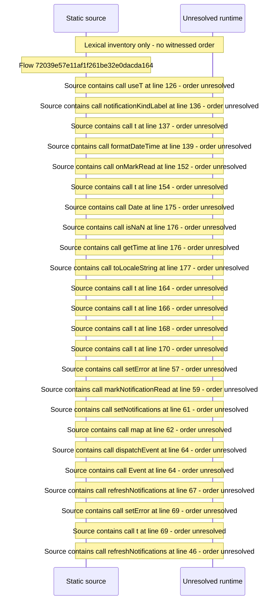

# Viewer notifications inbox — flow-diagram

Source revision: d442b4a6a38de86be0670669b3a3f6aa47e80b22. Trust: generated. Freshness: pinned source; run docs flows check for a later revision.

<!-- flowdocs:paragraph:022de9e1c3870011e548cee6056eaee1 -->
Static source inventory only; sequence and runtime ordering are unresolved\.

Source: internal/web/app/src/areas/viewer/pages/NotificationsPage\.tsx:119; symbol: NotificationRow; span SHA256: b24148d2db280286c5eac686af7ff3c720a22c3f543f7c474148b109b291bb61.

