# Viewer notifications inbox — flow-diagram

Source revision: 6742c2361d684c662e9ccb84d344a2200c377582. Trust: generated. Freshness: pinned source; run docs flows check for a later revision.

<!-- flowdocs:paragraph:022de9e1c3870011e548cee6056eaee1 -->
Static source inventory only; sequence and runtime ordering are unresolved\.

Source: internal/web/app/src/areas/viewer/pages/NotificationsPage\.tsx:11; symbol: NOTIFICATIONS\_CHANGED\_EVENT; span SHA256: 7dde5112c416d78842d0a78b8b573bc6866f08d7ac535b0bcf9c82ce0969e72c.

```mermaid
sequenceDiagram
    participant S as Static source
    participant U as Unresolved runtime
    Note over S,U: Lexical inventory only - no witnessed order
    Note over S: Flow 72039e57e11af1f261be32e0dacda164
    Note over S,U: Source contains call useT at line 134 - order unresolved
    Note over S,U: Source contains call notificationKindLabel at line 147 - order unresolved
    Note over S,U: Source contains call t at line 148 - order unresolved
    Note over S,U: Source contains call formatDateTime at line 150 - order unresolved
    Note over S,U: Source contains call onMarkRead at line 165 - order unresolved
    Note over S,U: Source contains call t at line 167 - order unresolved
    Note over S,U: Source contains call useT at line 18 - order unresolved
    Note over S,U: Source contains call useState at line 20 - order unresolved
    Note over S,U: Source contains call useCallback at line 23 - order unresolved
    Note over S,U: Source contains call async at line 24 - order unresolved
    Note over S,U: Source contains call setError at line 25 - order unresolved
    Note over S,U: Source contains call setLoading at line 26 - order unresolved
    Note over S,U: Source contains call setNotifications at line 28 - order unresolved
    Note over S,U: Source contains call fetchNotifications at line 28 - order unresolved
    Note over S,U: Source contains call setError at line 30 - order unresolved
    Note over S,U: Source contains call t at line 30 - order unresolved
    Note over S,U: Source contains call setLoading at line 32 - order unresolved
    Note over S,U: Source contains call useEffect at line 38 - order unresolved
    Note over S,U: Source contains call refreshNotifications at line 39 - order unresolved
    Note over S,U: Source contains call useEffect at line 42 - order unresolved
    Note over S,U: Source contains call Date at line 188 - order unresolved
    Note over S,U: Source contains call isNaN at line 189 - order unresolved
    Note over S,U: Source contains call getTime at line 189 - order unresolved
    Note over S,U: Source contains call toLocaleString at line 190 - order unresolved
    Note over S,U: Source contains call t at line 177 - order unresolved
    Note over S,U: Source contains call t at line 179 - order unresolved
    Note over S,U: Source contains call t at line 181 - order unresolved
    Note over S,U: Source contains call t at line 183 - order unresolved
    Note over S,U: Source contains call setError at line 56 - order unresolved
    Note over S,U: Source contains call markNotificationRead at line 58 - order unresolved
    Note over S,U: Source contains call setNotifications at line 60 - order unresolved
    Note over S,U: Source contains call map at line 61 - order unresolved
    Note over S,U: Source contains call dispatchEvent at line 63 - order unresolved
    Note over S,U: Source contains call Event at line 63 - order unresolved
    Note over S,U: Source contains call refreshNotifications at line 66 - order unresolved
    Note over S,U: Source contains call setError at line 68 - order unresolved
    Note over S,U: Source contains call t at line 68 - order unresolved
    Note over S,U: Source contains call refreshNotifications at line 45 - order unresolved
```

