# Backups: history, verify manifest, restore and export — flow-diagram

Source revision: e417fb394873a04fbd27fb8d5bcbca5484c8747f. Trust: generated. Freshness: pinned source; run docs flows check for a later revision.

<!-- flowdocs:paragraph:b42224772cc1a8bd498b67110696ffb1 -->
Static source inventory only; sequence and runtime ordering are unresolved\.

Source: internal/web/app/src/areas/manage/pages/BackupExportPage\.tsx:88; symbol: BackupExportPage; span SHA256: 9eae9d9d39c2b3071703d4e5f17a9f203efd54f5aefaebeb878dab0d3c1ed978.

```mermaid
sequenceDiagram
    participant S as Static source
    participant U as Unresolved runtime
    Note over S,U: Lexical inventory only - no witnessed order
    Note over S: Flow 74120a49433d1f637be34057b7f429f5
    Note over S,U: Source contains call useState at line 91 - order unresolved
    Note over S,U: Source contains call useT at line 127 - order unresolved
    Note over S,U: Source contains call useState at line 128 - order unresolved
    Note over S,U: Source contains call useState at line 129 - order unresolved
    Note over S,U: Source contains call useState at line 130 - order unresolved
    Note over S,U: Source contains call useState at line 131 - order unresolved
    Note over S,U: Source contains call useEpochRequest at line 141 - order unresolved
    Note over S,U: Source contains call useT at line 445 - order unresolved
    Note over S,U: Source contains call useState at line 446 - order unresolved
    Note over S,U: Source contains call useState at line 448 - order unresolved
    Note over S,U: Source contains call useEpochRequest at line 450 - order unresolved
    Note over S,U: Source contains call useT at line 356 - order unresolved
    Note over S,U: Source contains call t at line 360 - order unresolved
    Note over S,U: Source contains call t at line 362 - order unresolved
    Note over S,U: Source contains call t at line 366 - order unresolved
    Note over S,U: Source contains call t at line 372 - order unresolved
    Note over S,U: Source contains call t at line 376 - order unresolved
    Note over S,U: Source contains call manifestPath at line 378 - order unresolved
    Note over S,U: Source contains call formatDateTime at line 381 - order unresolved
    Note over S,U: Source contains call formatBytes at line 381 - order unresolved
    Note over S,U: Source contains call t at line 392 - order unresolved
    Note over S,U: Source contains call t at line 394 - order unresolved
    Note over S,U: Source contains call useT at line 408 - order unresolved
    Note over S,U: Source contains call t at line 412 - order unresolved
    Note over S,U: Source contains call t at line 414 - order unresolved
    Note over S,U: Source contains call t at line 418 - order unresolved
    Note over S,U: Source contains call t at line 419 - order unresolved
    Note over S,U: Source contains call t at line 420 - order unresolved
    Note over S,U: Source contains call t at line 421 - order unresolved
    Note over S,U: Source contains call t at line 426 - order unresolved
    Note over S,U: Source contains call t at line 428 - order unresolved
    Note over S,U: Source contains call t at line 430 - order unresolved
    Note over S,U: Source contains call t at line 435 - order unresolved
    Note over S,U: Source contains call t at line 437 - order unresolved
    Note over S,U: Source contains call useT at line 341 - order unresolved
    Note over S,U: Source contains call t at line 343 - order unresolved
    Note over S,U: Source contains call t at line 346 - order unresolved
    Note over S,U: Source contains call t at line 348 - order unresolved
    Note over S,U: Source contains call min at line 82 - order unresolved
    Note over S,U: Source contains call floor at line 82 - order unresolved
    Note over S,U: Source contains call log at line 82 - order unresolved
    Note over S,U: Source contains call String at line 84 - order unresolved
    Note over S,U: Source contains call toFixed at line 84 - order unresolved
    Note over S,U: Source contains call split at line 334 - order unresolved
    Note over S,U: Source contains call filter at line 334 - order unresolved
    Note over S,U: Source contains call useRef at line 53 - order unresolved
    Note over S,U: Source contains call useEffect at line 55 - order unresolved
    Note over S,U: Source contains call abort at line 59 - order unresolved
    Note over S,U: Source contains call useCallback at line 64 - order unresolved
    Note over S,U: Source contains call abort at line 65 - order unresolved
    Note over S,U: Source contains call AbortController at line 66 - order unresolved
    Note over S,U: Source contains call withAdminEpoch at line 69 - order unresolved
    Note over S,U: Source contains call useCallback at line 143 - order unresolved
    Note over S,U: Source contains call async at line 143 - order unresolved
    Note over S,U: Source contains call trim at line 144 - order unresolved
    Note over S,U: Source contains call setError at line 146 - order unresolved
    Note over S,U: Source contains call t at line 146 - order unresolved
    Note over S,U: Source contains call beginRequest at line 149 - order unresolved
    Note over S,U: Source contains call setError at line 150 - order unresolved
    Note over S,U: Source contains call setLoading at line 151 - order unresolved
    Note over S,U: Source contains call fetchBackupHistory at line 153 - order unresolved
    Note over S,U: Source contains call current at line 154 - order unresolved
    Note over S,U: Source contains call setEntries at line 155 - order unresolved
    Note over S,U: Source contains call setLoaded at line 156 - order unresolved
    Note over S,U: Source contains call some at line 158 - order unresolved
    Note over S,U: Source contains call setSelected at line 159 - order unresolved
    Note over S,U: Source contains call current at line 162 - order unresolved
    Note over S,U: Source contains call setError at line 163 - order unresolved
    Note over S,U: Source contains call t at line 163 - order unresolved
    Note over S,U: Source contains call current at line 165 - order unresolved
    Note over S,U: Source contains call setLoading at line 165 - order unresolved
    Note over S,U: Source contains call Blob at line 472 - order unresolved
    Note over S,U: Source contains call stringify at line 472 - order unresolved
    Note over S,U: Source contains call createObjectURL at line 475 - order unresolved
    Note over S,U: Source contains call createElement at line 476 - order unresolved
    Note over S,U: Source contains call click at line 479 - order unresolved
    Note over S,U: Source contains call revokeObjectURL at line 480 - order unresolved
    Note over S,U: Source contains call async at line 452 - order unresolved
    Note over S,U: Source contains call beginRequest at line 453 - order unresolved
    Note over S,U: Source contains call setError at line 454 - order unresolved
    Note over S,U: Source contains call setBusy at line 455 - order unresolved
    Note over S,U: Source contains call fetchMetadataExport at line 457 - order unresolved
    Note over S,U: Source contains call current at line 458 - order unresolved
    Note over S,U: Source contains call setExportData at line 459 - order unresolved
    Note over S,U: Source contains call current at line 461 - order unresolved
    Note over S,U: Source contains call setError at line 462 - order unresolved
    Note over S,U: Source contains call t at line 462 - order unresolved
    Note over S,U: Source contains call current at line 464 - order unresolved
    Note over S,U: Source contains call setBusy at line 464 - order unresolved
    Note over S,U: Source contains call async at line 169 - order unresolved
    Note over S,U: Source contains call trim at line 170 - order unresolved
    Note over S,U: Source contains call setError at line 172 - order unresolved
    Note over S,U: Source contains call t at line 172 - order unresolved
    Note over S,U: Source contains call setError at line 175 - order unresolved
    Note over S,U: Source contains call setRunning at line 176 - order unresolved
    Note over S,U: Source contains call runBackup at line 178 - order unresolved
    Note over S,U: Source contains call loadHistory at line 180 - order unresolved
    Note over S,U: Source contains call setError at line 182 - order unresolved
    Note over S,U: Source contains call t at line 182 - order unresolved
    Note over S,U: Source contains call setRunning at line 184 - order unresolved
    Note over S,U: Source contains call async at line 188 - order unresolved
    Note over S,U: Source contains call setError at line 189 - order unresolved
    Note over S,U: Source contains call setVerifying at line 190 - order unresolved
    Note over S,U: Source contains call setVerifyResult at line 191 - order unresolved
    Note over S,U: Source contains call verifyBackup at line 193 - order unresolved
    Note over S,U: Source contains call manifestPath at line 193 - order unresolved
    Note over S,U: Source contains call setVerifyResult at line 194 - order unresolved
    Note over S,U: Source contains call setEntries at line 200 - order unresolved
    Note over S,U: Source contains call map at line 201 - order unresolved
    Note over S,U: Source contains call setError at line 206 - order unresolved
    Note over S,U: Source contains call t at line 206 - order unresolved
    Note over S,U: Source contains call setVerifying at line 208 - order unresolved
```

