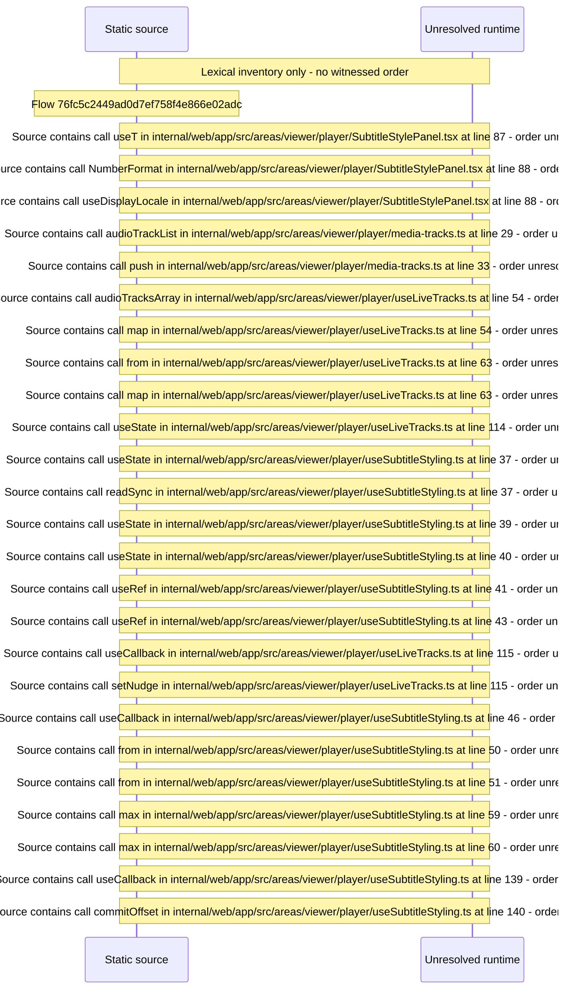

# Player audio and subtitle tracks, subtitle styling — flow-diagram

Source revision: 4d9f6ba81afcc8de0179eb7c056488d3e3bd8218. Trust: generated. Freshness: pinned source; run docs flows check for a later revision.

<!-- flowdocs:paragraph:1500616c2ec3a004d37072fdc22a79f9 -->
Static source inventory only; sequence and runtime ordering are unresolved\.

Source: internal/web/app/src/areas/viewer/lib/transport\.ts:450; symbol: TrackMenuLabels; span SHA256: 254b8c899b00bab907d731ac06734822eab5d6277240a1a9c5867ae572c8b104.

