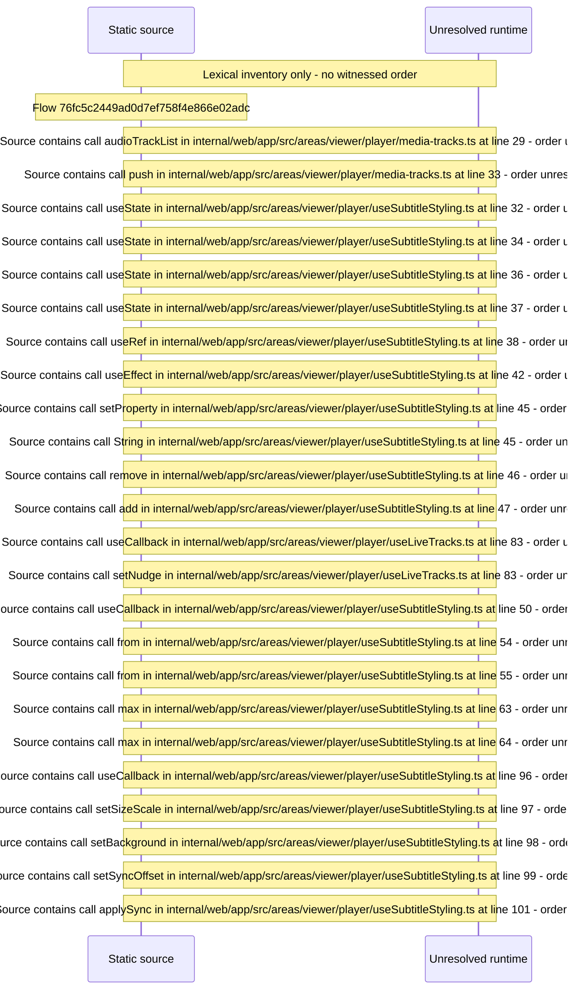

# Player audio and subtitle tracks, subtitle styling — flow-diagram

Source revision: 5ffe7939da2318f5153b1a20d0ef6ef94deef162. Trust: generated. Freshness: pinned source; run docs flows check for a later revision.

<!-- flowdocs:paragraph:1500616c2ec3a004d37072fdc22a79f9 -->
Static source inventory only; sequence and runtime ordering are unresolved\.

Source: internal/web/app/src/areas/viewer/lib/transport\.ts:411; symbol: buildTrackMenuModel; span SHA256: 08ad1dc2bca1f40d9cee935165267b7cd02908df2a1f69fc208938be66ebbd1a.

