# Manage tags: tag tree, assign, bulk, trashed tags — flow-diagram

Source revision: d658ad5b71dcb67da0ae540d6d5ff80ca8efefd5. Trust: generated. Freshness: pinned source; run docs flows check for a later revision.

<!-- flowdocs:paragraph:a3e7b63e72224666c05bc986c9dadf3b -->
Static source inventory only; sequence and runtime ordering are unresolved\.

Source: internal/web/app/src/areas/manage/pages/TagsPage\.tsx:359; symbol: AssignSection; span SHA256: ff76541b48b3a2f9b4e7cb4baf150f18989432602ae1aa6b427a1a99ae9c95a4.

```mermaid
sequenceDiagram
    participant S as Static source
    participant U as Unresolved runtime
    Note over S,U: Lexical inventory only - no witnessed order
    Note over S: Flow 7904a72ccfa91625534cebea607e6a03
    Note over S,U: Source contains call useT at line 360 - order unresolved
    Note over S,U: Source contains call useState at line 362 - order unresolved
    Note over S,U: Source contains call useState at line 364 - order unresolved
    Note over S,U: Source contains call useT at line 501 - order unresolved
    Note over S,U: Source contains call useState at line 504 - order unresolved
    Note over S,U: Source contains call Set at line 505 - order unresolved
    Note over S,U: Source contains call useT at line 166 - order unresolved
    Note over S,U: Source contains call useState at line 167 - order unresolved
    Note over S,U: Source contains call useState at line 168 - order unresolved
    Note over S,U: Source contains call useState at line 170 - order unresolved
    Note over S,U: Source contains call useState at line 171 - order unresolved
    Note over S,U: Source contains call useT at line 83 - order unresolved
    Note over S,U: Source contains call useState at line 85 - order unresolved
    Note over S,U: Source contains call useState at line 86 - order unresolved
    Note over S,U: Source contains call useState at line 87 - order unresolved
    Note over S,U: Source contains call useT at line 668 - order unresolved
    Note over S,U: Source contains call t at line 354 - order unresolved
    Note over S,U: Source contains call t at line 355 - order unresolved
    Note over S,U: Source contains call t at line 356 - order unresolved
    Note over S,U: Source contains call filter at line 54 - order unresolved
    Note over S,U: Source contains call get at line 58 - order unresolved
    Note over S,U: Source contains call push at line 59 - order unresolved
    Note over S,U: Source contains call set at line 60 - order unresolved
    Note over S,U: Source contains call Set at line 62 - order unresolved
    Note over S,U: Source contains call map at line 62 - order unresolved
    Note over S,U: Source contains call setEditing at line 193 - order unresolved
    Note over S,U: Source contains call setEditName at line 194 - order unresolved
    Note over S,U: Source contains call setEditParent at line 195 - order unresolved
    Note over S,U: Source contains call setEditFocus at line 196 - order unresolved
    Note over S,U: Source contains call useMemo at line 107 - order unresolved
    Note over S,U: Source contains call filter at line 107 - order unresolved
    Note over S,U: Source contains call useCallback at line 89 - order unresolved
    Note over S,U: Source contains call async at line 89 - order unresolved
    Note over S,U: Source contains call setError at line 90 - order unresolved
    Note over S,U: Source contains call setLoading at line 91 - order unresolved
    Note over S,U: Source contains call setTags at line 95 - order unresolved
    Note over S,U: Source contains call fetchTags at line 95 - order unresolved
    Note over S,U: Source contains call setError at line 97 - order unresolved
    Note over S,U: Source contains call t at line 97 - order unresolved
    Note over S,U: Source contains call setLoading at line 99 - order unresolved
    Note over S,U: Source contains call async at line 530 - order unresolved
    Note over S,U: Source contains call onError at line 531 - order unresolved
    Note over S,U: Source contains call idList at line 532 - order unresolved
    Note over S,U: Source contains call bulkAssignTags at line 536 - order unresolved
    Note over S,U: Source contains call setAffected at line 537 - order unresolved
    Note over S,U: Source contains call onError at line 539 - order unresolved
    Note over S,U: Source contains call t at line 539 - order unresolved
    Note over S,U: Source contains call async at line 377 - order unresolved
    Note over S,U: Source contains call onError at line 378 - order unresolved
    Note over S,U: Source contains call trim at line 379 - order unresolved
    Note over S,U: Source contains call setAssignment at line 382 - order unresolved
    Note over S,U: Source contains call assignTag at line 382 - order unresolved
    Note over S,U: Source contains call setAddTagID at line 383 - order unresolved
    Note over S,U: Source contains call onError at line 385 - order unresolved
    Note over S,U: Source contains call t at line 385 - order unresolved
    Note over S,U: Source contains call async at line 178 - order unresolved
    Note over S,U: Source contains call onError at line 179 - order unresolved
    Note over S,U: Source contains call trim at line 180 - order unresolved
    Note over S,U: Source contains call createTag at line 183 - order unresolved
    Note over S,U: Source contains call setName at line 184 - order unresolved
    Note over S,U: Source contains call setParentID at line 185 - order unresolved
    Note over S,U: Source contains call onChanged at line 186 - order unresolved
    Note over S,U: Source contains call onError at line 188 - order unresolved
    Note over S,U: Source contains call t at line 188 - order unresolved
    Note over S,U: Source contains call async at line 212 - order unresolved
    Note over S,U: Source contains call onError at line 213 - order unresolved
    Note over S,U: Source contains call deleteTag at line 215 - order unresolved
    Note over S,U: Source contains call onChanged at line 216 - order unresolved
    Note over S,U: Source contains call onError at line 218 - order unresolved
    Note over S,U: Source contains call t at line 218 - order unresolved
    Note over S,U: Source contains call async at line 366 - order unresolved
    Note over S,U: Source contains call onError at line 367 - order unresolved
    Note over S,U: Source contains call trim at line 368 - order unresolved
    Note over S,U: Source contains call setAssignment at line 371 - order unresolved
    Note over S,U: Source contains call fetchTagAssignments at line 371 - order unresolved
    Note over S,U: Source contains call onError at line 373 - order unresolved
    Note over S,U: Source contains call t at line 373 - order unresolved
    Note over S,U: Source contains call async at line 670 - order unresolved
    Note over S,U: Source contains call onError at line 671 - order unresolved
    Note over S,U: Source contains call restoreTag at line 673 - order unresolved
    Note over S,U: Source contains call onChanged at line 674 - order unresolved
    Note over S,U: Source contains call onError at line 676 - order unresolved
    Note over S,U: Source contains call t at line 676 - order unresolved
    Note over S,U: Source contains call async at line 199 - order unresolved
    Note over S,U: Source contains call onError at line 200 - order unresolved
    Note over S,U: Source contains call trim at line 201 - order unresolved
    Note over S,U: Source contains call updateTag at line 204 - order unresolved
    Note over S,U: Source contains call setEditing at line 205 - order unresolved
    Note over S,U: Source contains call onChanged at line 206 - order unresolved
    Note over S,U: Source contains call onError at line 208 - order unresolved
    Note over S,U: Source contains call t at line 208 - order unresolved
    Note over S,U: Source contains call async at line 389 - order unresolved
    Note over S,U: Source contains call onError at line 390 - order unresolved
    Note over S,U: Source contains call trim at line 391 - order unresolved
    Note over S,U: Source contains call setAssignment at line 394 - order unresolved
    Note over S,U: Source contains call unassignTag at line 394 - order unresolved
    Note over S,U: Source contains call onError at line 396 - order unresolved
    Note over S,U: Source contains call t at line 396 - order unresolved
    Note over S,U: Source contains call filter at line 224 - order unresolved
    Note over S,U: Source contains call useMemo at line 176 - order unresolved
    Note over S,U: Source contains call treeOrder at line 176 - order unresolved
    Note over S,U: Source contains call setSelected at line 515 - order unresolved
    Note over S,U: Source contains call Set at line 516 - order unresolved
    Note over S,U: Source contains call has at line 517 - order unresolved
    Note over S,U: Source contains call delete at line 517 - order unresolved
    Note over S,U: Source contains call add at line 518 - order unresolved
    Note over S,U: Source contains call useMemo at line 108 - order unresolved
    Note over S,U: Source contains call filter at line 108 - order unresolved
    Note over S,U: Source contains call get at line 65 - order unresolved
    Note over S,U: Source contains call sort at line 65 - order unresolved
    Note over S,U: Source contains call localeCompare at line 65 - order unresolved
    Note over S,U: Source contains call push at line 67 - order unresolved
    Note over S,U: Source contains call visit at line 68 - order unresolved
    Note over S,U: Source contains call min at line 68 - order unresolved
```

