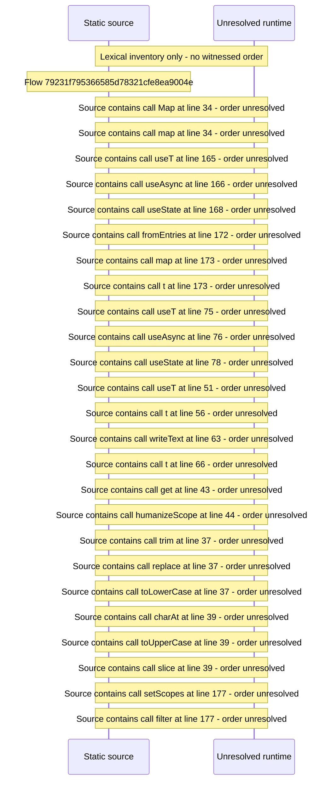

# Console API tokens and keys: scopes, create, revoke, one\-time secret — flow-diagram

Source revision: d658ad5b71dcb67da0ae540d6d5ff80ca8efefd5. Trust: generated. Freshness: pinned source; run docs flows check for a later revision.

<!-- flowdocs:paragraph:a91ca23b52b97df28174abf09ddef556 -->
Static source inventory only; sequence and runtime ordering are unresolved\.

Source: internal/web/app/src/areas/console/sections/ApiCredentials\.tsx:34; symbol: API\_SCOPE\_LABELS; span SHA256: ff2b726eff11658140fc63668c837d96b0b9923876a2c2de81700c20a04bfbfb.

