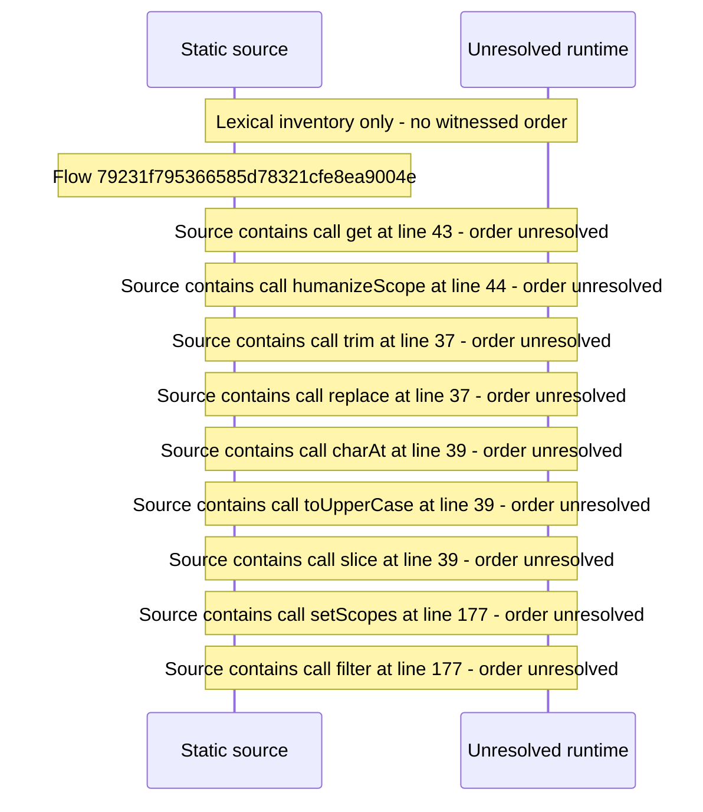

# Console API tokens and keys: scopes, create, revoke, one\-time secret — flow-diagram

Source revision: d442b4a6a38de86be0670669b3a3f6aa47e80b22. Trust: generated. Freshness: pinned source; run docs flows check for a later revision.

<!-- flowdocs:paragraph:a91ca23b52b97df28174abf09ddef556 -->
Static source inventory only; sequence and runtime ordering are unresolved\.

Source: internal/web/app/src/areas/console/sections/ApiCredentials\.tsx:42; symbol: apiScopeLabel; span SHA256: 82ae899bfdd27ffca06a52728a8ee3c7eb509e58ef1686ab4124bbf6b30f4abb.

