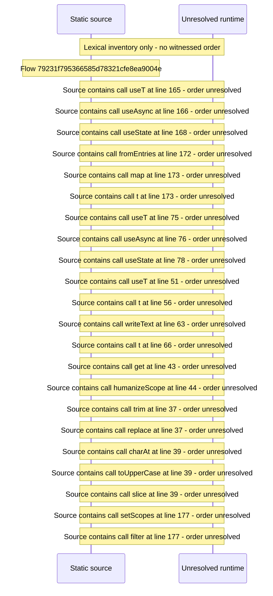

# Console API tokens and keys: scopes, create, revoke, one\-time secret — flow-diagram

Source revision: e417fb394873a04fbd27fb8d5bcbca5484c8747f. Trust: generated. Freshness: pinned source; run docs flows check for a later revision.

<!-- flowdocs:paragraph:a91ca23b52b97df28174abf09ddef556 -->
Static source inventory only; sequence and runtime ordering are unresolved\.

Source: internal/web/app/src/areas/console/sections/ApiCredentials\.tsx:293; symbol: ApiCredentials; span SHA256: b24c879471c66833e48c191aa9d6810b01f9d37491ed40287fcaef8f8135d587.

