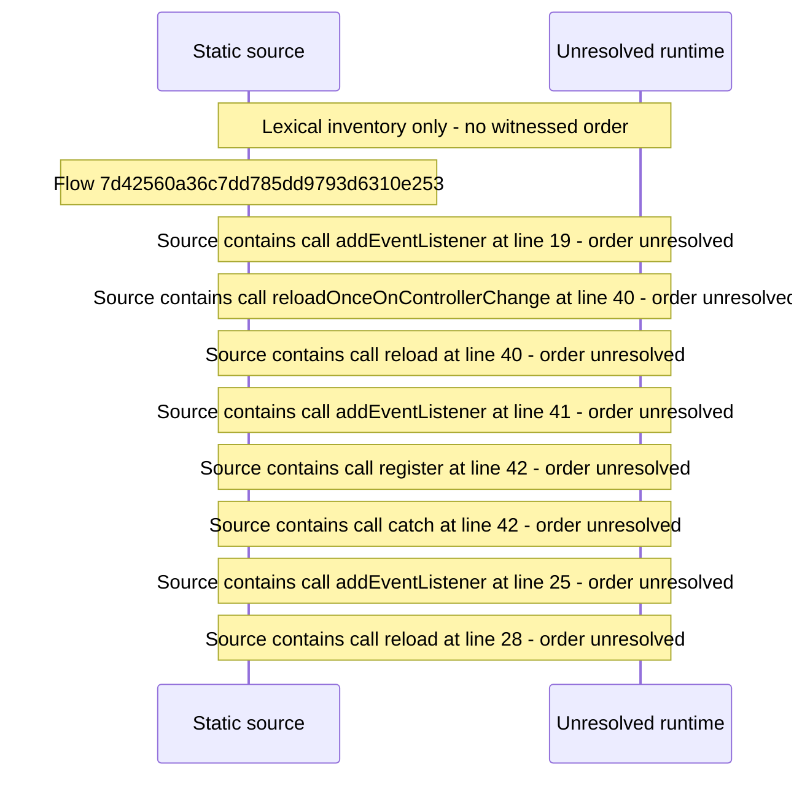

# Service worker registration and reload\-on\-controller\-change — flow-diagram

Source revision: e2ffd915f3bda309ca8792f07724053b048ba15f. Trust: generated. Freshness: pinned source; run docs flows check for a later revision.

<!-- flowdocs:paragraph:56d463b3d3c6cd0c370f2cb95e0573dc -->
Static source inventory only; sequence and runtime ordering are unresolved\.

Source: internal/web/app/src/lib/pwa\.ts:17; symbol: ServiceWorkerHost; span SHA256: 2bc16f6af4e4c3747d39d332451418ddbff2ecdf4635f69bb99a25b5f4094a96.

