# Viewer who&\#39;s\-watching Profile picker with PIN prompt — flow-diagram

Source revision: 6742c2361d684c662e9ccb84d344a2200c377582. Trust: generated. Freshness: pinned source; run docs flows check for a later revision.

<!-- flowdocs:paragraph:8dbf2b040d7e71d2cd950e4eb4ed6fe8 -->
Static source inventory only; sequence and runtime ordering are unresolved\.

Source: internal/web/app/src/areas/viewer/pages/ProfilePickerPage\.tsx:34; symbol: FAILURE\_MESSAGE; span SHA256: 822692c2083b855cb446429b0cac5e2c35adc7232f3248ea84920ddc133b8873.

```mermaid
sequenceDiagram
    participant S as Static source
    participant U as Unresolved runtime
    Note over S,U: Lexical inventory only - no witnessed order
    Note over S: Flow 83743f6282cf018923668839ed38a17a
    Note over S,U: Source contains call useT in internal/web/app/src/areas/viewer/pages/ProfilePickerPage.tsx at line 203 - order unresolved
    Note over S,U: Source contains call useState in internal/web/app/src/areas/viewer/pages/ProfilePickerPage.tsx at line 204 - order unresolved
    Note over S,U: Source contains call useId in internal/web/app/src/areas/viewer/pages/ProfilePickerPage.tsx at line 205 - order unresolved
    Note over S,U: Source contains call useId in internal/web/app/src/areas/viewer/pages/ProfilePickerPage.tsx at line 206 - order unresolved
    Note over S,U: Source contains call useEffect in internal/web/app/src/areas/viewer/pages/ProfilePickerPage.tsx at line 209 - order unresolved
    Note over S,U: Source contains call focus in internal/web/app/src/areas/viewer/pages/ProfilePickerPage.tsx at line 209 - order unresolved
    Note over S,U: Source contains call useT in internal/web/app/src/areas/viewer/pages/ProfilePickerPage.tsx at line 55 - order unresolved
    Note over S,U: Source contains call useNavigate in internal/web/app/src/areas/viewer/pages/ProfilePickerPage.tsx at line 56 - order unresolved
    Note over S,U: Source contains call useLocation in internal/web/app/src/areas/viewer/pages/ProfilePickerPage.tsx at line 57 - order unresolved
    Note over S,U: Source contains call useSession in internal/web/app/src/areas/viewer/pages/ProfilePickerPage.tsx at line 58 - order unresolved
    Note over S,U: Source contains call useState in internal/web/app/src/areas/viewer/pages/ProfilePickerPage.tsx at line 60 - order unresolved
    Note over S,U: Source contains call useEffect in internal/web/app/src/areas/viewer/pages/ProfilePickerPage.tsx at line 68 - order unresolved
    Note over S,U: Source contains call includes in internal/web/app/src/areas/viewer/pages/ProfilePickerPage.tsx at line 42 - order unresolved
    Note over S,U: Source contains call includes in internal/web/app/src/areas/viewer/pages/ProfilePickerPage.tsx at line 43 - order unresolved
    Note over S,U: Source contains call resolveAvatar in internal/web/app/src/components/beamfall/profile/ProfileAvatar.tsx at line 23 - order unresolved
    Note over S,U: Source contains call find in internal/web/app/src/components/beamfall/profile/ProfileAvatar.tsx at line 24 - order unresolved
    Note over S,U: Source contains call cn in internal/web/app/src/components/beamfall/profile/ProfileAvatar.tsx at line 31 - order unresolved
    Note over S,U: Source contains call profileInitial in internal/web/app/src/components/beamfall/profile/ProfileAvatar.tsx at line 33 - order unresolved
    Note over S,U: Source contains call charCodeAt in internal/web/app/src/components/beamfall/profile/avatar.ts at line 72 - order unresolved
    Note over S,U: Source contains call from in internal/web/app/src/components/beamfall/profile/avatar.ts at line 96 - order unresolved
    Note over S,U: Source contains call trim in internal/web/app/src/components/beamfall/profile/avatar.ts at line 96 - order unresolved
    Note over S,U: Source contains call toLocaleUpperCase in internal/web/app/src/components/beamfall/profile/avatar.ts at line 97 - order unresolved
    Note over S,U: Source contains call split in internal/web/app/src/components/beamfall/profile/avatar.ts at line 79 - order unresolved
    Note over S,U: Source contains call Number in internal/web/app/src/components/beamfall/profile/avatar.ts at line 80 - order unresolved
    Note over S,U: Source contains call test in internal/web/app/src/components/beamfall/profile/avatar.ts at line 81 - order unresolved
    Note over S,U: Source contains call generatedTone in internal/web/app/src/components/beamfall/profile/avatar.ts at line 82 - order unresolved
    Note over S,U: Source contains call find in internal/web/app/src/components/beamfall/profile/avatar.ts at line 84 - order unresolved
    Note over S,U: Source contains call generatedTone in internal/web/app/src/components/beamfall/profile/avatar.ts at line 85 - order unresolved
    Note over S,U: Source contains call setItem in internal/web/app/src/components/beamfall/profile/entry.ts at line 25 - order unresolved
    Note over S,U: Source contains call getItem in internal/web/app/src/components/beamfall/profile/entry.ts at line 16 - order unresolved
    Note over S,U: Source contains call markProfilePicked in internal/web/app/src/areas/viewer/pages/ProfilePickerPage.tsx at line 76 - order unresolved
    Note over S,U: Source contains call navigate in internal/web/app/src/areas/viewer/pages/ProfilePickerPage.tsx at line 77 - order unresolved
    Note over S,U: Source contains call destination in internal/web/app/src/areas/viewer/pages/ProfilePickerPage.tsx at line 77 - order unresolved
    Note over S,U: Source contains call done in internal/web/app/src/areas/viewer/pages/ProfilePickerPage.tsx at line 96 - order unresolved
    Note over S,U: Source contains call onSwitch in internal/web/app/src/areas/viewer/pages/ProfilePickerPage.tsx at line 97 - order unresolved
    Note over S,U: Source contains call setFailure in internal/web/app/src/areas/viewer/pages/ProfilePickerPage.tsx at line 98 - order unresolved
    Note over S,U: Source contains call setPinProfileID in internal/web/app/src/areas/viewer/pages/ProfilePickerPage.tsx at line 99 - order unresolved
    Note over S,U: Source contains call setFailure in internal/web/app/src/areas/viewer/pages/ProfilePickerPage.tsx at line 81 - order unresolved
    Note over S,U: Source contains call setBusyID in internal/web/app/src/areas/viewer/pages/ProfilePickerPage.tsx at line 82 - order unresolved
    Note over S,U: Source contains call switchProfile in internal/web/app/src/areas/viewer/pages/ProfilePickerPage.tsx at line 84 - order unresolved
    Note over S,U: Source contains call done in internal/web/app/src/areas/viewer/pages/ProfilePickerPage.tsx at line 85 - order unresolved
    Note over S,U: Source contains call failureKind in internal/web/app/src/areas/viewer/pages/ProfilePickerPage.tsx at line 87 - order unresolved
    Note over S,U: Source contains call setFailure in internal/web/app/src/areas/viewer/pages/ProfilePickerPage.tsx at line 90 - order unresolved
    Note over S,U: Source contains call setBusyID in internal/web/app/src/areas/viewer/pages/ProfilePickerPage.tsx at line 91 - order unresolved
    Note over S,U: Source contains call preventDefault in internal/web/app/src/areas/viewer/pages/ProfilePickerPage.tsx at line 212 - order unresolved
    Note over S,U: Source contains call onSubmit in internal/web/app/src/areas/viewer/pages/ProfilePickerPage.tsx at line 214 - order unresolved
```

