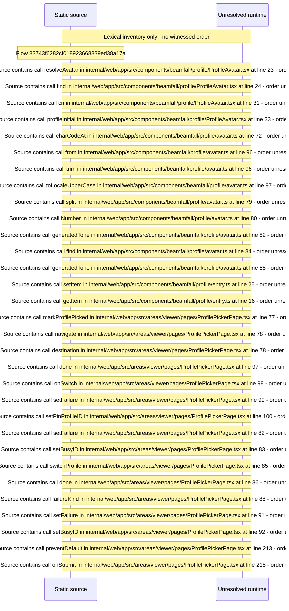

# Viewer who&\#39;s\-watching Profile picker with PIN prompt — flow-diagram

Source revision: 5ffe7939da2318f5153b1a20d0ef6ef94deef162. Trust: generated. Freshness: pinned source; run docs flows check for a later revision.

<!-- flowdocs:paragraph:8dbf2b040d7e71d2cd950e4eb4ed6fe8 -->
Static source inventory only; sequence and runtime ordering are unresolved\.

Source: internal/web/app/src/components/beamfall/profile/ProfileAvatar\.tsx:12; symbol: ProfileAvatar; span SHA256: 4d97af950c27a62df588bc3e465891483c94b5e26de48989d283f9d642a20f03.

