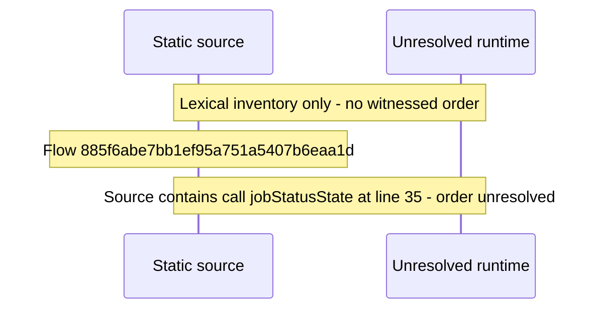

# Console operations and updates: resource governor, job queue and job log — flow-diagram

Source revision: e417fb394873a04fbd27fb8d5bcbca5484c8747f. Trust: generated. Freshness: pinned source; run docs flows check for a later revision.

<!-- flowdocs:paragraph:f1ce1ed6efb84e59e8c457a01cb5ac19 -->
Static source inventory only; sequence and runtime ordering are unresolved\.

Source: internal/web/app/src/areas/console/sections/OperationsControls\.tsx:34; symbol: statusTone; span SHA256: 268e63d4691ce29825a25335520600508f4aa86cfdba29bae473d22f05a7e07c.

