# Console operations and updates: resource governor, job queue and job log — flow-diagram

Source revision: d658ad5b71dcb67da0ae540d6d5ff80ca8efefd5. Trust: generated. Freshness: pinned source; run docs flows check for a later revision.

<!-- flowdocs:paragraph:f1ce1ed6efb84e59e8c457a01cb5ac19 -->
Static source inventory only; sequence and runtime ordering are unresolved\.

Source: internal/web/app/src/areas/console/sections/OperationsControls\.tsx:150; symbol: GovernorSettings; span SHA256: abc1dc8faca9781de3fb18b37fb9703e88f622dd772866977a585ed5dcf4a906.

```mermaid
sequenceDiagram
    participant S as Static source
    participant U as Unresolved runtime
    Note over S,U: Lexical inventory only - no witnessed order
    Note over S: Flow 885f6abe7bb1ef95a751a5407b6eaa1d
    Note over S,U: Source contains call useT at line 151 - order unresolved
    Note over S,U: Source contains call useAsync at line 152 - order unresolved
    Note over S,U: Source contains call useState at line 153 - order unresolved
    Note over S,U: Source contains call useState at line 154 - order unresolved
    Note over S,U: Source contains call useState at line 155 - order unresolved
    Note over S,U: Source contains call useState at line 156 - order unresolved
    Note over S,U: Source contains call useEffect at line 158 - order unresolved
    Note over S,U: Source contains call setWorkers at line 160 - order unresolved
    Note over S,U: Source contains call max at line 160 - order unresolved
    Note over S,U: Source contains call setRetentionDays at line 161 - order unresolved
    Note over S,U: Source contains call max at line 161 - order unresolved
    Note over S,U: Source contains call useT at line 86 - order unresolved
    Note over S,U: Source contains call useAsync at line 87 - order unresolved
    Note over S,U: Source contains call useEffect at line 89 - order unresolved
    Note over S,U: Source contains call subscribeEvents at line 89 - order unresolved
    Note over S,U: Source contains call refresh at line 89 - order unresolved
    Note over S,U: Source contains call refresh at line 96 - order unresolved
    Note over S,U: Source contains call t at line 98 - order unresolved
    Note over S,U: Source contains call t at line 110 - order unresolved
    Note over S,U: Source contains call t at line 116 - order unresolved
    Note over S,U: Source contains call t at line 132 - order unresolved
    Note over S,U: Source contains call t at line 135 - order unresolved
    Note over S,U: Source contains call t at line 137 - order unresolved
    Note over S,U: Source contains call useT at line 290 - order unresolved
    Note over S,U: Source contains call useAsync at line 291 - order unresolved
    Note over S,U: Source contains call fetchJobEvents at line 291 - order unresolved
    Note over S,U: Source contains call map at line 300 - order unresolved
    Note over S,U: Source contains call redactJobLogPayload at line 305 - order unresolved
    Note over S,U: Source contains call t at line 305 - order unresolved
    Note over S,U: Source contains call useT at line 318 - order unresolved
    Note over S,U: Source contains call useAsync at line 319 - order unresolved
    Note over S,U: Source contains call useState at line 322 - order unresolved
    Note over S,U: Source contains call useEffect at line 324 - order unresolved
    Note over S,U: Source contains call subscribeEvents at line 326 - order unresolved
    Note over S,U: Source contains call refresh at line 327 - order unresolved
    Note over S,U: Source contains call setLogRefresh at line 328 - order unresolved
    Note over S,U: Source contains call useT at line 65 - order unresolved
    Note over S,U: Source contains call t at line 68 - order unresolved
    Note over S,U: Source contains call t at line 72 - order unresolved
    Note over S,U: Source contains call reduce at line 50 - order unresolved
    Note over S,U: Source contains call replace at line 51 - order unresolved
    Note over S,U: Source contains call jobStatusState at line 35 - order unresolved
```

