# Console operations: resource governor, job queue and job log — flow-diagram

Source revision: 6742c2361d684c662e9ccb84d344a2200c377582. Trust: generated. Freshness: pinned source; run docs flows check for a later revision.

<!-- flowdocs:paragraph:f1ce1ed6efb84e59e8c457a01cb5ac19 -->
Static source inventory only; sequence and runtime ordering are unresolved\.

Source: internal/web/app/src/areas/console/sections/OperationsControls\.tsx:148; symbol: GovernorSettings; span SHA256: abc1dc8faca9781de3fb18b37fb9703e88f622dd772866977a585ed5dcf4a906.

```mermaid
sequenceDiagram
    participant S as Static source
    participant U as Unresolved runtime
    Note over S,U: Lexical inventory only - no witnessed order
    Note over S: Flow 885f6abe7bb1ef95a751a5407b6eaa1d
    Note over S,U: Source contains call useT at line 149 - order unresolved
    Note over S,U: Source contains call useAsync at line 150 - order unresolved
    Note over S,U: Source contains call useState at line 151 - order unresolved
    Note over S,U: Source contains call useState at line 152 - order unresolved
    Note over S,U: Source contains call useState at line 153 - order unresolved
    Note over S,U: Source contains call useState at line 154 - order unresolved
    Note over S,U: Source contains call useEffect at line 156 - order unresolved
    Note over S,U: Source contains call setWorkers at line 158 - order unresolved
    Note over S,U: Source contains call max at line 158 - order unresolved
    Note over S,U: Source contains call setRetentionDays at line 159 - order unresolved
    Note over S,U: Source contains call max at line 159 - order unresolved
    Note over S,U: Source contains call useT at line 85 - order unresolved
    Note over S,U: Source contains call useAsync at line 86 - order unresolved
    Note over S,U: Source contains call useEffect at line 88 - order unresolved
    Note over S,U: Source contains call subscribeEvents at line 88 - order unresolved
    Note over S,U: Source contains call refresh at line 88 - order unresolved
    Note over S,U: Source contains call refresh at line 94 - order unresolved
    Note over S,U: Source contains call t at line 96 - order unresolved
    Note over S,U: Source contains call t at line 108 - order unresolved
    Note over S,U: Source contains call t at line 114 - order unresolved
    Note over S,U: Source contains call t at line 130 - order unresolved
    Note over S,U: Source contains call t at line 133 - order unresolved
    Note over S,U: Source contains call t at line 135 - order unresolved
    Note over S,U: Source contains call useT at line 298 - order unresolved
    Note over S,U: Source contains call useAsync at line 299 - order unresolved
    Note over S,U: Source contains call fetchJobEvents at line 299 - order unresolved
    Note over S,U: Source contains call map at line 308 - order unresolved
    Note over S,U: Source contains call redactJobLogPayload at line 313 - order unresolved
    Note over S,U: Source contains call t at line 313 - order unresolved
    Note over S,U: Source contains call useT at line 326 - order unresolved
    Note over S,U: Source contains call useAsync at line 327 - order unresolved
    Note over S,U: Source contains call useState at line 330 - order unresolved
    Note over S,U: Source contains call useEffect at line 332 - order unresolved
    Note over S,U: Source contains call subscribeEvents at line 334 - order unresolved
    Note over S,U: Source contains call refresh at line 335 - order unresolved
    Note over S,U: Source contains call setLogRefresh at line 336 - order unresolved
    Note over S,U: Source contains call useT at line 66 - order unresolved
    Note over S,U: Source contains call t at line 69 - order unresolved
    Note over S,U: Source contains call t at line 72 - order unresolved
    Note over S,U: Source contains call reduce at line 51 - order unresolved
    Note over S,U: Source contains call replace at line 52 - order unresolved
    Note over S,U: Source contains call jobStatusState at line 36 - order unresolved
```

