# Viewer full library browse: sort, filters, grouping, virtual grid — flow-diagram

Source revision: 684328a3dab29cbba9cf1058ce382b864f4b6b2d. Trust: generated. Freshness: pinned source; run docs flows check for a later revision.

<!-- flowdocs:paragraph:5b0d2ac12fe121fe626124cacee60bca -->
Static source inventory only; sequence and runtime ordering are unresolved\.

Source: internal/web/app/src/areas/viewer/components/useVirtualGrid\.ts:18; symbol: VIRTUAL\_GRID\_COLUMN\_MIN; span SHA256: 87590b98abc150d2bb68da279e1fa3abe4e7ee1db2f02213a61255815d87e645.

```mermaid
sequenceDiagram
    participant S as Static source
    participant U as Unresolved runtime
    Note over S,U: Lexical inventory only - no witnessed order
    Note over S: Flow 89e5f11cc94f6f133a5558cd0f4edf61
    Note over S,U: Source contains call getComputedStyle in internal/web/app/src/areas/viewer/components/useVirtualGrid.ts at line 38 - order unresolved
    Note over S,U: Source contains call split in internal/web/app/src/areas/viewer/components/useVirtualGrid.ts at line 41 - order unresolved
    Note over S,U: Source contains call filter in internal/web/app/src/areas/viewer/components/useVirtualGrid.ts at line 41 - order unresolved
    Note over S,U: Source contains call max in internal/web/app/src/areas/viewer/components/useVirtualGrid.ts at line 45 - order unresolved
    Note over S,U: Source contains call floor in internal/web/app/src/areas/viewer/components/useVirtualGrid.ts at line 45 - order unresolved
    Note over S,U: Source contains call getComputedStyle in internal/web/app/src/areas/viewer/components/useVirtualGrid.ts at line 30 - order unresolved
    Note over S,U: Source contains call parseFloat in internal/web/app/src/areas/viewer/components/useVirtualGrid.ts at line 31 - order unresolved
    Note over S,U: Source contains call isFinite in internal/web/app/src/areas/viewer/components/useVirtualGrid.ts at line 32 - order unresolved
    Note over S,U: Source contains call useRef in internal/web/app/src/areas/viewer/components/useVirtualGrid.ts at line 118 - order unresolved
    Note over S,U: Source contains call useRef in internal/web/app/src/areas/viewer/components/useVirtualGrid.ts at line 122 - order unresolved
    Note over S,U: Source contains call URLSearchParams in internal/web/app/src/areas/viewer/lib/libraryBrowse.ts at line 85 - order unresolved
    Note over S,U: Source contains call set in internal/web/app/src/areas/viewer/lib/libraryBrowse.ts at line 86 - order unresolved
    Note over S,U: Source contains call set in internal/web/app/src/areas/viewer/lib/libraryBrowse.ts at line 87 - order unresolved
    Note over S,U: Source contains call set in internal/web/app/src/areas/viewer/lib/libraryBrowse.ts at line 88 - order unresolved
    Note over S,U: Source contains call keys in internal/web/app/src/areas/viewer/lib/libraryBrowse.ts at line 89 - order unresolved
    Note over S,U: Source contains call sort in internal/web/app/src/areas/viewer/lib/libraryBrowse.ts at line 89 - order unresolved
    Note over S,U: Source contains call set in internal/web/app/src/areas/viewer/lib/libraryBrowse.ts at line 90 - order unresolved
    Note over S,U: Source contains call set in internal/web/app/src/areas/viewer/lib/libraryBrowse.ts at line 92 - order unresolved
    Note over S,U: Source contains call String in internal/web/app/src/areas/viewer/lib/libraryBrowse.ts at line 92 - order unresolved
    Note over S,U: Source contains call set in internal/web/app/src/areas/viewer/lib/libraryBrowse.ts at line 93 - order unresolved
    Note over S,U: Source contains call set in internal/web/app/src/areas/viewer/lib/libraryBrowse.ts at line 94 - order unresolved
    Note over S,U: Source contains call String in internal/web/app/src/areas/viewer/lib/libraryBrowse.ts at line 94 - order unresolved
    Note over S,U: Source contains call keys in internal/web/app/src/areas/viewer/lib/libraryBrowse.ts at line 156 - order unresolved
    Note over S,U: Source contains call includes in internal/web/app/src/areas/viewer/lib/libraryBrowse.ts at line 59 - order unresolved
    Note over S,U: Source contains call parseInt in internal/web/app/src/areas/viewer/lib/libraryBrowse.ts at line 64 - order unresolved
    Note over S,U: Source contains call get in internal/web/app/src/areas/viewer/lib/libraryBrowse.ts at line 64 - order unresolved
    Note over S,U: Source contains call startsWith in internal/web/app/src/areas/viewer/lib/libraryBrowse.ts at line 67 - order unresolved
    Note over S,U: Source contains call slice in internal/web/app/src/areas/viewer/lib/libraryBrowse.ts at line 67 - order unresolved
    Note over S,U: Source contains call trim in internal/web/app/src/areas/viewer/lib/libraryBrowse.ts at line 67 - order unresolved
    Note over S,U: Source contains call trim in internal/web/app/src/areas/viewer/lib/libraryBrowse.ts at line 68 - order unresolved
    Note over S,U: Source contains call parseInt in internal/web/app/src/areas/viewer/lib/libraryBrowse.ts at line 71 - order unresolved
    Note over S,U: Source contains call get in internal/web/app/src/areas/viewer/lib/libraryBrowse.ts at line 71 - order unresolved
    Note over S,U: Source contains call oneOf in internal/web/app/src/areas/viewer/lib/libraryBrowse.ts at line 73 - order unresolved
    Note over S,U: Source contains call get in internal/web/app/src/areas/viewer/lib/libraryBrowse.ts at line 73 - order unresolved
    Note over S,U: Source contains call get in internal/web/app/src/areas/viewer/lib/libraryBrowse.ts at line 74 - order unresolved
    Note over S,U: Source contains call oneOf in internal/web/app/src/areas/viewer/lib/libraryBrowse.ts at line 75 - order unresolved
    Note over S,U: Source contains call get in internal/web/app/src/areas/viewer/lib/libraryBrowse.ts at line 75 - order unresolved
    Note over S,U: Source contains call isFinite in internal/web/app/src/areas/viewer/lib/libraryBrowse.ts at line 77 - order unresolved
    Note over S,U: Source contains call floor in internal/web/app/src/areas/viewer/lib/libraryBrowse.ts at line 77 - order unresolved
    Note over S,U: Source contains call oneOf in internal/web/app/src/areas/viewer/lib/libraryBrowse.ts at line 78 - order unresolved
    Note over S,U: Source contains call get in internal/web/app/src/areas/viewer/lib/libraryBrowse.ts at line 78 - order unresolved
    Note over S,U: Source contains call includes in internal/web/app/src/areas/viewer/lib/libraryBrowse.ts at line 79 - order unresolved
    Note over S,U: Source contains call getItem in internal/web/app/src/areas/viewer/lib/libraryBrowse.ts at line 188 - order unresolved
    Note over S,U: Source contains call setItem in internal/web/app/src/areas/viewer/lib/libraryBrowse.ts at line 196 - order unresolved
    Note over S,U: Source contains call map in internal/web/app/src/areas/viewer/pages/LibraryBrowsePage.tsx at line 708 - order unresolved
    Note over S,U: Source contains call useT in internal/web/app/src/areas/viewer/pages/LibraryBrowsePage.tsx at line 122 - order unresolved
    Note over S,U: Source contains call useDisplayLocale in internal/web/app/src/areas/viewer/pages/LibraryBrowsePage.tsx at line 123 - order unresolved
    Note over S,U: Source contains call useNavigate in internal/web/app/src/areas/viewer/pages/LibraryBrowsePage.tsx at line 124 - order unresolved
    Note over S,U: Source contains call useSearchParams in internal/web/app/src/areas/viewer/pages/LibraryBrowsePage.tsx at line 125 - order unresolved
    Note over S,U: Source contains call useT in internal/web/app/src/areas/viewer/pages/LibraryBrowsePage.tsx at line 86 - order unresolved
    Note over S,U: Source contains call useParams in internal/web/app/src/areas/viewer/pages/LibraryBrowsePage.tsx at line 87 - order unresolved
    Note over S,U: Source contains call useSession in internal/web/app/src/areas/viewer/pages/LibraryBrowsePage.tsx at line 88 - order unresolved
    Note over S,U: Source contains call t in internal/web/app/src/areas/viewer/pages/LibraryBrowsePage.tsx at line 93 - order unresolved
    Note over S,U: Source contains call find in internal/web/app/src/areas/viewer/pages/LibraryBrowsePage.tsx at line 97 - order unresolved
    Note over S,U: Source contains call randomUUID in internal/web/app/src/areas/viewer/pages/LibraryBrowsePage.tsx at line 752 - order unresolved
    Note over S,U: Source contains call String in internal/web/app/src/areas/viewer/pages/LibraryBrowsePage.tsx at line 754 - order unresolved
    Note over S,U: Source contains call now in internal/web/app/src/areas/viewer/pages/LibraryBrowsePage.tsx at line 754 - order unresolved
    Note over S,U: Source contains call includes in internal/web/app/src/areas/viewer/pages/LibraryBrowsePage.tsx at line 746 - order unresolved
    Note over S,U: Source contains call useCallback in internal/web/app/src/areas/viewer/components/useVirtualGrid.ts at line 123 - order unresolved
    Note over S,U: Source contains call readGap in internal/web/app/src/areas/viewer/components/useVirtualGrid.ts at line 131 - order unresolved
    Note over S,U: Source contains call readColumns in internal/web/app/src/areas/viewer/components/useVirtualGrid.ts at line 132 - order unresolved
    Note over S,U: Source contains call max in internal/web/app/src/areas/viewer/components/useVirtualGrid.ts at line 133 - order unresolved
    Note over S,U: Source contains call readCardHeight in internal/web/app/src/areas/viewer/components/useVirtualGrid.ts at line 133 - order unresolved
    Note over S,U: Source contains call set in internal/web/app/src/areas/viewer/components/useVirtualGrid.ts at line 134 - order unresolved
    Note over S,U: Source contains call ceil in internal/web/app/src/areas/viewer/components/useVirtualGrid.ts at line 136 - order unresolved
    Note over S,U: Source contains call getBoundingClientRect in internal/web/app/src/areas/viewer/components/useVirtualGrid.ts at line 138 - order unresolved
    Note over S,U: Source contains call max in internal/web/app/src/areas/viewer/components/useVirtualGrid.ts at line 141 - order unresolved
    Note over S,U: Source contains call ceil in internal/web/app/src/areas/viewer/components/useVirtualGrid.ts at line 143 - order unresolved
    Note over S,U: Source contains call min in internal/web/app/src/areas/viewer/components/useVirtualGrid.ts at line 147 - order unresolved
    Note over S,U: Source contains call max in internal/web/app/src/areas/viewer/components/useVirtualGrid.ts at line 148 - order unresolved
    Note over S,U: Source contains call max in internal/web/app/src/areas/viewer/components/useVirtualGrid.ts at line 149 - order unresolved
    Note over S,U: Source contains call floor in internal/web/app/src/areas/viewer/components/useVirtualGrid.ts at line 149 - order unresolved
    Note over S,U: Source contains call min in internal/web/app/src/areas/viewer/components/useVirtualGrid.ts at line 152 - order unresolved
    Note over S,U: Source contains call min in internal/web/app/src/areas/viewer/components/useVirtualGrid.ts at line 153 - order unresolved
    Note over S,U: Source contains call ceil in internal/web/app/src/areas/viewer/components/useVirtualGrid.ts at line 154 - order unresolved
    Note over S,U: Source contains call max in internal/web/app/src/areas/viewer/components/useVirtualGrid.ts at line 160 - order unresolved
    Note over S,U: Source contains call requestAnimationFrame in internal/web/app/src/areas/viewer/components/useVirtualGrid.ts at line 176 - order unresolved
    Note over S,U: Source contains call setWindowState in internal/web/app/src/areas/viewer/components/useVirtualGrid.ts at line 178 - order unresolved
    Note over S,U: Source contains call compute in internal/web/app/src/areas/viewer/components/useVirtualGrid.ts at line 178 - order unresolved
    Note over S,U: Source contains call setViewMode in internal/web/app/src/areas/viewer/pages/LibraryBrowsePage.tsx at line 329 - order unresolved
    Note over S,U: Source contains call writeLibraryViewMode in internal/web/app/src/areas/viewer/pages/LibraryBrowsePage.tsx at line 330 - order unresolved
    Note over S,U: Source contains call t in internal/web/app/src/areas/viewer/pages/LibraryBrowsePage.tsx at line 360 - order unresolved
    Note over S,U: Source contains call String in internal/web/app/src/areas/viewer/pages/LibraryBrowsePage.tsx at line 360 - order unresolved
    Note over S,U: Source contains call setStarting in internal/web/app/src/areas/viewer/pages/LibraryBrowsePage.tsx at line 343 - order unresolved
    Note over S,U: Source contains call startPlayQueue in internal/web/app/src/areas/viewer/pages/LibraryBrowsePage.tsx at line 345 - order unresolved
    Note over S,U: Source contains call newSeed in internal/web/app/src/areas/viewer/pages/LibraryBrowsePage.tsx at line 346 - order unresolved
    Note over S,U: Source contains call navigate in internal/web/app/src/areas/viewer/pages/LibraryBrowsePage.tsx at line 351 - order unresolved
    Note over S,U: Source contains call setFailed in internal/web/app/src/areas/viewer/pages/LibraryBrowsePage.tsx at line 354 - order unresolved
    Note over S,U: Source contains call setStarting in internal/web/app/src/areas/viewer/pages/LibraryBrowsePage.tsx at line 356 - order unresolved
    Note over S,U: Source contains call get in internal/web/app/src/areas/viewer/pages/LibraryBrowsePage.tsx at line 417 - order unresolved
    Note over S,U: Source contains call has in internal/web/app/src/areas/viewer/pages/LibraryBrowsePage.tsx at line 421 - order unresolved
    Note over S,U: Source contains call has in internal/web/app/src/areas/viewer/pages/LibraryBrowsePage.tsx at line 423 - order unresolved
    Note over S,U: Source contains call push in internal/web/app/src/areas/viewer/pages/LibraryBrowsePage.tsx at line 425 - order unresolved
    Note over S,U: Source contains call get in internal/web/app/src/areas/viewer/pages/LibraryBrowsePage.tsx at line 425 - order unresolved
    Note over S,U: Source contains call playQueueOf in internal/web/app/src/areas/viewer/pages/LibraryBrowsePage.tsx at line 426 - order unresolved
    Note over S,U: Source contains call set in internal/web/app/src/areas/viewer/pages/LibraryBrowsePage.tsx at line 427 - order unresolved
    Note over S,U: Source contains call t in internal/web/app/src/areas/viewer/pages/LibraryBrowsePage.tsx at line 364 - order unresolved
    Note over S,U: Source contains call t in internal/web/app/src/areas/viewer/pages/LibraryBrowsePage.tsx at line 366 - order unresolved
    Note over S,U: Source contains call String in internal/web/app/src/areas/viewer/pages/LibraryBrowsePage.tsx at line 366 - order unresolved
    Note over S,U: Source contains call keys in internal/web/app/src/areas/viewer/pages/LibraryBrowsePage.tsx at line 373 - order unresolved
    Note over S,U: Source contains call filter in internal/web/app/src/areas/viewer/pages/LibraryBrowsePage.tsx at line 374 - order unresolved
    Note over S,U: Source contains call some in internal/web/app/src/areas/viewer/pages/LibraryBrowsePage.tsx at line 374 - order unresolved
    Note over S,U: Source contains call map in internal/web/app/src/areas/viewer/pages/LibraryBrowsePage.tsx at line 375 - order unresolved
    Note over S,U: Source contains call map in internal/web/app/src/areas/viewer/pages/LibraryBrowsePage.tsx at line 376 - order unresolved
    Note over S,U: Source contains call displayString in internal/web/app/src/areas/viewer/pages/LibraryBrowsePage.tsx at line 378 - order unresolved
    Note over S,U: Source contains call withSelected in internal/web/app/src/areas/viewer/pages/LibraryBrowsePage.tsx at line 379 - order unresolved
    Note over S,U: Source contains call useMemo in internal/web/app/src/areas/viewer/pages/LibraryBrowsePage.tsx at line 126 - order unresolved
    Note over S,U: Source contains call parseBrowseState in internal/web/app/src/areas/viewer/pages/LibraryBrowsePage.tsx at line 126 - order unresolved
    Note over S,U: Source contains call setSearchParams in internal/web/app/src/areas/viewer/pages/LibraryBrowsePage.tsx at line 325 - order unresolved
    Note over S,U: Source contains call browseStateParams in internal/web/app/src/areas/viewer/pages/LibraryBrowsePage.tsx at line 325 - order unresolved
```

