# Viewer full library browse: sort, filters, grouping, virtual grid — flow-diagram

Source revision: e417fb394873a04fbd27fb8d5bcbca5484c8747f. Trust: generated. Freshness: pinned source; run docs flows check for a later revision.

<!-- flowdocs:paragraph:5b0d2ac12fe121fe626124cacee60bca -->
Static source inventory only; sequence and runtime ordering are unresolved\.

Source: internal/web/app/src/areas/viewer/components/useVirtualGrid\.ts:37; symbol: readColumns; span SHA256: 0548b29e2ddf2bd9ea8e432834a57f336451cdcc1e314b63181e9337d8fefce0.

```mermaid
sequenceDiagram
    participant S as Static source
    participant U as Unresolved runtime
    Note over S,U: Lexical inventory only - no witnessed order
    Note over S: Flow 89e5f11cc94f6f133a5558cd0f4edf61
    Note over S,U: Source contains call getComputedStyle in internal/web/app/src/areas/viewer/components/useVirtualGrid.ts at line 38 - order unresolved
    Note over S,U: Source contains call split in internal/web/app/src/areas/viewer/components/useVirtualGrid.ts at line 41 - order unresolved
    Note over S,U: Source contains call filter in internal/web/app/src/areas/viewer/components/useVirtualGrid.ts at line 41 - order unresolved
    Note over S,U: Source contains call max in internal/web/app/src/areas/viewer/components/useVirtualGrid.ts at line 45 - order unresolved
    Note over S,U: Source contains call floor in internal/web/app/src/areas/viewer/components/useVirtualGrid.ts at line 45 - order unresolved
    Note over S,U: Source contains call getComputedStyle in internal/web/app/src/areas/viewer/components/useVirtualGrid.ts at line 30 - order unresolved
    Note over S,U: Source contains call parseFloat in internal/web/app/src/areas/viewer/components/useVirtualGrid.ts at line 31 - order unresolved
    Note over S,U: Source contains call isFinite in internal/web/app/src/areas/viewer/components/useVirtualGrid.ts at line 32 - order unresolved
    Note over S,U: Source contains call getBoundingClientRect in internal/web/app/src/areas/viewer/components/useVirtualGrid.ts at line 52 - order unresolved
    Note over S,U: Source contains call URLSearchParams in internal/web/app/src/areas/viewer/lib/libraryBrowse.ts at line 85 - order unresolved
    Note over S,U: Source contains call set in internal/web/app/src/areas/viewer/lib/libraryBrowse.ts at line 86 - order unresolved
    Note over S,U: Source contains call set in internal/web/app/src/areas/viewer/lib/libraryBrowse.ts at line 87 - order unresolved
    Note over S,U: Source contains call set in internal/web/app/src/areas/viewer/lib/libraryBrowse.ts at line 88 - order unresolved
    Note over S,U: Source contains call keys in internal/web/app/src/areas/viewer/lib/libraryBrowse.ts at line 89 - order unresolved
    Note over S,U: Source contains call sort in internal/web/app/src/areas/viewer/lib/libraryBrowse.ts at line 89 - order unresolved
    Note over S,U: Source contains call set in internal/web/app/src/areas/viewer/lib/libraryBrowse.ts at line 90 - order unresolved
    Note over S,U: Source contains call set in internal/web/app/src/areas/viewer/lib/libraryBrowse.ts at line 92 - order unresolved
    Note over S,U: Source contains call String in internal/web/app/src/areas/viewer/lib/libraryBrowse.ts at line 92 - order unresolved
    Note over S,U: Source contains call set in internal/web/app/src/areas/viewer/lib/libraryBrowse.ts at line 93 - order unresolved
    Note over S,U: Source contains call set in internal/web/app/src/areas/viewer/lib/libraryBrowse.ts at line 94 - order unresolved
    Note over S,U: Source contains call String in internal/web/app/src/areas/viewer/lib/libraryBrowse.ts at line 94 - order unresolved
    Note over S,U: Source contains call keys in internal/web/app/src/areas/viewer/lib/libraryBrowse.ts at line 147 - order unresolved
    Note over S,U: Source contains call includes in internal/web/app/src/areas/viewer/lib/libraryBrowse.ts at line 59 - order unresolved
    Note over S,U: Source contains call parseInt in internal/web/app/src/areas/viewer/lib/libraryBrowse.ts at line 64 - order unresolved
    Note over S,U: Source contains call get in internal/web/app/src/areas/viewer/lib/libraryBrowse.ts at line 64 - order unresolved
    Note over S,U: Source contains call startsWith in internal/web/app/src/areas/viewer/lib/libraryBrowse.ts at line 67 - order unresolved
    Note over S,U: Source contains call slice in internal/web/app/src/areas/viewer/lib/libraryBrowse.ts at line 67 - order unresolved
    Note over S,U: Source contains call trim in internal/web/app/src/areas/viewer/lib/libraryBrowse.ts at line 67 - order unresolved
    Note over S,U: Source contains call trim in internal/web/app/src/areas/viewer/lib/libraryBrowse.ts at line 68 - order unresolved
    Note over S,U: Source contains call parseInt in internal/web/app/src/areas/viewer/lib/libraryBrowse.ts at line 71 - order unresolved
    Note over S,U: Source contains call get in internal/web/app/src/areas/viewer/lib/libraryBrowse.ts at line 71 - order unresolved
    Note over S,U: Source contains call oneOf in internal/web/app/src/areas/viewer/lib/libraryBrowse.ts at line 73 - order unresolved
    Note over S,U: Source contains call get in internal/web/app/src/areas/viewer/lib/libraryBrowse.ts at line 73 - order unresolved
    Note over S,U: Source contains call get in internal/web/app/src/areas/viewer/lib/libraryBrowse.ts at line 74 - order unresolved
    Note over S,U: Source contains call oneOf in internal/web/app/src/areas/viewer/lib/libraryBrowse.ts at line 75 - order unresolved
    Note over S,U: Source contains call get in internal/web/app/src/areas/viewer/lib/libraryBrowse.ts at line 75 - order unresolved
    Note over S,U: Source contains call isFinite in internal/web/app/src/areas/viewer/lib/libraryBrowse.ts at line 77 - order unresolved
    Note over S,U: Source contains call floor in internal/web/app/src/areas/viewer/lib/libraryBrowse.ts at line 77 - order unresolved
    Note over S,U: Source contains call oneOf in internal/web/app/src/areas/viewer/lib/libraryBrowse.ts at line 78 - order unresolved
    Note over S,U: Source contains call get in internal/web/app/src/areas/viewer/lib/libraryBrowse.ts at line 78 - order unresolved
    Note over S,U: Source contains call includes in internal/web/app/src/areas/viewer/lib/libraryBrowse.ts at line 79 - order unresolved
    Note over S,U: Source contains call getItem in internal/web/app/src/areas/viewer/lib/libraryBrowse.ts at line 178 - order unresolved
    Note over S,U: Source contains call setItem in internal/web/app/src/areas/viewer/lib/libraryBrowse.ts at line 186 - order unresolved
    Note over S,U: Source contains call map in internal/web/app/src/areas/viewer/pages/LibraryBrowsePage.tsx at line 595 - order unresolved
    Note over S,U: Source contains call useT in internal/web/app/src/areas/viewer/pages/LibraryBrowsePage.tsx at line 110 - order unresolved
    Note over S,U: Source contains call useDisplayLocale in internal/web/app/src/areas/viewer/pages/LibraryBrowsePage.tsx at line 111 - order unresolved
    Note over S,U: Source contains call useNavigate in internal/web/app/src/areas/viewer/pages/LibraryBrowsePage.tsx at line 112 - order unresolved
    Note over S,U: Source contains call useSearchParams in internal/web/app/src/areas/viewer/pages/LibraryBrowsePage.tsx at line 113 - order unresolved
    Note over S,U: Source contains call useT in internal/web/app/src/areas/viewer/pages/LibraryBrowsePage.tsx at line 74 - order unresolved
    Note over S,U: Source contains call useParams in internal/web/app/src/areas/viewer/pages/LibraryBrowsePage.tsx at line 75 - order unresolved
    Note over S,U: Source contains call useSession in internal/web/app/src/areas/viewer/pages/LibraryBrowsePage.tsx at line 76 - order unresolved
    Note over S,U: Source contains call t in internal/web/app/src/areas/viewer/pages/LibraryBrowsePage.tsx at line 81 - order unresolved
    Note over S,U: Source contains call find in internal/web/app/src/areas/viewer/pages/LibraryBrowsePage.tsx at line 85 - order unresolved
    Note over S,U: Source contains call randomUUID in internal/web/app/src/areas/viewer/pages/LibraryBrowsePage.tsx at line 639 - order unresolved
    Note over S,U: Source contains call String in internal/web/app/src/areas/viewer/pages/LibraryBrowsePage.tsx at line 641 - order unresolved
    Note over S,U: Source contains call now in internal/web/app/src/areas/viewer/pages/LibraryBrowsePage.tsx at line 641 - order unresolved
    Note over S,U: Source contains call includes in internal/web/app/src/areas/viewer/pages/LibraryBrowsePage.tsx at line 633 - order unresolved
    Note over S,U: Source contains call useCallback in internal/web/app/src/areas/viewer/components/useVirtualGrid.ts at line 72 - order unresolved
    Note over S,U: Source contains call readGap in internal/web/app/src/areas/viewer/components/useVirtualGrid.ts at line 76 - order unresolved
    Note over S,U: Source contains call readColumns in internal/web/app/src/areas/viewer/components/useVirtualGrid.ts at line 77 - order unresolved
    Note over S,U: Source contains call readRowHeight in internal/web/app/src/areas/viewer/components/useVirtualGrid.ts at line 78 - order unresolved
    Note over S,U: Source contains call ceil in internal/web/app/src/areas/viewer/components/useVirtualGrid.ts at line 79 - order unresolved
    Note over S,U: Source contains call getBoundingClientRect in internal/web/app/src/areas/viewer/components/useVirtualGrid.ts at line 81 - order unresolved
    Note over S,U: Source contains call max in internal/web/app/src/areas/viewer/components/useVirtualGrid.ts at line 84 - order unresolved
    Note over S,U: Source contains call ceil in internal/web/app/src/areas/viewer/components/useVirtualGrid.ts at line 86 - order unresolved
    Note over S,U: Source contains call min in internal/web/app/src/areas/viewer/components/useVirtualGrid.ts at line 90 - order unresolved
    Note over S,U: Source contains call max in internal/web/app/src/areas/viewer/components/useVirtualGrid.ts at line 91 - order unresolved
    Note over S,U: Source contains call max in internal/web/app/src/areas/viewer/components/useVirtualGrid.ts at line 92 - order unresolved
    Note over S,U: Source contains call floor in internal/web/app/src/areas/viewer/components/useVirtualGrid.ts at line 92 - order unresolved
    Note over S,U: Source contains call min in internal/web/app/src/areas/viewer/components/useVirtualGrid.ts at line 95 - order unresolved
    Note over S,U: Source contains call min in internal/web/app/src/areas/viewer/components/useVirtualGrid.ts at line 96 - order unresolved
    Note over S,U: Source contains call ceil in internal/web/app/src/areas/viewer/components/useVirtualGrid.ts at line 97 - order unresolved
    Note over S,U: Source contains call max in internal/web/app/src/areas/viewer/components/useVirtualGrid.ts at line 103 - order unresolved
    Note over S,U: Source contains call requestAnimationFrame in internal/web/app/src/areas/viewer/components/useVirtualGrid.ts at line 117 - order unresolved
    Note over S,U: Source contains call setWindowState in internal/web/app/src/areas/viewer/components/useVirtualGrid.ts at line 119 - order unresolved
    Note over S,U: Source contains call compute in internal/web/app/src/areas/viewer/components/useVirtualGrid.ts at line 119 - order unresolved
    Note over S,U: Source contains call setViewMode in internal/web/app/src/areas/viewer/pages/LibraryBrowsePage.tsx at line 241 - order unresolved
    Note over S,U: Source contains call writeLibraryViewMode in internal/web/app/src/areas/viewer/pages/LibraryBrowsePage.tsx at line 242 - order unresolved
    Note over S,U: Source contains call t in internal/web/app/src/areas/viewer/pages/LibraryBrowsePage.tsx at line 272 - order unresolved
    Note over S,U: Source contains call String in internal/web/app/src/areas/viewer/pages/LibraryBrowsePage.tsx at line 272 - order unresolved
    Note over S,U: Source contains call setStarting in internal/web/app/src/areas/viewer/pages/LibraryBrowsePage.tsx at line 255 - order unresolved
    Note over S,U: Source contains call startPlayQueue in internal/web/app/src/areas/viewer/pages/LibraryBrowsePage.tsx at line 257 - order unresolved
    Note over S,U: Source contains call newSeed in internal/web/app/src/areas/viewer/pages/LibraryBrowsePage.tsx at line 258 - order unresolved
    Note over S,U: Source contains call navigate in internal/web/app/src/areas/viewer/pages/LibraryBrowsePage.tsx at line 263 - order unresolved
    Note over S,U: Source contains call setFailed in internal/web/app/src/areas/viewer/pages/LibraryBrowsePage.tsx at line 266 - order unresolved
    Note over S,U: Source contains call setStarting in internal/web/app/src/areas/viewer/pages/LibraryBrowsePage.tsx at line 268 - order unresolved
    Note over S,U: Source contains call get in internal/web/app/src/areas/viewer/pages/LibraryBrowsePage.tsx at line 329 - order unresolved
    Note over S,U: Source contains call has in internal/web/app/src/areas/viewer/pages/LibraryBrowsePage.tsx at line 333 - order unresolved
    Note over S,U: Source contains call has in internal/web/app/src/areas/viewer/pages/LibraryBrowsePage.tsx at line 335 - order unresolved
    Note over S,U: Source contains call push in internal/web/app/src/areas/viewer/pages/LibraryBrowsePage.tsx at line 337 - order unresolved
    Note over S,U: Source contains call get in internal/web/app/src/areas/viewer/pages/LibraryBrowsePage.tsx at line 337 - order unresolved
    Note over S,U: Source contains call playQueueOf in internal/web/app/src/areas/viewer/pages/LibraryBrowsePage.tsx at line 338 - order unresolved
    Note over S,U: Source contains call set in internal/web/app/src/areas/viewer/pages/LibraryBrowsePage.tsx at line 339 - order unresolved
    Note over S,U: Source contains call t in internal/web/app/src/areas/viewer/pages/LibraryBrowsePage.tsx at line 276 - order unresolved
    Note over S,U: Source contains call t in internal/web/app/src/areas/viewer/pages/LibraryBrowsePage.tsx at line 278 - order unresolved
    Note over S,U: Source contains call String in internal/web/app/src/areas/viewer/pages/LibraryBrowsePage.tsx at line 278 - order unresolved
    Note over S,U: Source contains call keys in internal/web/app/src/areas/viewer/pages/LibraryBrowsePage.tsx at line 285 - order unresolved
    Note over S,U: Source contains call filter in internal/web/app/src/areas/viewer/pages/LibraryBrowsePage.tsx at line 286 - order unresolved
    Note over S,U: Source contains call some in internal/web/app/src/areas/viewer/pages/LibraryBrowsePage.tsx at line 286 - order unresolved
    Note over S,U: Source contains call map in internal/web/app/src/areas/viewer/pages/LibraryBrowsePage.tsx at line 287 - order unresolved
    Note over S,U: Source contains call map in internal/web/app/src/areas/viewer/pages/LibraryBrowsePage.tsx at line 288 - order unresolved
    Note over S,U: Source contains call displayString in internal/web/app/src/areas/viewer/pages/LibraryBrowsePage.tsx at line 290 - order unresolved
    Note over S,U: Source contains call withSelected in internal/web/app/src/areas/viewer/pages/LibraryBrowsePage.tsx at line 291 - order unresolved
    Note over S,U: Source contains call useMemo in internal/web/app/src/areas/viewer/pages/LibraryBrowsePage.tsx at line 114 - order unresolved
    Note over S,U: Source contains call parseBrowseState in internal/web/app/src/areas/viewer/pages/LibraryBrowsePage.tsx at line 114 - order unresolved
    Note over S,U: Source contains call setSearchParams in internal/web/app/src/areas/viewer/pages/LibraryBrowsePage.tsx at line 237 - order unresolved
    Note over S,U: Source contains call browseStateParams in internal/web/app/src/areas/viewer/pages/LibraryBrowsePage.tsx at line 237 - order unresolved
```

