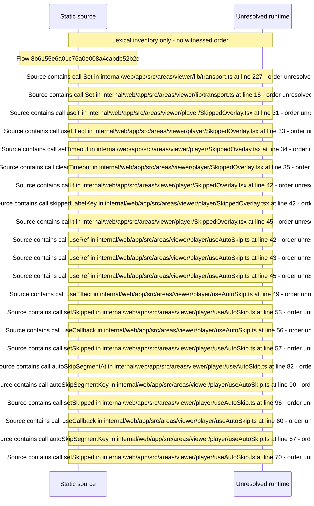

# Player auto\-skip of intro/credits segments with skipped toast — flow-diagram

Source revision: e2ffd915f3bda309ca8792f07724053b048ba15f. Trust: generated. Freshness: pinned source; run docs flows check for a later revision.

<!-- flowdocs:paragraph:efbe5dbe6004fab2e549142092b9223e -->
Static source inventory only; sequence and runtime ordering are unresolved\.

Source: internal/web/app/src/areas/viewer/lib/transport\.ts:227; symbol: AUTO\_SKIP\_SEGMENT\_KINDS; span SHA256: 519db138d4e94f43eaab0dfd646f015da47f1acb9e06f0829aa2b9e0c001d6c9.

