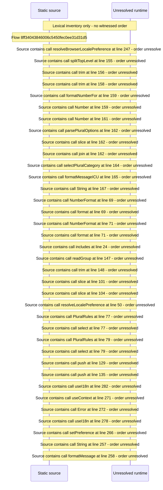

# Localization: locale resolution, ICU formatting and string catalogs — flow-diagram

Source revision: e417fb394873a04fbd27fb8d5bcbca5484c8747f. Trust: generated. Freshness: pinned source; run docs flows check for a later revision.

<!-- flowdocs:paragraph:70687676a287479a4e9d27b342b665f8 -->
Static source inventory only; sequence and runtime ordering are unresolved\.

Source: internal/web/app/src/lib/i18n\.tsx:231; symbol: I18nProvider; span SHA256: bc8286cce6e090a1c7b6445fc9e39dff33a84f01f997f60efdea408ac65ea981.

