# Localization: locale resolution, ICU formatting and string catalogs — flow-diagram

Source revision: 4d9f6ba81afcc8de0179eb7c056488d3e3bd8218. Trust: generated. Freshness: pinned source; run docs flows check for a later revision.

<!-- flowdocs:paragraph:70687676a287479a4e9d27b342b665f8 -->
Static source inventory only; sequence and runtime ordering are unresolved\.

Source: internal/web/app/src/lib/i18n\.tsx:17; symbol: I18nContext; span SHA256: e413313dc92cbee6475688aa909676d74886583ba788af61ad034122f678f598.

```mermaid
sequenceDiagram
    participant S as Static source
    participant U as Unresolved runtime
    Note over S,U: Lexical inventory only - no witnessed order
    Note over S: Flow 8ff34043846006c5450fec0ee31d31d5
    Note over S,U: Source contains call resolveBrowserLocalePreference in internal/web/app/src/lib/i18n.tsx at line 251 - order unresolved
    Note over S,U: Source contains call splitTopLevel in internal/web/app/src/lib/i18n.tsx at line 159 - order unresolved
    Note over S,U: Source contains call trim in internal/web/app/src/lib/i18n.tsx at line 160 - order unresolved
    Note over S,U: Source contains call trim in internal/web/app/src/lib/i18n.tsx at line 162 - order unresolved
    Note over S,U: Source contains call formatNumberFor in internal/web/app/src/lib/i18n.tsx at line 163 - order unresolved
    Note over S,U: Source contains call Number in internal/web/app/src/lib/i18n.tsx at line 163 - order unresolved
    Note over S,U: Source contains call Number in internal/web/app/src/lib/i18n.tsx at line 165 - order unresolved
    Note over S,U: Source contains call parsePluralOptions in internal/web/app/src/lib/i18n.tsx at line 166 - order unresolved
    Note over S,U: Source contains call slice in internal/web/app/src/lib/i18n.tsx at line 166 - order unresolved
    Note over S,U: Source contains call join in internal/web/app/src/lib/i18n.tsx at line 166 - order unresolved
    Note over S,U: Source contains call selectPluralCategory in internal/web/app/src/lib/i18n.tsx at line 168 - order unresolved
    Note over S,U: Source contains call formatMessageICU in internal/web/app/src/lib/i18n.tsx at line 169 - order unresolved
    Note over S,U: Source contains call String in internal/web/app/src/lib/i18n.tsx at line 171 - order unresolved
    Note over S,U: Source contains call NumberFormat in internal/web/app/src/lib/i18n.tsx at line 73 - order unresolved
    Note over S,U: Source contains call format in internal/web/app/src/lib/i18n.tsx at line 73 - order unresolved
    Note over S,U: Source contains call NumberFormat in internal/web/app/src/lib/i18n.tsx at line 75 - order unresolved
    Note over S,U: Source contains call format in internal/web/app/src/lib/i18n.tsx at line 75 - order unresolved
    Note over S,U: Source contains call hasOwn in internal/web/app/src/strings.ts at line 19 - order unresolved
    Note over S,U: Source contains call test in internal/web/app/src/lib/i18n.tsx at line 147 - order unresolved
    Note over S,U: Source contains call readGroup in internal/web/app/src/lib/i18n.tsx at line 151 - order unresolved
    Note over S,U: Source contains call trim in internal/web/app/src/lib/i18n.tsx at line 152 - order unresolved
    Note over S,U: Source contains call slice in internal/web/app/src/lib/i18n.tsx at line 105 - order unresolved
    Note over S,U: Source contains call slice in internal/web/app/src/lib/i18n.tsx at line 108 - order unresolved
    Note over S,U: Source contains call resolveLocalePreference in internal/web/app/src/lib/i18n.tsx at line 54 - order unresolved
    Note over S,U: Source contains call PluralRules in internal/web/app/src/lib/i18n.tsx at line 81 - order unresolved
    Note over S,U: Source contains call select in internal/web/app/src/lib/i18n.tsx at line 81 - order unresolved
    Note over S,U: Source contains call PluralRules in internal/web/app/src/lib/i18n.tsx at line 83 - order unresolved
    Note over S,U: Source contains call select in internal/web/app/src/lib/i18n.tsx at line 83 - order unresolved
    Note over S,U: Source contains call push in internal/web/app/src/lib/i18n.tsx at line 133 - order unresolved
    Note over S,U: Source contains call push in internal/web/app/src/lib/i18n.tsx at line 139 - order unresolved
    Note over S,U: Source contains call useI18n in internal/web/app/src/lib/i18n.tsx at line 286 - order unresolved
    Note over S,U: Source contains call useContext in internal/web/app/src/lib/i18n.tsx at line 275 - order unresolved
    Note over S,U: Source contains call Error in internal/web/app/src/lib/i18n.tsx at line 276 - order unresolved
    Note over S,U: Source contains call useI18n in internal/web/app/src/lib/i18n.tsx at line 282 - order unresolved
    Note over S,U: Source contains call buildStringTables in internal/web/app/src/strings.ts at line 36 - order unresolved
    Note over S,U: Source contains call setPreference in internal/web/app/src/lib/i18n.tsx at line 270 - order unresolved
    Note over S,U: Source contains call String in internal/web/app/src/lib/i18n.tsx at line 261 - order unresolved
    Note over S,U: Source contains call formatMessage in internal/web/app/src/lib/i18n.tsx at line 262 - order unresolved
```

