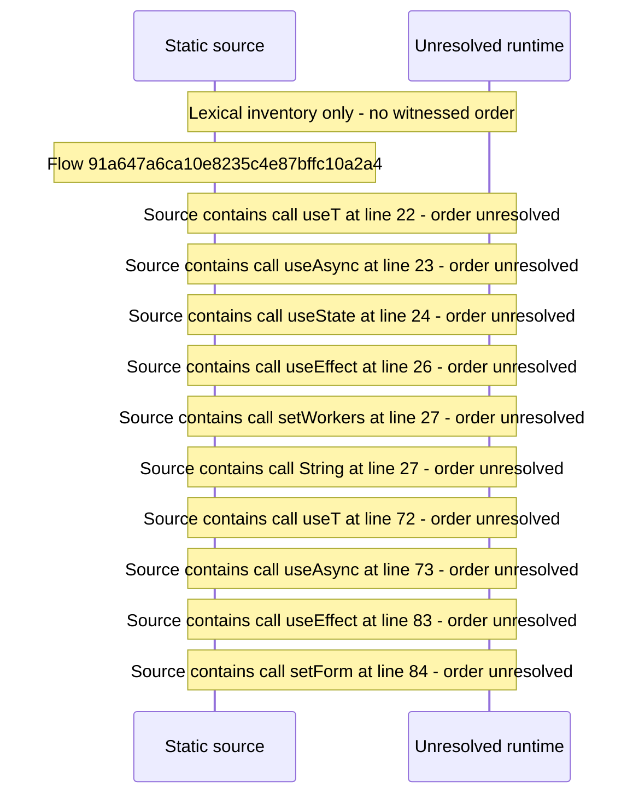

# Console server and transcode configuration — flow-diagram

Source revision: e417fb394873a04fbd27fb8d5bcbca5484c8747f. Trust: generated. Freshness: pinned source; run docs flows check for a later revision.

<!-- flowdocs:paragraph:b89e56ddc682034d64055b3467b90caa -->
Static source inventory only; sequence and runtime ordering are unresolved\.

Source: internal/web/app/src/areas/console/sections/Config\.tsx:171; symbol: Config; span SHA256: cf87b5d0b3c2a8081c41ce54a5f24e8c47b3f6572dfc88925186ee95c34fa071.

