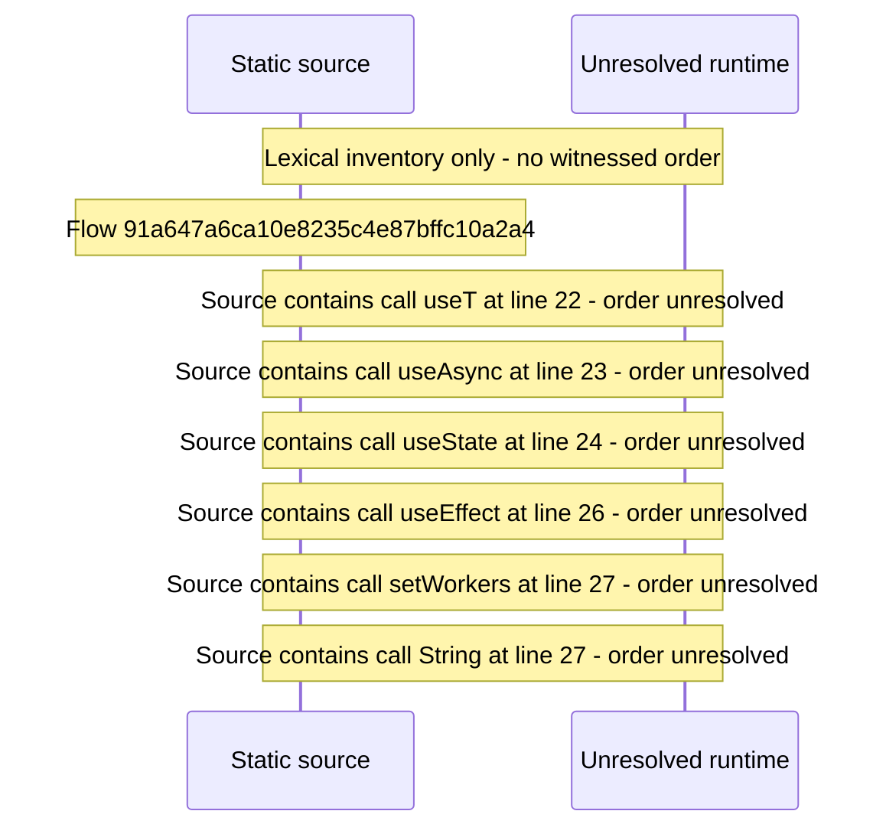

# Console server and transcode configuration — flow-diagram

Source revision: d442b4a6a38de86be0670669b3a3f6aa47e80b22. Trust: generated. Freshness: pinned source; run docs flows check for a later revision.

<!-- flowdocs:paragraph:b89e56ddc682034d64055b3467b90caa -->
Static source inventory only; sequence and runtime ordering are unresolved\.

Source: internal/web/app/src/areas/console/sections/Config\.tsx:21; symbol: ServerConfig; span SHA256: 91c2f1f80d5a565af74b899c64ba777887f22f98e9df47ff0856e73b00ae336b.

