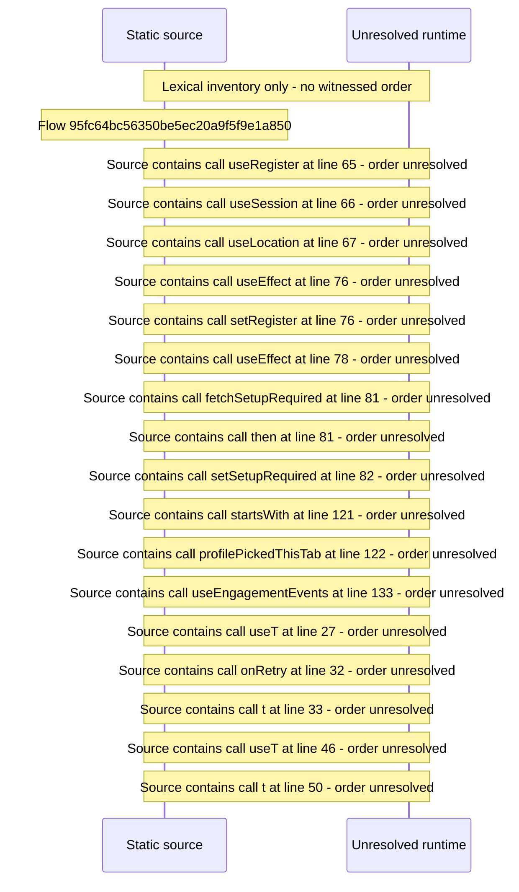

# Viewer area: session pending/error states, setup hand\-off, viewer routes — flow-diagram

Source revision: 6742c2361d684c662e9ccb84d344a2200c377582. Trust: generated. Freshness: pinned source; run docs flows check for a later revision.

<!-- flowdocs:paragraph:a37b18a6b52aee290eceb8133096f236 -->
Static source inventory only; sequence and runtime ordering are unresolved\.

Source: internal/web/app/src/areas/viewer/index\.tsx:64; symbol: ViewerArea; span SHA256: e8c23e5be0c66a622011605c335083f61b506242b50e7f5c4047f2d83ae145ca.

