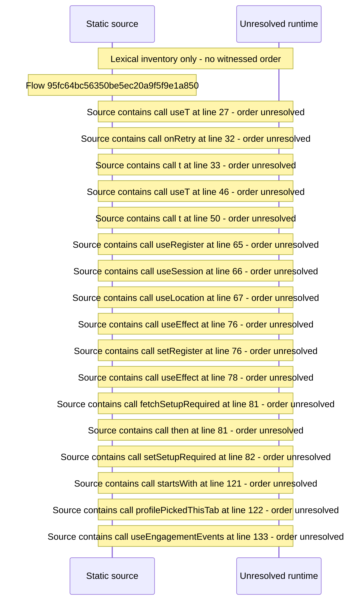

# Viewer area: session pending/error states, setup hand\-off, viewer routes — flow-diagram

Source revision: 5ffe7939da2318f5153b1a20d0ef6ef94deef162. Trust: generated. Freshness: pinned source; run docs flows check for a later revision.

<!-- flowdocs:paragraph:a37b18a6b52aee290eceb8133096f236 -->
Static source inventory only; sequence and runtime ordering are unresolved\.

Source: internal/web/app/src/areas/viewer/index\.tsx:26; symbol: ViewerSessionError; span SHA256: 15e7bb4f0c6cd0210e45e8d78744ef6e8bf99159c99e202a3085a6d1ead15fbf.

