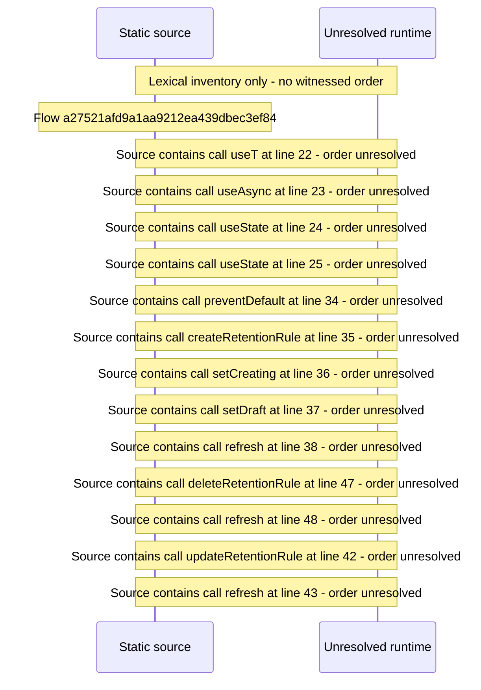

# Console retention rules — flow-diagram

Source revision: 6742c2361d684c662e9ccb84d344a2200c377582. Trust: generated. Freshness: pinned source; run docs flows check for a later revision.

<!-- flowdocs:paragraph:70a4b7a561e855b9bd630408774b8e25 -->
Static source inventory only; sequence and runtime ordering are unresolved\.

Source: internal/web/app/src/areas/console/sections/Retention\.tsx:21; symbol: Retention; span SHA256: e7fe8429b520baef04dd1941a40c2c4e44d2b3f3db6421b63b073b877342d5a1.

