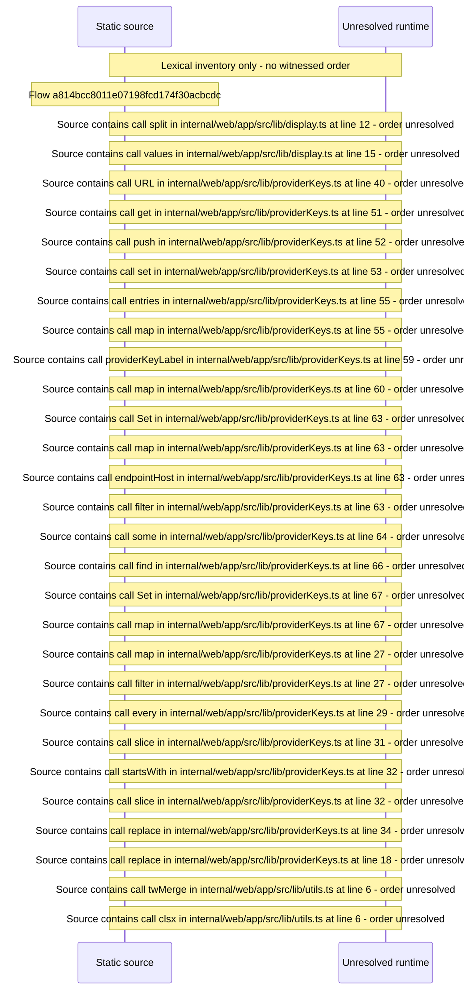

# Display helpers: activity, job, provider\-key and string formatting — flow-diagram

Source revision: d442b4a6a38de86be0670669b3a3f6aa47e80b22. Trust: generated. Freshness: pinned source; run docs flows check for a later revision.

<!-- flowdocs:paragraph:2be4f055260fe96658c7617ba9dda609 -->
Static source inventory only; sequence and runtime ordering are unresolved\.

Source: internal/web/app/src/lib/display\.ts:7; symbol: displayString; span SHA256: b2197f7f32797be6ef2343140e6cf0e53b4fd035c84c60a1188d6bd2b77f5f31.

