# Display helpers: activity, job, provider\-key and string formatting — flow-diagram

Source revision: e417fb394873a04fbd27fb8d5bcbca5484c8747f. Trust: generated. Freshness: pinned source; run docs flows check for a later revision.

<!-- flowdocs:paragraph:2be4f055260fe96658c7617ba9dda609 -->
Static source inventory only; sequence and runtime ordering are unresolved\.

Source: internal/web/app/src/lib/activityDisplay\.ts:361; symbol: activityMatches; span SHA256: 113e44e9fddc15a969da1011a31c3a677e172f0203f442c713e8836baa7e2ad8.

```mermaid
sequenceDiagram
    participant S as Static source
    participant U as Unresolved runtime
    Note over S,U: Lexical inventory only - no witnessed order
    Note over S: Flow a814bcc8011e07198fcd174f30acbcdc
    Note over S,U: Source contains call trim in internal/web/app/src/lib/activityDisplay.ts at line 362 - order unresolved
    Note over S,U: Source contains call toLowerCase in internal/web/app/src/lib/activityDisplay.ts at line 362 - order unresolved
    Note over S,U: Source contains call some in internal/web/app/src/lib/activityDisplay.ts at line 373 - order unresolved
    Note over S,U: Source contains call toLowerCase in internal/web/app/src/lib/activityDisplay.ts at line 373 - order unresolved
    Note over S,U: Source contains call includes in internal/web/app/src/lib/activityDisplay.ts at line 373 - order unresolved
    Note over S,U: Source contains call get in internal/web/app/src/lib/activityDisplay.ts at line 304 - order unresolved
    Note over S,U: Source contains call DateTimeFormat in internal/web/app/src/lib/activityDisplay.ts at line 400 - order unresolved
    Note over S,U: Source contains call format in internal/web/app/src/lib/activityDisplay.ts at line 404 - order unresolved
    Note over S,U: Source contains call round in internal/web/app/src/lib/activityDisplay.ts at line 388 - order unresolved
    Note over S,U: Source contains call getTime in internal/web/app/src/lib/activityDisplay.ts at line 388 - order unresolved
    Note over S,U: Source contains call RelativeTimeFormat in internal/web/app/src/lib/activityDisplay.ts at line 389 - order unresolved
    Note over S,U: Source contains call abs in internal/web/app/src/lib/activityDisplay.ts at line 390 - order unresolved
    Note over S,U: Source contains call format in internal/web/app/src/lib/activityDisplay.ts at line 391 - order unresolved
    Note over S,U: Source contains call format in internal/web/app/src/lib/activityDisplay.ts at line 393 - order unresolved
    Note over S,U: Source contains call trunc in internal/web/app/src/lib/activityDisplay.ts at line 393 - order unresolved
    Note over S,U: Source contains call format in internal/web/app/src/lib/activityDisplay.ts at line 395 - order unresolved
    Note over S,U: Source contains call trim in internal/web/app/src/lib/activityDisplay.ts at line 292 - order unresolved
    Note over S,U: Source contains call replace in internal/web/app/src/lib/activityDisplay.ts at line 293 - order unresolved
    Note over S,U: Source contains call replace in internal/web/app/src/lib/activityDisplay.ts at line 294 - order unresolved
    Note over S,U: Source contains call toLowerCase in internal/web/app/src/lib/activityDisplay.ts at line 295 - order unresolved
    Note over S,U: Source contains call sentenceCase in internal/web/app/src/lib/activityDisplay.ts at line 296 - order unresolved
    Note over S,U: Source contains call Date in internal/web/app/src/lib/activityDisplay.ts at line 414 - order unresolved
    Note over S,U: Source contains call isNaN in internal/web/app/src/lib/activityDisplay.ts at line 415 - order unresolved
    Note over S,U: Source contains call getTime in internal/web/app/src/lib/activityDisplay.ts at line 415 - order unresolved
    Note over S,U: Source contains call charAt in internal/web/app/src/lib/activityDisplay.ts at line 300 - order unresolved
    Note over S,U: Source contains call toUpperCase in internal/web/app/src/lib/activityDisplay.ts at line 300 - order unresolved
    Note over S,U: Source contains call slice in internal/web/app/src/lib/activityDisplay.ts at line 300 - order unresolved
    Note over S,U: Source contains call split in internal/web/app/src/lib/display.ts at line 12 - order unresolved
    Note over S,U: Source contains call values in internal/web/app/src/lib/display.ts at line 15 - order unresolved
    Note over S,U: Source contains call String in internal/web/app/src/lib/jobDisplay.ts at line 53 - order unresolved
    Note over S,U: Source contains call trim in internal/web/app/src/lib/jobDisplay.ts at line 54 - order unresolved
    Note over S,U: Source contains call replace in internal/web/app/src/lib/jobDisplay.ts at line 55 - order unresolved
    Note over S,U: Source contains call replace in internal/web/app/src/lib/jobDisplay.ts at line 56 - order unresolved
    Note over S,U: Source contains call toLowerCase in internal/web/app/src/lib/jobDisplay.ts at line 57 - order unresolved
    Note over S,U: Source contains call charAt in internal/web/app/src/lib/jobDisplay.ts at line 59 - order unresolved
    Note over S,U: Source contains call toUpperCase in internal/web/app/src/lib/jobDisplay.ts at line 59 - order unresolved
    Note over S,U: Source contains call slice in internal/web/app/src/lib/jobDisplay.ts at line 59 - order unresolved
    Note over S,U: Source contains call mappedLabel in internal/web/app/src/lib/jobDisplay.ts at line 81 - order unresolved
    Note over S,U: Source contains call jobProgressMessageLabel in internal/web/app/src/lib/jobDisplay.ts at line 129 - order unresolved
    Note over S,U: Source contains call lookup in internal/web/app/src/lib/jobDisplay.ts at line 95 - order unresolved
    Note over S,U: Source contains call replace in internal/web/app/src/lib/jobDisplay.ts at line 96 - order unresolved
    Note over S,U: Source contains call mappedDiagnostic in internal/web/app/src/lib/jobDisplay.ts at line 98 - order unresolved
    Note over S,U: Source contains call mappedLabel in internal/web/app/src/lib/jobDisplay.ts at line 89 - order unresolved
    Note over S,U: Source contains call mappedLabel in internal/web/app/src/lib/jobDisplay.ts at line 85 - order unresolved
    Note over S,U: Source contains call labels in internal/web/app/src/lib/jobDisplay.ts at line 49 - order unresolved
    Note over S,U: Source contains call URL in internal/web/app/src/lib/providerKeys.ts at line 40 - order unresolved
    Note over S,U: Source contains call get in internal/web/app/src/lib/providerKeys.ts at line 51 - order unresolved
    Note over S,U: Source contains call push in internal/web/app/src/lib/providerKeys.ts at line 52 - order unresolved
    Note over S,U: Source contains call set in internal/web/app/src/lib/providerKeys.ts at line 53 - order unresolved
    Note over S,U: Source contains call entries in internal/web/app/src/lib/providerKeys.ts at line 55 - order unresolved
    Note over S,U: Source contains call map in internal/web/app/src/lib/providerKeys.ts at line 55 - order unresolved
    Note over S,U: Source contains call providerKeyLabel in internal/web/app/src/lib/providerKeys.ts at line 59 - order unresolved
    Note over S,U: Source contains call map in internal/web/app/src/lib/providerKeys.ts at line 60 - order unresolved
    Note over S,U: Source contains call Set in internal/web/app/src/lib/providerKeys.ts at line 63 - order unresolved
    Note over S,U: Source contains call map in internal/web/app/src/lib/providerKeys.ts at line 63 - order unresolved
    Note over S,U: Source contains call endpointHost in internal/web/app/src/lib/providerKeys.ts at line 63 - order unresolved
    Note over S,U: Source contains call filter in internal/web/app/src/lib/providerKeys.ts at line 63 - order unresolved
    Note over S,U: Source contains call some in internal/web/app/src/lib/providerKeys.ts at line 64 - order unresolved
    Note over S,U: Source contains call find in internal/web/app/src/lib/providerKeys.ts at line 66 - order unresolved
    Note over S,U: Source contains call Set in internal/web/app/src/lib/providerKeys.ts at line 67 - order unresolved
    Note over S,U: Source contains call map in internal/web/app/src/lib/providerKeys.ts at line 67 - order unresolved
    Note over S,U: Source contains call map in internal/web/app/src/lib/providerKeys.ts at line 27 - order unresolved
    Note over S,U: Source contains call filter in internal/web/app/src/lib/providerKeys.ts at line 27 - order unresolved
    Note over S,U: Source contains call every in internal/web/app/src/lib/providerKeys.ts at line 29 - order unresolved
    Note over S,U: Source contains call slice in internal/web/app/src/lib/providerKeys.ts at line 31 - order unresolved
    Note over S,U: Source contains call startsWith in internal/web/app/src/lib/providerKeys.ts at line 32 - order unresolved
    Note over S,U: Source contains call slice in internal/web/app/src/lib/providerKeys.ts at line 32 - order unresolved
    Note over S,U: Source contains call replace in internal/web/app/src/lib/providerKeys.ts at line 34 - order unresolved
    Note over S,U: Source contains call replace in internal/web/app/src/lib/providerKeys.ts at line 18 - order unresolved
    Note over S,U: Source contains call twMerge in internal/web/app/src/lib/utils.ts at line 6 - order unresolved
    Note over S,U: Source contains call clsx in internal/web/app/src/lib/utils.ts at line 6 - order unresolved
```

