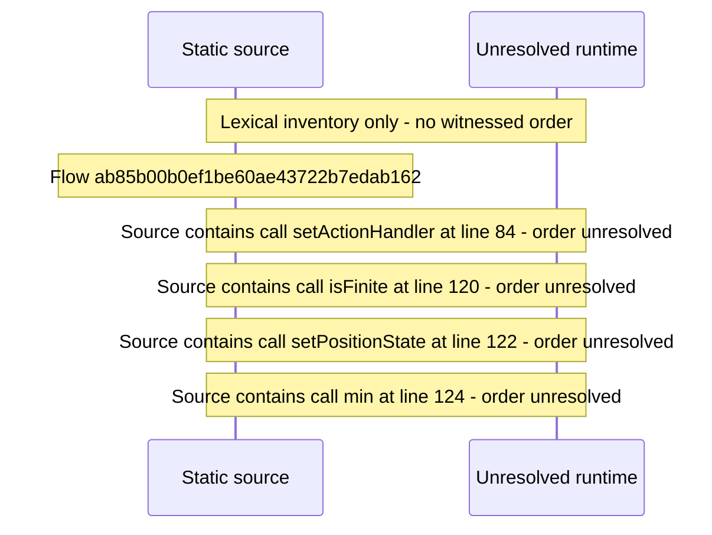

# Player OS media\-session integration \(lock\-screen controls\) — flow-diagram

Source revision: d442b4a6a38de86be0670669b3a3f6aa47e80b22. Trust: generated. Freshness: pinned source; run docs flows check for a later revision.

<!-- flowdocs:paragraph:44e0c94c18165c1f66a949213f14b5c2 -->
Static source inventory only; sequence and runtime ordering are unresolved\.

Source: internal/web/app/src/areas/viewer/player/useMediaSession\.ts:81; symbol: safeSet; span SHA256: d9fdf30c1146cc24c5a621e8fe82b00396cd51cebc3259469e87f37fe1f45690.

