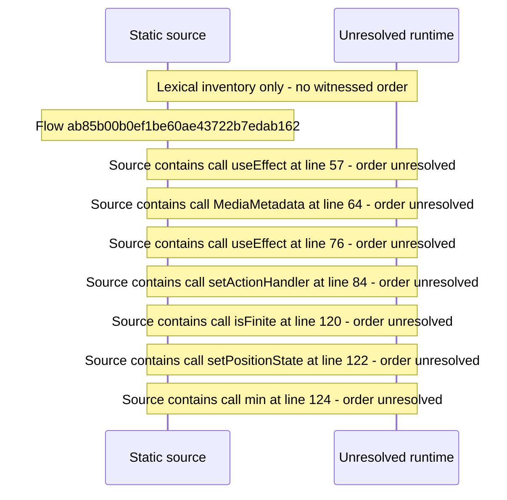

# Player OS media\-session integration \(lock\-screen controls\) — flow-diagram

Source revision: 6742c2361d684c662e9ccb84d344a2200c377582. Trust: generated. Freshness: pinned source; run docs flows check for a later revision.

<!-- flowdocs:paragraph:44e0c94c18165c1f66a949213f14b5c2 -->
Static source inventory only; sequence and runtime ordering are unresolved\.

Source: internal/web/app/src/areas/viewer/player/useMediaSession\.ts:21; symbol: MediaSessionOptions; span SHA256: 95576f28669ad505c5392f40a89e0b690355ee7fe776f9c634f395d223406529.

