# Console admin gate: locked reasons and unlock — flow-diagram

Source revision: 6742c2361d684c662e9ccb84d344a2200c377582. Trust: generated. Freshness: pinned source; run docs flows check for a later revision.

<!-- flowdocs:paragraph:6506c30cf6a970da06a91e620e0477db -->
Static source inventory only; sequence and runtime ordering are unresolved\.

Source: internal/web/app/src/areas/console/AdminGate\.tsx:46; symbol: AdminGate; span SHA256: 7fec3f21e920c5b6baebe521f9c0721935304bf74d69e13ad72c3a8769272c45.

```mermaid
sequenceDiagram
    participant S as Static source
    participant U as Unresolved runtime
    Note over S,U: Lexical inventory only - no witnessed order
    Note over S: Flow acae33ecb9a51ac24e01ea18bef86966
    Note over S,U: Source contains call useT in internal/web/app/src/areas/console/AdminGate.tsx at line 56 - order unresolved
    Note over S,U: Source contains call useSession in internal/web/app/src/areas/console/AdminGate.tsx at line 57 - order unresolved
    Note over S,U: Source contains call useState in internal/web/app/src/areas/console/AdminGate.tsx at line 63 - order unresolved
    Note over S,U: Source contains call useState in internal/web/app/src/areas/console/AdminGate.tsx at line 64 - order unresolved
    Note over S,U: Source contains call useState in internal/web/app/src/areas/console/AdminGate.tsx at line 65 - order unresolved
    Note over S,U: Source contains call useState in internal/web/app/src/areas/console/AdminGate.tsx at line 69 - order unresolved
    Note over S,U: Source contains call useState in internal/web/app/src/areas/console/AdminGate.tsx at line 70 - order unresolved
    Note over S,U: Source contains call useState in internal/web/app/src/areas/console/AdminGate.tsx at line 71 - order unresolved
    Note over S,U: Source contains call useState in internal/web/app/src/areas/console/AdminGate.tsx at line 74 - order unresolved
    Note over S,U: Source contains call useState in internal/web/app/src/areas/console/AdminGate.tsx at line 76 - order unresolved
    Note over S,U: Source contains call useRef in internal/web/app/src/areas/console/AdminGate.tsx at line 78 - order unresolved
    Note over S,U: Source contains call useT in internal/web/app/src/areas/console/AdminGate.tsx at line 304 - order unresolved
    Note over S,U: Source contains call t in internal/web/app/src/areas/console/AdminGate.tsx at line 318 - order unresolved
    Note over S,U: Source contains call t in internal/web/app/src/areas/console/AdminGate.tsx at line 319 - order unresolved
    Note over S,U: Source contains call t in internal/web/app/src/areas/console/AdminGate.tsx at line 325 - order unresolved
    Note over S,U: Source contains call setPassword in internal/web/app/src/areas/console/AdminGate.tsx at line 330 - order unresolved
    Note over S,U: Source contains call t in internal/web/app/src/areas/console/AdminGate.tsx at line 337 - order unresolved
    Note over S,U: Source contains call setConfirmPassword in internal/web/app/src/areas/console/AdminGate.tsx at line 342 - order unresolved
    Note over S,U: Source contains call t in internal/web/app/src/areas/console/AdminGate.tsx at line 349 - order unresolved
    Note over S,U: Source contains call t in internal/web/app/src/areas/console/AdminGate.tsx at line 354 - order unresolved
    Note over S,U: Source contains call t in internal/web/app/src/areas/console/AdminGate.tsx at line 361 - order unresolved
    Note over S,U: Source contains call t in internal/web/app/src/areas/console/AdminGate.tsx at line 372 - order unresolved
    Note over S,U: Source contains call parse in internal/web/app/src/areas/console/lib/lockReason.ts at line 50 - order unresolved
    Note over S,U: Source contains call isNaN in internal/web/app/src/areas/console/lib/lockReason.ts at line 51 - order unresolved
    Note over S,U: Source contains call now in internal/web/app/src/areas/console/lib/lockReason.ts at line 51 - order unresolved
    Note over S,U: Source contains call rebindCompatibility in internal/web/app/src/lib/graphql/auth.ts at line 87 - order unresolved
    Note over S,U: Source contains call rebindCompatibility in internal/web/app/src/lib/graphql/auth.ts at line 28 - order unresolved
    Note over S,U: Source contains call useCallback in internal/web/app/src/areas/console/AdminGate.tsx at line 95 - order unresolved
    Note over S,U: Source contains call invalidateRequest in internal/web/app/src/areas/console/AdminGate.tsx at line 96 - order unresolved
    Note over S,U: Source contains call AbortController in internal/web/app/src/areas/console/AdminGate.tsx at line 97 - order unresolved
    Note over S,U: Source contains call setAdminEpochSignal in internal/web/app/src/areas/console/AdminGate.tsx at line 100 - order unresolved
    Note over S,U: Source contains call useCallback in internal/web/app/src/areas/console/AdminGate.tsx at line 88 - order unresolved
    Note over S,U: Source contains call abort in internal/web/app/src/areas/console/AdminGate.tsx at line 90 - order unresolved
    Note over S,U: Source contains call setAdminEpochSignal in internal/web/app/src/areas/console/AdminGate.tsx at line 92 - order unresolved
    Note over S,U: Source contains call beginRequest in internal/web/app/src/areas/console/AdminGate.tsx at line 226 - order unresolved
    Note over S,U: Source contains call setActive in internal/web/app/src/areas/console/AdminGate.tsx at line 227 - order unresolved
    Note over S,U: Source contains call setBoundProfileID in internal/web/app/src/areas/console/AdminGate.tsx at line 228 - order unresolved
    Note over S,U: Source contains call setExpiresAt in internal/web/app/src/areas/console/AdminGate.tsx at line 229 - order unresolved
    Note over S,U: Source contains call endAdminSession in internal/web/app/src/areas/console/AdminGate.tsx at line 231 - order unresolved
    Note over S,U: Source contains call preventDefault in internal/web/app/src/areas/console/AdminGate.tsx at line 186 - order unresolved
    Note over S,U: Source contains call setMismatch in internal/web/app/src/areas/console/AdminGate.tsx at line 190 - order unresolved
    Note over S,U: Source contains call setMismatch in internal/web/app/src/areas/console/AdminGate.tsx at line 193 - order unresolved
    Note over S,U: Source contains call setBusy in internal/web/app/src/areas/console/AdminGate.tsx at line 194 - order unresolved
    Note over S,U: Source contains call setRejected in internal/web/app/src/areas/console/AdminGate.tsx at line 195 - order unresolved
    Note over S,U: Source contains call beginRequest in internal/web/app/src/areas/console/AdminGate.tsx at line 196 - order unresolved
    Note over S,U: Source contains call verifyAdminSession in internal/web/app/src/areas/console/AdminGate.tsx at line 198 - order unresolved
    Note over S,U: Source contains call isCurrent in internal/web/app/src/areas/console/AdminGate.tsx at line 199 - order unresolved
    Note over S,U: Source contains call setActive in internal/web/app/src/areas/console/AdminGate.tsx at line 200 - order unresolved
    Note over S,U: Source contains call setPassword in internal/web/app/src/areas/console/AdminGate.tsx at line 201 - order unresolved
    Note over S,U: Source contains call setConfirmPassword in internal/web/app/src/areas/console/AdminGate.tsx at line 202 - order unresolved
    Note over S,U: Source contains call setNeedsFirstPassword in internal/web/app/src/areas/console/AdminGate.tsx at line 204 - order unresolved
    Note over S,U: Source contains call setBoundProfileID in internal/web/app/src/areas/console/AdminGate.tsx at line 205 - order unresolved
    Note over S,U: Source contains call setExpiresAt in internal/web/app/src/areas/console/AdminGate.tsx at line 206 - order unresolved
    Note over S,U: Source contains call setRejected in internal/web/app/src/areas/console/AdminGate.tsx at line 208 - order unresolved
    Note over S,U: Source contains call recheckFirstPassword in internal/web/app/src/areas/console/AdminGate.tsx at line 209 - order unresolved
    Note over S,U: Source contains call isCurrent in internal/web/app/src/areas/console/AdminGate.tsx at line 212 - order unresolved
    Note over S,U: Source contains call setRejected in internal/web/app/src/areas/console/AdminGate.tsx at line 216 - order unresolved
    Note over S,U: Source contains call setPassword in internal/web/app/src/areas/console/AdminGate.tsx at line 217 - order unresolved
    Note over S,U: Source contains call setConfirmPassword in internal/web/app/src/areas/console/AdminGate.tsx at line 218 - order unresolved
    Note over S,U: Source contains call recheckFirstPassword in internal/web/app/src/areas/console/AdminGate.tsx at line 219 - order unresolved
    Note over S,U: Source contains call isCurrent in internal/web/app/src/areas/console/AdminGate.tsx at line 221 - order unresolved
    Note over S,U: Source contains call setBusy in internal/web/app/src/areas/console/AdminGate.tsx at line 221 - order unresolved
```

