# Console admin gate: locked reasons and unlock — flow-diagram

Source revision: b952880cf4519beaa9738e25e349aabf600c9a41. Trust: generated. Freshness: pinned source; run docs flows check for a later revision.

<!-- flowdocs:paragraph:6506c30cf6a970da06a91e620e0477db -->
Static source inventory only; sequence and runtime ordering are unresolved\.

Source: internal/web/app/src/areas/console/AdminGate\.tsx:51; symbol: AdminGate; span SHA256: 7fec3f21e920c5b6baebe521f9c0721935304bf74d69e13ad72c3a8769272c45.

```mermaid
sequenceDiagram
    participant S as Static source
    participant U as Unresolved runtime
    Note over S,U: Lexical inventory only - no witnessed order
    Note over S: Flow acae33ecb9a51ac24e01ea18bef86966
    Note over S,U: Source contains call useT in internal/web/app/src/areas/console/AdminGate.tsx at line 61 - order unresolved
    Note over S,U: Source contains call useSession in internal/web/app/src/areas/console/AdminGate.tsx at line 62 - order unresolved
    Note over S,U: Source contains call useState in internal/web/app/src/areas/console/AdminGate.tsx at line 68 - order unresolved
    Note over S,U: Source contains call useState in internal/web/app/src/areas/console/AdminGate.tsx at line 69 - order unresolved
    Note over S,U: Source contains call useState in internal/web/app/src/areas/console/AdminGate.tsx at line 70 - order unresolved
    Note over S,U: Source contains call useState in internal/web/app/src/areas/console/AdminGate.tsx at line 74 - order unresolved
    Note over S,U: Source contains call useState in internal/web/app/src/areas/console/AdminGate.tsx at line 75 - order unresolved
    Note over S,U: Source contains call useState in internal/web/app/src/areas/console/AdminGate.tsx at line 76 - order unresolved
    Note over S,U: Source contains call useState in internal/web/app/src/areas/console/AdminGate.tsx at line 77 - order unresolved
    Note over S,U: Source contains call useState in internal/web/app/src/areas/console/AdminGate.tsx at line 80 - order unresolved
    Note over S,U: Source contains call useState in internal/web/app/src/areas/console/AdminGate.tsx at line 82 - order unresolved
    Note over S,U: Source contains call useRef in internal/web/app/src/areas/console/AdminGate.tsx at line 84 - order unresolved
    Note over S,U: Source contains call useT in internal/web/app/src/areas/console/AdminGate.tsx at line 319 - order unresolved
    Note over S,U: Source contains call t in internal/web/app/src/areas/console/AdminGate.tsx at line 332 - order unresolved
    Note over S,U: Source contains call t in internal/web/app/src/areas/console/AdminGate.tsx at line 336 - order unresolved
    Note over S,U: Source contains call setPassword in internal/web/app/src/areas/console/AdminGate.tsx at line 341 - order unresolved
    Note over S,U: Source contains call t in internal/web/app/src/areas/console/AdminGate.tsx at line 348 - order unresolved
    Note over S,U: Source contains call t in internal/web/app/src/areas/console/AdminGate.tsx at line 354 - order unresolved
    Note over S,U: Source contains call setConfirmPassword in internal/web/app/src/areas/console/AdminGate.tsx at line 360 - order unresolved
    Note over S,U: Source contains call t in internal/web/app/src/areas/console/AdminGate.tsx at line 365 - order unresolved
    Note over S,U: Source contains call t in internal/web/app/src/areas/console/AdminGate.tsx at line 366 - order unresolved
    Note over S,U: Source contains call t in internal/web/app/src/areas/console/AdminGate.tsx at line 369 - order unresolved
    Note over S,U: Source contains call t in internal/web/app/src/areas/console/AdminGate.tsx at line 377 - order unresolved
    Note over S,U: Source contains call t in internal/web/app/src/areas/console/AdminGate.tsx at line 388 - order unresolved
    Note over S,U: Source contains call parse in internal/web/app/src/areas/console/lib/lockReason.ts at line 50 - order unresolved
    Note over S,U: Source contains call isNaN in internal/web/app/src/areas/console/lib/lockReason.ts at line 51 - order unresolved
    Note over S,U: Source contains call now in internal/web/app/src/areas/console/lib/lockReason.ts at line 51 - order unresolved
    Note over S,U: Source contains call rebindCompatibility in internal/web/app/src/lib/graphql/auth.ts at line 87 - order unresolved
    Note over S,U: Source contains call rebindCompatibility in internal/web/app/src/lib/graphql/auth.ts at line 28 - order unresolved
    Note over S,U: Source contains call useCallback in internal/web/app/src/areas/console/AdminGate.tsx at line 101 - order unresolved
    Note over S,U: Source contains call invalidateRequest in internal/web/app/src/areas/console/AdminGate.tsx at line 102 - order unresolved
    Note over S,U: Source contains call AbortController in internal/web/app/src/areas/console/AdminGate.tsx at line 103 - order unresolved
    Note over S,U: Source contains call setAdminEpochSignal in internal/web/app/src/areas/console/AdminGate.tsx at line 106 - order unresolved
    Note over S,U: Source contains call useCallback in internal/web/app/src/areas/console/AdminGate.tsx at line 94 - order unresolved
    Note over S,U: Source contains call abort in internal/web/app/src/areas/console/AdminGate.tsx at line 96 - order unresolved
    Note over S,U: Source contains call setAdminEpochSignal in internal/web/app/src/areas/console/AdminGate.tsx at line 98 - order unresolved
    Note over S,U: Source contains call beginRequest in internal/web/app/src/areas/console/AdminGate.tsx at line 237 - order unresolved
    Note over S,U: Source contains call setActive in internal/web/app/src/areas/console/AdminGate.tsx at line 238 - order unresolved
    Note over S,U: Source contains call setBoundProfileID in internal/web/app/src/areas/console/AdminGate.tsx at line 239 - order unresolved
    Note over S,U: Source contains call setExpiresAt in internal/web/app/src/areas/console/AdminGate.tsx at line 240 - order unresolved
    Note over S,U: Source contains call endAdminSession in internal/web/app/src/areas/console/AdminGate.tsx at line 242 - order unresolved
    Note over S,U: Source contains call preventDefault in internal/web/app/src/areas/console/AdminGate.tsx at line 193 - order unresolved
    Note over S,U: Source contains call setTooShort in internal/web/app/src/areas/console/AdminGate.tsx at line 198 - order unresolved
    Note over S,U: Source contains call setMismatch in internal/web/app/src/areas/console/AdminGate.tsx at line 201 - order unresolved
    Note over S,U: Source contains call setMismatch in internal/web/app/src/areas/console/AdminGate.tsx at line 204 - order unresolved
    Note over S,U: Source contains call setBusy in internal/web/app/src/areas/console/AdminGate.tsx at line 205 - order unresolved
    Note over S,U: Source contains call setRejected in internal/web/app/src/areas/console/AdminGate.tsx at line 206 - order unresolved
    Note over S,U: Source contains call beginRequest in internal/web/app/src/areas/console/AdminGate.tsx at line 207 - order unresolved
    Note over S,U: Source contains call verifyAdminSession in internal/web/app/src/areas/console/AdminGate.tsx at line 209 - order unresolved
    Note over S,U: Source contains call isCurrent in internal/web/app/src/areas/console/AdminGate.tsx at line 210 - order unresolved
    Note over S,U: Source contains call setActive in internal/web/app/src/areas/console/AdminGate.tsx at line 211 - order unresolved
    Note over S,U: Source contains call setPassword in internal/web/app/src/areas/console/AdminGate.tsx at line 212 - order unresolved
    Note over S,U: Source contains call setConfirmPassword in internal/web/app/src/areas/console/AdminGate.tsx at line 213 - order unresolved
    Note over S,U: Source contains call setNeedsFirstPassword in internal/web/app/src/areas/console/AdminGate.tsx at line 215 - order unresolved
    Note over S,U: Source contains call setBoundProfileID in internal/web/app/src/areas/console/AdminGate.tsx at line 216 - order unresolved
    Note over S,U: Source contains call setExpiresAt in internal/web/app/src/areas/console/AdminGate.tsx at line 217 - order unresolved
    Note over S,U: Source contains call setRejected in internal/web/app/src/areas/console/AdminGate.tsx at line 219 - order unresolved
    Note over S,U: Source contains call recheckFirstPassword in internal/web/app/src/areas/console/AdminGate.tsx at line 220 - order unresolved
    Note over S,U: Source contains call isCurrent in internal/web/app/src/areas/console/AdminGate.tsx at line 223 - order unresolved
    Note over S,U: Source contains call setRejected in internal/web/app/src/areas/console/AdminGate.tsx at line 227 - order unresolved
    Note over S,U: Source contains call setPassword in internal/web/app/src/areas/console/AdminGate.tsx at line 228 - order unresolved
    Note over S,U: Source contains call setConfirmPassword in internal/web/app/src/areas/console/AdminGate.tsx at line 229 - order unresolved
    Note over S,U: Source contains call recheckFirstPassword in internal/web/app/src/areas/console/AdminGate.tsx at line 230 - order unresolved
    Note over S,U: Source contains call isCurrent in internal/web/app/src/areas/console/AdminGate.tsx at line 232 - order unresolved
    Note over S,U: Source contains call setBusy in internal/web/app/src/areas/console/AdminGate.tsx at line 232 - order unresolved
```

