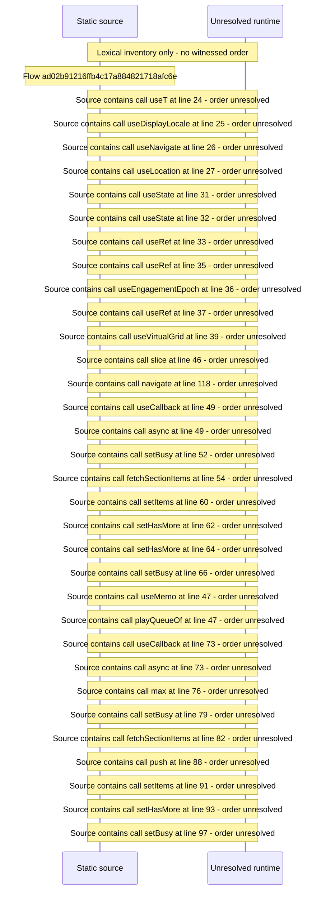

# Viewer See\-All: paginate a Source from a shelf — flow-diagram

Source revision: d658ad5b71dcb67da0ae540d6d5ff80ca8efefd5. Trust: generated. Freshness: pinned source; run docs flows check for a later revision.

<!-- flowdocs:paragraph:35dc7221ff6127a19e79c18c39766408 -->
Static source inventory only; sequence and runtime ordering are unresolved\.

Source: internal/web/app/src/areas/viewer/lib/seeall\.ts:9; symbol: SeeAllContext; span SHA256: 921399fdb693119d57af0c253f1ee17c14f48420ced5c43e2f5ba1b72b0af4aa.

