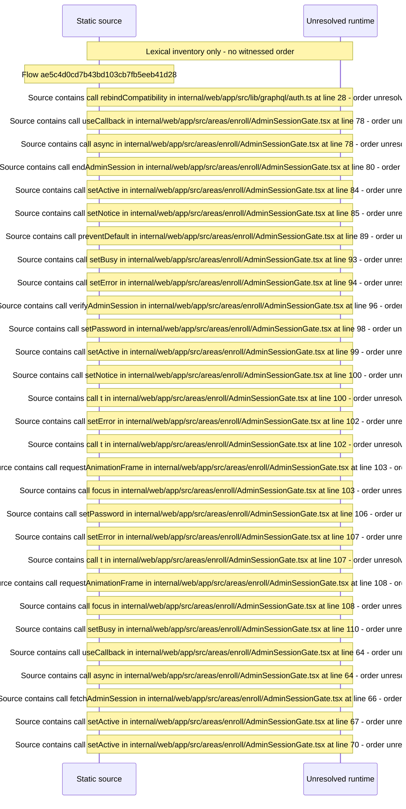

# Admin Session unlock gate \(admin password\) reused by Console — flow-diagram

Source revision: 5ffe7939da2318f5153b1a20d0ef6ef94deef162. Trust: generated. Freshness: pinned source; run docs flows check for a later revision.

<!-- flowdocs:paragraph:0bcd5c8419cc5762207130812a4e38b3 -->
Static source inventory only; sequence and runtime ordering are unresolved\.

Source: internal/web/app/src/lib/graphql/auth\.ts:26; symbol: settleRebind; span SHA256: b13faca8956ab229de82053f9ca2976e5f0b4a1b28d78439f5d3ec44657139bb.

