# Manage trash: restore, purge and reversible activity — flow-diagram

Source revision: 5ffe7939da2318f5153b1a20d0ef6ef94deef162. Trust: generated. Freshness: pinned source; run docs flows check for a later revision.

<!-- flowdocs:paragraph:18ede8bc22ccbe2bc90020f3cd1199ed -->
Static source inventory only; sequence and runtime ordering are unresolved\.

Source: internal/web/app/src/areas/manage/pages/TrashPage\.tsx:160; symbol: PurgeSection; span SHA256: 460803bbad5407e93b0571e9fecea61b9d14ac1b969e86e6c73beb173aecea89.

```mermaid
sequenceDiagram
    participant S as Static source
    participant U as Unresolved runtime
    Note over S,U: Lexical inventory only - no witnessed order
    Note over S: Flow b0c5440f654fa21d739d5b2b5c585f3b
    Note over S,U: Source contains call useT at line 161 - order unresolved
    Note over S,U: Source contains call useState at line 163 - order unresolved
    Note over S,U: Source contains call useState at line 164 - order unresolved
    Note over S,U: Source contains call useState at line 165 - order unresolved
    Note over S,U: Source contains call useState at line 166 - order unresolved
    Note over S,U: Source contains call trim at line 169 - order unresolved
    Note over S,U: Source contains call useT at line 50 - order unresolved
    Note over S,U: Source contains call useState at line 52 - order unresolved
    Note over S,U: Source contains call useState at line 53 - order unresolved
    Note over S,U: Source contains call useRef at line 54 - order unresolved
    Note over S,U: Source contains call async at line 171 - order unresolved
    Note over S,U: Source contains call setError at line 172 - order unresolved
    Note over S,U: Source contains call setPurged at line 173 - order unresolved
    Note over S,U: Source contains call trim at line 174 - order unresolved
    Note over S,U: Source contains call setError at line 175 - order unresolved
    Note over S,U: Source contains call t at line 175 - order unresolved
    Note over S,U: Source contains call Date at line 178 - order unresolved
    Note over S,U: Source contains call isNaN at line 179 - order unresolved
    Note over S,U: Source contains call getTime at line 179 - order unresolved
    Note over S,U: Source contains call setError at line 180 - order unresolved
    Note over S,U: Source contains call t at line 180 - order unresolved
    Note over S,U: Source contains call setBusy at line 183 - order unresolved
    Note over S,U: Source contains call purgeTrash at line 185 - order unresolved
    Note over S,U: Source contains call toISOString at line 185 - order unresolved
    Note over S,U: Source contains call setPurged at line 186 - order unresolved
    Note over S,U: Source contains call setAcknowledged at line 187 - order unresolved
    Note over S,U: Source contains call setBefore at line 188 - order unresolved
    Note over S,U: Source contains call onPurged at line 189 - order unresolved
    Note over S,U: Source contains call setError at line 191 - order unresolved
    Note over S,U: Source contains call t at line 191 - order unresolved
    Note over S,U: Source contains call setBusy at line 193 - order unresolved
    Note over S,U: Source contains call async at line 77 - order unresolved
    Note over S,U: Source contains call setError at line 78 - order unresolved
    Note over S,U: Source contains call restoreMedia at line 82 - order unresolved
    Note over S,U: Source contains call load at line 83 - order unresolved
    Note over S,U: Source contains call setError at line 85 - order unresolved
    Note over S,U: Source contains call t at line 85 - order unresolved
    Note over S,U: Source contains call getElementById at line 284 - order unresolved
    Note over S,U: Source contains call scrollIntoView at line 284 - order unresolved
    Note over S,U: Source contains call useMemo at line 287 - order unresolved
```

