# Manage trash: restore, purge and reversible activity — flow-diagram

Source revision: 6742c2361d684c662e9ccb84d344a2200c377582. Trust: generated. Freshness: pinned source; run docs flows check for a later revision.

<!-- flowdocs:paragraph:18ede8bc22ccbe2bc90020f3cd1199ed -->
Static source inventory only; sequence and runtime ordering are unresolved\.

Source: internal/web/app/src/areas/manage/pages/TrashPage\.tsx:259; symbol: ActivitySection; span SHA256: 3e919863e35f12ddc418f5cf97c9e47dd440cd05819cdb3dc85ab4dea03403d4.

```mermaid
sequenceDiagram
    participant S as Static source
    participant U as Unresolved runtime
    Note over S,U: Lexical inventory only - no witnessed order
    Note over S: Flow b0c5440f654fa21d739d5b2b5c585f3b
    Note over S,U: Source contains call useT at line 260 - order unresolved
    Note over S,U: Source contains call useState at line 262 - order unresolved
    Note over S,U: Source contains call useState at line 263 - order unresolved
    Note over S,U: Source contains call useT at line 160 - order unresolved
    Note over S,U: Source contains call useState at line 162 - order unresolved
    Note over S,U: Source contains call useState at line 163 - order unresolved
    Note over S,U: Source contains call useState at line 164 - order unresolved
    Note over S,U: Source contains call useState at line 165 - order unresolved
    Note over S,U: Source contains call trim at line 168 - order unresolved
    Note over S,U: Source contains call Set at line 46 - order unresolved
    Note over S,U: Source contains call useT at line 50 - order unresolved
    Note over S,U: Source contains call useState at line 52 - order unresolved
    Note over S,U: Source contains call useState at line 53 - order unresolved
    Note over S,U: Source contains call useRef at line 54 - order unresolved
    Note over S,U: Source contains call async at line 170 - order unresolved
    Note over S,U: Source contains call setError at line 171 - order unresolved
    Note over S,U: Source contains call setPurged at line 172 - order unresolved
    Note over S,U: Source contains call trim at line 173 - order unresolved
    Note over S,U: Source contains call setError at line 174 - order unresolved
    Note over S,U: Source contains call t at line 174 - order unresolved
    Note over S,U: Source contains call Date at line 177 - order unresolved
    Note over S,U: Source contains call isNaN at line 178 - order unresolved
    Note over S,U: Source contains call getTime at line 178 - order unresolved
    Note over S,U: Source contains call setError at line 179 - order unresolved
    Note over S,U: Source contains call t at line 179 - order unresolved
    Note over S,U: Source contains call setBusy at line 182 - order unresolved
    Note over S,U: Source contains call purgeTrash at line 184 - order unresolved
    Note over S,U: Source contains call toISOString at line 184 - order unresolved
    Note over S,U: Source contains call setPurged at line 185 - order unresolved
    Note over S,U: Source contains call setAcknowledged at line 186 - order unresolved
    Note over S,U: Source contains call setBefore at line 187 - order unresolved
    Note over S,U: Source contains call onPurged at line 188 - order unresolved
    Note over S,U: Source contains call setError at line 190 - order unresolved
    Note over S,U: Source contains call t at line 190 - order unresolved
    Note over S,U: Source contains call setBusy at line 192 - order unresolved
    Note over S,U: Source contains call async at line 77 - order unresolved
    Note over S,U: Source contains call setError at line 78 - order unresolved
    Note over S,U: Source contains call restoreMedia at line 82 - order unresolved
    Note over S,U: Source contains call load at line 83 - order unresolved
    Note over S,U: Source contains call setError at line 85 - order unresolved
    Note over S,U: Source contains call t at line 85 - order unresolved
    Note over S,U: Source contains call getElementById at line 282 - order unresolved
    Note over S,U: Source contains call scrollIntoView at line 282 - order unresolved
    Note over S,U: Source contains call useMemo at line 285 - order unresolved
```

